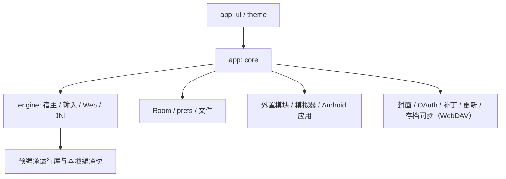

# Architecture

本文说明 Tyranor Next 当前实现的模块职责、运行边界与数据流。功能行为见 [SPEC.md](SPEC.md)，开发约束见 [AGENTS.md](AGENTS.md)，术语见 [CONTEXT.md](CONTEXT.md)。

## 1. 系统范围与模块

Tyranor Next 是 Android 多引擎视觉小说聚合启动器。它管理游戏库、启动编排与应用侧工具，并通过内置宿主、外置 APK 引擎模块或外置模拟器运行游戏；识别到引擎不代表兼容性已经验收。

| 位置 | 职责与依赖边界 |
| --- | --- |
| `app/src/main/java/com/tyranor/next/ui/` | Compose 页面、输入交互、导航、状态展示与错误文案；经 core 调用引擎能力 |
| `app/src/main/java/com/tyranor/next/core/` | 扫描、游戏库、启动、设置、封面、存档、补丁、拆封包、授权与更新；可依赖 engine，禁止 Compose/UI 依赖 |
| `app/src/main/java/com/tyranor/next/theme/` | Material/Miuix 主题与视觉状态，属于表现层 |
| `engine/` | 引擎宿主、Java/Kotlin 桥、Web 脚本、JNI、预编译运行库与输入/图形基础能力；不依赖 App 页面 |
| `buildSrc/` | 图形贡献目录生成、资源归属及来源校验；独立构建逻辑，不是第三个业务模块 |
| `tools/`、`.github/workflows/` | 离线检查/生成工具与 CI/发布流水线 |

Gradle 仅包含 `:app` 与 `:engine`，`app` 通过 `implementation(project(":engine"))` 依赖后者；core 是 app 内部包边界，并非独立模块。

## 2. 应用启动与界面状态

- [TyranorNextApplication.kt](app/src/main/java/com/tyranor/next/TyranorNextApplication.kt) 在最早阶段迁移共享 prefs 名称、配置 WebView profile、预热主进程游戏库，并在应用进入后台时安排更新检查；前后台切换同时驱动存档同步（WebDAV）的打开拉取与会话兜底（`core/game/save/sync/SaveSyncRuntime`）。
- [MainActivity.kt](app/src/main/java/com/tyranor/next/MainActivity.kt) 承载主界面；[MainScreen.kt](app/src/main/java/com/tyranor/next/ui/main/MainScreen.kt) 组合首页、游戏、引擎、设置四页。四页常驻，切换用水平位移与 alpha，避免重建列表。
- [MainLibraryViewModel.kt](app/src/main/java/com/tyranor/next/ui/main/MainLibraryViewModel.kt) 通过 `StateFlow<MainLibraryUiState>` 发布游戏库快照，Channel 串行处理扫描/删除/刷新等命令；搜索防抖并拒绝过期结果。
- 二级页通常复用 [AppScreen.kt](app/src/main/java/com/tyranor/next/ui/common/AppScreen.kt) 中的 `AppScreenActivity` / `AppScreenScaffold`，统一语言、主题、系统栏、背景与转场；正文由 `setAppScreenContent` 提供，主题包裹依次经过 `ProvideAppLocale`、`TyranorNextTheme` 与 `GlassBackground`。全屏按键编辑器保留明文例外。

主线程负责 UI。扫描、持久化和启动准备通常转入 IO；现有同步兼容门面仍可能阻塞，不能将本仓库描述为完全没有主线程 I/O。

## 3. 游戏库与持久化

[GameLibraryDatabase.kt](app/src/main/java/com/tyranor/next/core/game/storage/GameLibraryDatabase.kt) 定义主进程专用 Room 数据库 `game_library.db`，当前 schema v2：

| 表 | 内容 |
| --- | --- |
| `games` | 游戏身份、引擎、启动目标、封面/标题元数据与最近打开时间 |
| `scan_roots` | 扫描根目录 |
| `quick_launch` | 有序快捷启动关系 |
| `game_overrides` | 单游戏设置覆盖 |
| `engine_detection_cache` | 可重建的引擎识别缓存 |

数据写入链为 UI 命令队列 → [GameLibraryFacade](app/src/main/java/com/tyranor/next/core/game/storage/GameLibraryFacade.kt) 缓存与修订号 → [GameLibraryRepository](app/src/main/java/com/tyranor/next/core/game/storage/GameLibraryRepository.kt) 单线程 FIFO + mutex → Room。封面更新只修改对应字段；一致性搜索先等待已排队写入，避免旧结果覆盖新状态。

旧 `game_scanner` prefs 仍作为幂等迁移来源和恢复镜像，不能删除为“无用缓存”。应用/引擎偏好及引擎进程读取的单游戏 blob 仍保留 prefs；Room 不是所有状态的唯一介质，也不能把普通 SharedPreferences 当成实时跨进程消息总线。

Schema 导出到 `app/schemas/`。现有 v1→v2 及降级允许破坏性恢复并从镜像修复；后续版本必须显式注册 `Migration`，不能扩大全局破坏性回退。当前数据库、加密凭据、存档同步状态与备份边界统一见 [持久化数据清单](docs/应用持久化数据清单.md)；专题验收记录仍只对各自标注的版本有效。

## 4. 扫描与启动编排

1. [EngineScanner](app/src/main/java/com/tyranor/next/core/game/scan/EngineScanner.kt) 遍历已授权根目录，利用真实路径或 SAF 会话读取目录特征，按优先链识别引擎并产出 `ScanGame`；重扫合并保留手动添加记录。
2. UI 处理 Artemis 补丁与 MV/MZ 存档转化等用户确认，调用 [EngineLauncher](app/src/main/java/com/tyranor/next/core/game/launch/EngineLauncher.kt)。
3. Android 应用和 ROM 模拟器跳转优先分流；Windows 游戏交 Winlator；Ren'Py / RPG Maker RGSS / Ruffle（SWF / Flash）交外置 APK 模块。它们的权限、目录载荷与错误协议各有契约，不统一伪装成内置宿主。Ruffle 属文件型入口（`launchEntryIsFile`）：文件记录保存 SWF 文件 URI、包装目录记录保存目录 URI，启动前统一解析出 SWF 所在目录，再以 `game` 的 `folder` + `execFile` 交给模块；运行时与存档由插件自行承担，主 App 不接管。
4. 内置启动解析真实目录及生效设置，检查权限、插件、存档位置和适用补丁；Kirikiri 的 SAF 镜像等特殊路径由 core 负责准备。
5. App 与宿主使用 [LaunchContract.kt](engine/src/main/java/com/core/engine/LaunchContract.kt) 的常量传递 Intent extras。启动结果为 `LaunchResult`；`Success` 表示已发起启动，不代表游戏已显示首帧或能够通关。

[EngineSettingsResolver](app/src/main/java/com/tyranor/next/core/settings/EngineSettingsResolver.kt) 统一读取引擎全局与单游戏覆盖，`EffectiveEngineSettings` 处理归一化与回退。启动和存档消费同一份生效规则，页面不得另写优先级逻辑。

## 5. 引擎进程与生命周期

以 [engine Manifest](engine/src/main/AndroidManifest.xml) 为准，内置宿主均为 `exported=false`，主要分为 `:kirikiri2`、`:krkrsdl3`、`:ons`、多档 `:artemis*`、`:siglus`、`:fbgames`、`:fvp`、`:ethornell`、`:xsys35`、`:xsys4`、`:tyrano`、`:rpgmaker`。进程隔离用于控制原生库、全局状态与符号冲突；不提供通用跨引擎热切换保证。

- FVP、Framebuffer 及 Siglus 关闭滤镜的路径仍由主线程 `Choreographer` 同步驱动原生调用。
- Siglus 有效滤镜链才启用专用 engine owner 与 GLES consumer；关闭、空链或无效链沿用 SurfaceView 原路径。两种路径共享原生实例准入，不能同时启动第二个 owner。
- Ethornell 由专用 owner 线程管理 JNI 会话，Surface 世代、会话 token、退出 ACK 与存档操作门禁独立约束。
- `Surface` 消失、Activity `finish()`、原生销毁完成与进程退出是不同事件。修改宿主必须维护线程归属、资源租约、回调世代和释放时序，不能用强杀结果冒充正常退出。

WebView 数据目录另行隔离：API 28+ 主进程用 `home` 后缀，`:tyrano` 保留历史默认目录，`:rpgmaker` 自设后缀。更改 profile 或本地 HTTP 端口会影响历史网页存储作用域，须同时评估存档兼容。

## 6. 资源与原生构建链

| 源头 | 生成/消费方式 |
| --- | --- |
| `engine/src/main/assets/` | Web 注入脚本、字体与运行资源；选定的五个共享 JS 同步到 `app/build/generated/assets/engine/` |
| `engine/src/main/nativeplugins/` + `app/src/main/nativeplugins/` | 合并共享 `.so` 与 App manifest，重名失败；生成 `app/build/generated/assets/nativeplugins/{kirikiroid2,ons,artemis}.zip`，运行时安装到私有目录 |
| `app/src/main/assets/` | App 自有资源，当前主要为 `rtp/`；不在此手工保存生成插件 zip |
| `engine/src/main/jniLibs/arm64-v8a/` | 随 APK 分发的预编译运行库 |
| `engine/src/main/cpp/` | CMake 现场编译 JNI/图形桥，动态连接既有运行库 |
| `engine/src/main/graphicsfilters/*.json`、`engine/patches/*.json` | 描述滤镜贡献与固定来源；buildSrc 生成目录并校验资源、许可与相关库哈希 |

普通 Gradle 构建不会重编大部分引擎，也不会执行 Rust 构建：

- XP3 源码与固定依赖在 [engine/rust](engine/rust/Cargo.toml)；`build-archives.sh` 先运行宿主测试，再用 cargo-ndk 生成 `libarchive_xp3_core.so`。JNI panic 防护依赖 unwind，不改为 `panic=abort`。
- System35/4 的固定来源构建脚本位于 `engine/xsystem35/scripts/`、`engine/xsystem4/scripts/`；共享 `libSDL2x.so` / `org.libsdl.app32`，与 ONS 的 `libSDL2.so` / `org.libsdl.app` 分开维护。
- Siglus 保留已固定的原始运行库，来源与哈希见 [说明](engine/patches/siglus/README.md)；当前 CI 不重编其 Rust 源码。
- Ethornell `.so`、provenance JSON 与 ABI header 必须成套核对。自动 CI 的 `--local-static` 校验来源记录和产物字节，不等价于严格外部源码审计或可复现构建。

预编译源码归属决策见 [ADR 0002](docs/adr/0002-prebuilt-engine-libs-source-in-fork.md)。所有生成目录禁止手工维护；共享字体保持不压缩，并兼顾 System35、System4 与 ONS。

## 7. 其它功能边界

- 封面：`CoverScraperService` 聚合在线来源，`CoverScrapeTaskManager` 管理应用级批量任务；UI 使用缩略图缓存，不在重组期同步抓取/解码。
- 存档：`GameSaveManager` 解析位置并导入/导出 ZIP；MV/MZ 的格式转化与互通独立于存档镜像，均采用同源目录解析。Ethornell 存档管理仍由 capability 关闭。
- 存档同步（WebDAV）：`core/game/save/sync/SaveSyncService` 在既有 ZIP 导出/导入能力之上管理不可变历史，按相对路径和内容字节计算 SHA-256；网络串行锁与本地历史锁按 URI 区分，活动存档锁按规范化实际目录区分，重叠 SAF 根共享写入门禁。`SaveDirectoryActivationStore` 在 `noBackupFilesDir/save_sync/directory_selections` 持久化该目录的 owner URI/token 与 revision；导入前写入，所有 alias 在恢复及 session/baseline 清理成功前拒绝启动与捕获，清理按持久 `activeKey` 扫描而不依赖当前 alias 是否可解析，完成后保留 revision 使旧 pinned transfer 失效。网络等待不持有本地锁，上传固定私有 ZIP 副本，选择/身份/清理通过 revision 使旧传输收尾失效。默认关闭、启用后默认手动；`SaveSnapshotStore` 负责每游戏 5 版与临时文件维护，`WebDavClient` 负责 WebDAV 传输与旧布局读取，10/20/无上限的独立保留策略由 `SaveSyncService` 执行。每次拉取只取该游戏当前最新云端版本并写入本地历史，不批量下载或直接恢复远端历史；手动激活版本才导入活动存档。旧版本 S 激活后继续保存出的 N 仍沿同一恢复链发布，并用 N 替换云端旧 S。旧保留量值、v1 云端布局和早期 Debug 本地选择标记均保留迁移/读取路径。
  目录 owner 会保留到 journal 清理成功；删除 journal 前先持久化 `completionCommitted`，因此 journal 已删除而 owner 残留时仍能按已知结果完成释放。未提交的 abort 以持久 false 结果恢复 `previousRevision`；旧 token 的 `resume` 只接受自己的当前 epoch 或没有 revision 的 legacy 空 epoch，不能回退较新的 alias。`WebDavClient` 为每轮传输安装事务准入回调；每个顶层及嵌套 DAV exchange 在发出前都复核持久 generation、session/current 条件和已固定的 revision/activeKey，准入检查与请求入队在同一短临界区内完成，网络响应等待不持有本地版本/目录锁。
  `SaveSyncRuntime` 在 App 侧协调游戏会话结束后的补写上传；engine 的 `SiglusEngineAdmission.hasActiveOwner()` 仅提供只读 owner 状态，实际销毁确认前保持对应 URI 的宿主 busy，owner 释放后先持久化最终宿主记录再发退出信号，写入失败保持保守并重试。WorkManager 将打开立即、退出立即、打开 fallback、退出 fallback 保持为四条独立唯一链：立即链 `APPEND_OR_REPLACE`，fallback 链 `KEEP`；前台、宿主退出/监测和 busy/可重试失败分别排入对应链。Activity 次级进程名从应用清单惰性读取并在进程内缓存成功结果，查询失败不缓存且仍按忙碌处理。`WebDavSettingsStore.setEnabled(false)` 与递增的 `disable_generation` 在同一 `webdav_sync_secure` prefs 提交中持久化；session 保存 `enabledGeneration`，旧 ticket 在 sweep 前及进程重启后都因 generation 不匹配而失效，新 launch 不会继承旧 generation 的 pending baseline。`whileEnabled` 在动作边界复核持久 generation 与 enabled；关闭还会同步捕获旧 session token，异步清理只移除精确捕获值且不受随后重新开启影响。凭据由 AndroidKeyStore 加密并排除备份。UI 的一次性结果观察与文案映射由 `ui/common/SaveSyncFeedback.kt` / `SaveSyncMessages.kt` 承担。
  启动前忙碌探测按当前持久 generation 过滤 session 与启动宽限，避免旧 ticket 阻塞新 epoch；旧快照仍尊重较新的启动宽限，失败启动仅清理匹配 generation/token 的宽限；宿主进程列表、持久 PID 与无法确认身份的进程仍独立保守判忙。
- 启动与配置代际：`EngineLauncher` 调用 `SaveSyncRuntime.launchKey`；WebDAV 关闭时返回 `null`，跳过存档目录解析及同步目录锁，直接走原启动链，但仍进入独立 mutation 门禁，与在途激活/恢复/收尾的目录变更串行。启用时，可选启动记账的目录解析异常回退到游戏 URI，继续启动（同样走 mutation 门禁）；正常同步的 `activeKey` 仍严格校验实际目录。`WebDavConfig` 快照携带独立 `config_revision`；保存或重置配置时 revision 与加密 payload 在同一次 prefs `commit()` 中更新，`SaveSyncService` 的本地事务检查及 `WebDavClient.exchange` 的真实 HTTP enqueue 准入都会复核。配置 revision 不推进 `disable_generation`，因此现有 session、ticket 与启动宽限不被模拟成关闭/重开。
- 版本激活恢复：`SaveActivationJournal` 在 `noBackupFilesDir/save_sync/pending/{records,archives}` 中按游戏最多保留一个记录和一个 staging ZIP。导入前先把校验后的私有 ZIP 移入 journal，并在同一目录锁内调用 `SaveDirectoryActivationStore.begin`；提交后先把所选 S 重新登记到本地版本历史，再捕获规范化后的活动存档。未提交记录只有“当前哈希等于 S 且不同于导入前哈希”才能证明目录提交，导入前已相同的字节不构成证据；`committed` 标记活动目录已切换，持久化的 `completedActivation` token 防止重复登记 promotion。重试只完成目录/元数据收尾并清除 token，不自动再次导入活动存档。
  用户明确放弃中断状态前先保护当前有效数据，恢复入口不依赖 WebDAV 总开关；新的明确选择不会被旧 journal 的待补齐结果冒充成功：同一 S 的旧事务完成时若活动内容已前进到 N，仍重新执行 S 的导入。记录无法解析或其声明哈希与 ZIP 不符时，独立校验 archive 内容后救入历史；恢复事务在五版裁剪中同时保护源 S 和活动存档 N，确认两者均有效才删除 staging。无法救回则保留原件并报错。SDK 数据/存储卷根及已验证别名由 `SaveStorageRoots` 提供，`SavePathSafety` 只 canonical 化可信前缀，根下继续逐段 NOFOLLOW；备份与活动存档删除采用不跟随链接的树删除。导入交换在 staging 内写 token 标记并在相邻事务记录绑定 URI/token；只有 destination 中匹配的标记可证明提交，缺少证据的旧 backup 改名为 `.import_orphan_<UUID>` 留存，不凭目录存在就删除。
  未上传 session 的空树 baseline 也跨重启继承。启动内容 baseline 与元数据签名持久化在 `noBackupFilesDir/save_sync/baselines`，两者均绑定规范化实际目录 `activeKey`；目录变更或旧会话缺少绑定时保留原任务并以类型化错误暂停，禁止把旧 baseline 用于新目录。前后台标志回写与自动回传都在目录锁内复核原 token。退出仍以内容哈希决定传输。互斥表按各层键统计持有者与等待者，在最后一个引用释放时回收；自动 Worker 使用非计费网络且 fallback 达重试上限即结束本轮，不删除待同步 session。
  staging 损坏/缺失的恢复可采用独立验证的同内容历史 S；清 journal 前仍保护 S/N，并保留同 completed token、同源及时间匹配的有效 promotion，先删除 staging 成功再移除记录，删除失败不丢 token。未提交的不同 token 不因 staging 不匹配而覆盖或清除 older completed S→N。目录 store 仅在首次 begin 保存 `previousRevision`；committed completion 保留新 revision，已证明的 precommit abort 用 `complete(..., committed = false)` 回滚到该值，避免丢弃较早 completed 链的目录 epoch。所有历史新增、维护与恢复淘汰都先保护 journal 的 `selected`、`beforeHash`，以及 `promotionAwaitingChange` 或 legacy/stale `promotionNeedsRecovery` 所需且独立验证有效的 `promotionFromHash` source，再按有效版本上限裁剪。超过五版时才全量校验淘汰候选，把坏 ZIP 改名隔离为 `.corrupt`，不让它占用有效配额；普通列表与未超限维护不全量哈希。会话写入另在目录锁后取得按 URI 哈希关联的 session 锁，目录切换不会产生两把可互相覆盖 token 的会话锁；锁顺序为历史（若需要）→实际目录→mutation（目录替换/回填）→session，网络不持有后三者。自动上传同时绑定本轮已判定的目录与内容哈希，不在 A→B→A 的设置切换中采用 B 的其它内容。`promotionActiveKey` 与 `promotionDirectoryRevision` 共同绑定未消费的 S→N 链；另一 URI 成功推进目录 revision 后，旧 alias promotion 暂停。跨目录、旧 revision 或缺少绑定的 legacy promotion 以 `SAVE_LOCATION_CHANGED` 暂停。completed promotion 的目录或 revision 缺失、为空、与当前目录不匹配时，也通过 `needsSelectionRecovery` 暴露恢复入口：`abandonActivationLocked` 捕获当前活动 N、保留可验证历史 S，清除无法证明归属的 promotion ancestry，不调用 import；恢复后 N 作为普通内容变化同步，不冒充替换远端 S。该恢复路径服务于所有已接入统一存档管理的引擎；MV/MZ 互通仍由独立开关与格式边界约束。当前同版本显式重选仍是可选路径，执行时实际重新导入并建立当前目录/revision 链。
- 清理上限与本地失败边界：每个游戏每个同步轮次中，所有经 `SaveSyncService` 发起的远程 DELETE 合计最多 20 次。超过上限时保留 `needsPrune` / `publicationConfirmed` checkpoint 和 pending session，以 `SaveSyncReport.cleanupPending` 结束本游戏本轮；WorkManager fallback 继续，下一轮先重新确认有效替换再裁剪，已有 S→N 链与同字节待清理意图保持。下载在写盘前检查可用空间，写入、flush、close 或原子替换的本地失败分类为 `STORAGE_FULL` / `LOCAL_IO`，空间不足不进入自动网络重试；上传 pin 复制失败会释放临时文件登记并删除残留。`LOCAL_STATE_CHANGED` 是独立 typed error，不冒充 `GAME_RUNNING`；游戏删除保留原始 `SaveSyncError`，UI 按错误码映射提示。Service 已确认的 `needsPrune` 会在 capture/pin 前重新验证云端档案，active 为空或上传 pin 创建失败仍可继续清理，但验证所需空间与 checkpoint 持久化必须成功、验证失败不得删除旧版本；Runtime 以 pending cleanup 优先于非空 hash 差异判断，20 次 DELETE 预算耗尽时保留 marker，新 M 可在同轮发布并由后续轮次继续清理，临时文件 create/copy 的 ENOSPC 统一为不重试的 `STORAGE_FULL`。
- WebDAV 本地删除：移除游戏时在本地历史/活动存档锁内清理该 URI 的版本、激活源、检查点、会话与 baseline，不删除云端历史；子项清理失败保留主状态的身份与 checkpointKeys 归属索引，并恢复游戏库条目以提供重试入口。宿主登记为进程级，零 Activity 在 native owner 完成后再经 1.5 秒宽限视为空闲；ActivityManager 空列表失败关闭，并以持久 PID 和 `/proc` 身份补证被 OEM 隐藏的宿主。
- 拆封包：`ui/archive` → `core/unpack` → `com.core.archive.Xp3Core` → Rust；SAF 不能映射路径时经 staging 中转。Artemis PFS 补丁解包不走该工具链。
- 输入：UI → core 门面 → `engine/com.core.input`，按 canonical 键位注入每宿主的 `InputSink`；布局编辑器复用原生按键层。
- 授权/更新：Hikarinagi OAuth 经 AppAuth 与 Keystore 保护的凭据存储；后台更新由 WorkManager 单次任务驱动，下载后经 FileProvider 交系统安装器。

## 8. 已知架构偏差

当前代码仍有与规范不完全一致的部分：`SaveLocation.description`、授权及在线补丁的部分接口携带本地化文本；旧数据清单和专题验收说明也有历史快照。新增/改动接口须采用类型化错误，修复时连同调用链迁移。
