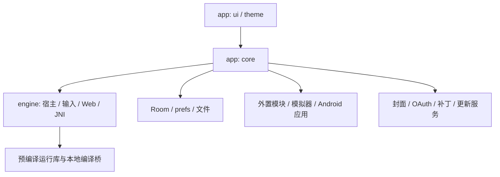

# Architecture

本文说明 Tyranor Next 当前实现的模块职责、运行边界与数据流。功能行为见 [SPEC.md](SPEC.md)，开发约束见 [AGENTS.md](AGENTS.md)，术语见 [CONTEXT.md](CONTEXT.md)。

## 1. 系统范围与模块

Tyranor Next 是 Android 多引擎视觉小说聚合启动器。它管理游戏库、启动编排与应用侧工具，并通过内置宿主、外置 APK 引擎模块或外置模拟器运行游戏；识别到引擎不代表兼容性已经验收。

| 位置 | 职责与依赖边界 |
| --- | --- |
| `app/src/main/java/com/tyranor/next/ui/` | Compose 页面、输入交互、导航、状态展示与错误文案；经 core 调用引擎能力 |
| `app/src/main/java/com/tyranor/next/core/` | 扫描、游戏库、启动、设置、封面、存档、补丁、拆封包、授权与更新；可依赖 engine，禁止 Compose/UI 依赖 |
| `app/src/main/java/com/tyranor/next/theme/` | Material/Miuix 主题与视觉状态，属于表现层 |
| `engine/` | 引擎宿主、Java/Kotlin 桥、Web 脚本、JNI、预编译运行库与输入/图形基础能力；不依赖 App 页面 |
| `buildSrc/` | 图形贡献目录生成、资源归属及来源校验；独立构建逻辑，不是第三个业务模块 |
| `tools/`、`.github/workflows/` | 离线检查/生成工具与 CI/发布流水线 |

Gradle 仅包含 `:app` 与 `:engine`，`app` 通过 `implementation(project(":engine"))` 依赖后者；core 是 app 内部包边界，并非独立模块。

## 2. 应用启动与界面状态

- [TyranorNextApplication.kt](app/src/main/java/com/tyranor/next/TyranorNextApplication.kt) 在最早阶段迁移共享 prefs 名称、配置 WebView profile、预热主进程游戏库，并在应用进入后台时安排更新检查。
- [MainActivity.kt](app/src/main/java/com/tyranor/next/MainActivity.kt) 承载主界面；[MainScreen.kt](app/src/main/java/com/tyranor/next/ui/main/MainScreen.kt) 组合首页、游戏、引擎、设置四页。四页常驻，切换用水平位移与 alpha，避免重建列表。
- [MainLibraryViewModel.kt](app/src/main/java/com/tyranor/next/ui/main/MainLibraryViewModel.kt) 通过 `StateFlow<MainLibraryUiState>` 发布游戏库快照，Channel 串行处理扫描/删除/刷新等命令；搜索防抖并拒绝过期结果。
- 二级页通常复用 [AppScreen.kt](app/src/main/java/com/tyranor/next/ui/common/AppScreen.kt) 中的 `AppScreenActivity` / `AppScreenScaffold`，统一语言、主题、系统栏、背景与转场；正文由 `setAppScreenContent` 提供，主题包裹依次经过 `ProvideAppLocale`、`TyranorNextTheme` 与 `GlassBackground`。全屏按键编辑器保留明文例外。

主线程负责 UI。扫描、持久化和启动准备通常转入 IO；现有同步兼容门面仍可能阻塞，不能将本仓库描述为完全没有主线程 I/O。

## 3. 游戏库与持久化

[GameLibraryDatabase.kt](app/src/main/java/com/tyranor/next/core/game/storage/GameLibraryDatabase.kt) 定义主进程专用 Room 数据库 `game_library.db`，当前 schema v2：

| 表 | 内容 |
| --- | --- |
| `games` | 游戏身份、引擎、启动目标、封面/标题元数据与最近打开时间 |
| `scan_roots` | 扫描根目录 |
| `quick_launch` | 有序快捷启动关系 |
| `game_overrides` | 单游戏设置覆盖 |
| `engine_detection_cache` | 可重建的引擎识别缓存 |

数据写入链为 UI 命令队列 → [GameLibraryFacade](app/src/main/java/com/tyranor/next/core/game/storage/GameLibraryFacade.kt) 缓存与修订号 → [GameLibraryRepository](app/src/main/java/com/tyranor/next/core/game/storage/GameLibraryRepository.kt) 单线程 FIFO + mutex → Room。封面更新只修改对应字段；一致性搜索先等待已排队写入，避免旧结果覆盖新状态。

`games` 表的预计算排序键列只覆盖「字母」「括号标签」两种排序；「引擎」「最近游玩」在 UI 内存完成（无对应 SQL 列）。因此任何排序切换都不重新查库，DB 只负责「哪些标题命中」，展示顺序一律由 UI 内存重排。

旧 `game_scanner` prefs 仍作为幂等迁移来源和恢复镜像，不能删除为“无用缓存”。应用/引擎偏好及引擎进程读取的单游戏 blob 仍保留 prefs；Room 不是所有状态的唯一介质，也不能把普通 SharedPreferences 当成实时跨进程消息总线。

Schema 导出到 `app/schemas/`。现有 v1→v2 及降级允许破坏性恢复并从镜像修复；后续版本必须显式注册 `Migration`，不能扩大全局破坏性回退。历史 [持久化数据清单](docs/应用持久化数据清单.md) 中“尚未使用数据库”等描述属于迁移前快照，应结合当前实现阅读。

## 4. 扫描与启动编排

1. [EngineScanner](app/src/main/java/com/tyranor/next/core/game/scan/EngineScanner.kt) 遍历已授权根目录，利用真实路径或 SAF 会话读取目录特征，按优先链识别引擎并产出 `ScanGame`；重扫合并保留手动添加记录。
2. UI 处理 Artemis 补丁与 MV/MZ 存档转化等用户确认，调用 [EngineLauncher](app/src/main/java/com/tyranor/next/core/game/launch/EngineLauncher.kt)。
3. Android 应用和 ROM 模拟器跳转优先分流；Windows 游戏交 Winlator；Ren'Py / RPG Maker RGSS / Ruffle（SWF / Flash）交外置 APK 模块。它们的权限、目录载荷与错误协议各有契约，不统一伪装成内置宿主。Ruffle 属文件型入口（`launchEntryIsFile`）：文件记录保存 SWF 文件 URI、包装目录记录保存目录 URI，启动前统一解析出 SWF 所在目录，再以 `game` 的 `folder` + `execFile` 交给模块；运行时与存档由插件自行承担，主 App 不接管。
4. 内置启动解析真实目录及生效设置，检查权限、插件、存档位置和适用补丁；Kirikiri 的 SAF 镜像等特殊路径由 core 负责准备。
5. App 与宿主使用 [LaunchContract.kt](engine/src/main/java/com/core/engine/LaunchContract.kt) 的常量传递 Intent extras。启动结果为 `LaunchResult`；`Success` 表示已发起启动，不代表游戏已显示首帧或能够通关。

[EngineSettingsResolver](app/src/main/java/com/tyranor/next/core/settings/EngineSettingsResolver.kt) 统一读取引擎全局与单游戏覆盖，`EffectiveEngineSettings` 处理归一化与回退。启动和存档消费同一份生效规则，页面不得另写优先级逻辑。

## 5. 引擎进程与生命周期

以 [engine Manifest](engine/src/main/AndroidManifest.xml) 为准，内置宿主均为 `exported=false`，主要分为 `:kirikiri2`、`:krkrsdl3`、`:ons`、多档 `:artemis*`、`:siglus`、`:fbgames`、`:fvp`、`:ethornell`、`:xsys35`、`:xsys4`、`:tyrano`、`:rpgmaker`。进程隔离用于控制原生库、全局状态与符号冲突；不提供通用跨引擎热切换保证。

- FVP、Framebuffer 及 Siglus 关闭滤镜的路径仍由主线程 `Choreographer` 同步驱动原生调用。
- Siglus 有效滤镜链才启用专用 engine owner 与 GLES consumer；关闭、空链或无效链沿用 SurfaceView 原路径。两种路径共享原生实例准入，不能同时启动第二个 owner。
- Ethornell 由专用 owner 线程管理 JNI 会话，Surface 世代、会话 token、退出 ACK 与存档操作门禁独立约束。
- `Surface` 消失、Activity `finish()`、原生销毁完成与进程退出是不同事件。修改宿主必须维护线程归属、资源租约、回调世代和释放时序，不能用强杀结果冒充正常退出。

WebView 数据目录另行隔离：API 28+ 主进程用 `home` 后缀，`:tyrano` 保留历史默认目录，`:rpgmaker` 自设后缀。更改 profile 或本地 HTTP 端口会影响历史网页存储作用域，须同时评估存档兼容。

## 6. 资源与原生构建链

| 源头 | 生成/消费方式 |
| --- | --- |
| `engine/src/main/assets/` | Web 注入脚本、字体与运行资源；选定的五个共享 JS 同步到 `app/build/generated/assets/engine/` |
| `engine/src/main/nativeplugins/` + `app/src/main/nativeplugins/` | 合并共享 `.so` 与 App manifest，重名失败；生成 `app/build/generated/assets/nativeplugins/{kirikiroid2,ons,artemis}.zip`，运行时安装到私有目录 |
| `app/src/main/assets/` | App 自有资源，当前主要为 `rtp/`；不在此手工保存生成插件 zip |
| `engine/src/main/jniLibs/arm64-v8a/` | 随 APK 分发的预编译运行库 |
| `engine/src/main/cpp/` | CMake 现场编译 JNI/图形桥，动态连接既有运行库 |
| `engine/src/main/graphicsfilters/*.json`、`engine/patches/*.json` | 描述滤镜贡献与固定来源；buildSrc 生成目录并校验资源、许可与相关库哈希 |

普通 Gradle 构建不会重编大部分引擎，也不会执行 Rust 构建：

- XP3 源码与固定依赖在 [engine/rust](engine/rust/Cargo.toml)；`build-archives.sh` 先运行宿主测试，再用 cargo-ndk 生成 `libarchive_xp3_core.so`。JNI panic 防护依赖 unwind，不改为 `panic=abort`。
- System35/4 的固定来源构建脚本位于 `engine/xsystem35/scripts/`、`engine/xsystem4/scripts/`；共享 `libSDL2x.so` / `org.libsdl.app32`，与 ONS 的 `libSDL2.so` / `org.libsdl.app` 分开维护。
- Siglus 保留已固定的原始运行库，来源与哈希见 [说明](engine/patches/siglus/README.md)；当前 CI 不重编其 Rust 源码。
- Ethornell `.so`、provenance JSON 与 ABI header 必须成套核对。自动 CI 的 `--local-static` 校验来源记录和产物字节，不等价于严格外部源码审计或可复现构建。

预编译源码归属决策见 [ADR 0002](docs/adr/0002-prebuilt-engine-libs-source-in-fork.md)。所有生成目录禁止手工维护；共享字体保持不压缩，并兼顾 System35、System4 与 ONS。

## 7. 其它功能边界

- 封面：`CoverScraperService` 聚合在线来源，`CoverScrapeTaskManager` 管理应用级批量任务；UI 使用缩略图缓存，不在重组期同步抓取/解码。
- 存档：`GameSaveManager` 解析位置并导入/导出 ZIP；MV/MZ 的格式转化与互通独立于存档镜像，均采用同源目录解析。Ethornell 存档管理仍由 capability 关闭。
- 拆封包：`ui/archive` → `core/unpack` → `com.core.archive.Xp3Core` → Rust；SAF 不能映射路径时经 staging 中转。Artemis PFS 补丁解包不走该工具链。
- 输入：UI → core 门面 → `engine/com.core.input`，按 canonical 键位注入每宿主的 `InputSink`；布局编辑器复用原生按键层。
- 授权/更新：Hikarinagi OAuth 经 AppAuth 与 Keystore 保护的凭据存储；后台更新由 WorkManager 单次任务驱动，下载后经 FileProvider 交系统安装器。

## 8. 已知架构偏差

当前代码仍有与规范不完全一致的部分：`SaveLocation.description`、授权及在线补丁的部分接口携带本地化文本；旧数据清单和专题验收说明也有历史快照。新增/改动接口须采用类型化错误，修复时连同调用链迁移。
