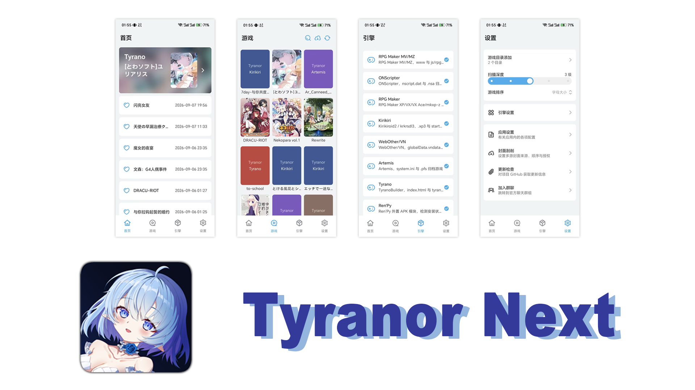

# Tyranor Next

<p align="center">
  
</p>

基于 **Tyranor 模拟器逆向重写**的多引擎视觉小说（Galgame）聚合启动器，面向 Android 平台。内置 Kirikiri / ONScripter / Tyrano / Artemis / Siglus / RealLive / AVG32 / UK2 / FVP / System35 / System4 等原生与 Web 运行环境，另含 Ethornell / BGI 实验接入，并支持 Ren'Py、RPG Maker RGSS 外置 APK 引擎模块与外置模拟器跳转（PPSSPP / Eden / Winlator），提供游戏库管理、封面获取、存档镜像、引擎参数调节等一体化体验。具体功能与兼容边界见 [SPEC.md](SPEC.md)。

mac原生版本如下：

- [Tyranor Next for macOS](https://github.com/Weiss-UltimateSavior/Tyranor-Mac)

iOS版本计划中...
鸿蒙设备可使用卓易通安装

主打轻便、简单、快捷，不引入其他冗余功能的简约设计思路

企鹅群：364439133

感谢 [@安音](https://www.pixiv.net/users/8182248) 为本项目绘画的logo娘！

## 感谢各位贡献者们！一起成为光吧！

<a href="https://github.com/Weiss-UltimateSavior/Tyranor-Next/graphs/contributors">
  
</a>

RPG Maker MV/MZ 的 DKTools 浏览器文件索引缺失时，可由宿主提供会话内只读索引，支持目录及 ASAR 游戏，并优先保留游戏已有索引。适用模式与验证边界见 [SPEC.md](SPEC.md#10-实验能力与证据边界)。

## 支持范围

### 引擎与游戏类型

| 游戏类型                 | 典型识别特征                                                              | 运行环境                         |
| -------------------- | ------------------------------------------------------------------- | ---------------------------- |
| Kirikiri / Kirikiri2 | `.xp3`、`startup.tjs`                                                | Kirikiroid2 / krkrsdl3 原生运行时 |
| ONScripter           | `nscript.dat`、`.nsa`                                                | ONScripter 原生运行时             |
| Artemis              | `system.ini`、`.pfs`                                                 | Artemis 原生运行时                |
| SiglusEngine         | `Gameexe.dat`/`Gameexe.ini`、`Scene.pck`（根或 `Data/`）                | Siglus 原生运行时（siglus_rs）      |
| RealLive             | `Gameexe.ini` + `SEEN.TXT`（10000 项 TOC）或 `SEEN####.TXT`             | 内置视觉小说运行时（game_launcher）  |
| AVG32                | `Gameexe.ini` + `SEEN.TXT`（`PACL`）或 `SEEN###.TXT`（`TPC32`）          | 内置视觉小说运行时（game_launcher）  |
| UK2（PC-98）          | `UK2.CFG`、`*.MES`（`<< UK2 TEXT Ver1.00 >>` 头）                       | 内置视觉小说运行时（game_launcher）  |
| FVP                  | `*.hcb`/`*.bch` 脚本、`graph.bin`/`voice.bin` 等资源包                   | 内置 FVP 原生运行时（rfvp）          |
| System35             | `*.ALD`（`SA.ALD` 等；根目录或 `GAMEDATA/`）、`System39.ain`/`System39.ini`/`*.wai`/`*.bgi`/`*.alk` | 内置 System3.x 运行时（xsystem35） |
| System4              | `System40.ini` 或 `AliceStart.ini`（根目录；`*.ain` 为辅助特征）                    | 内置 System4 运行时（xsystem4）      |
| YU-RIS               | `yscfg.dat`、`pac/*.ypf`、`YS*.DLL`、`.ymv`                          | 外置 Winlator（winlator-cn）        |
| CatSystem2           | `config/startup.xml`、`*.int`、`*.cst`、`*.hg3`、`*.kcs` 等组合         | 外置 Winlator（winlator-cn）        |
| PC（手动添加）        | 游戏页顶栏「添加 PC 游戏」选择目录并指定启动 exe                          | 外置 Winlator（winlator-cn）        |
| TyranoBuilder        | `index.html`、`tyrano/`                                              | 内置 Tyrano Web 运行环境           |
| RPG Maker XP         | `.rgssad`、`Game.ini` + `Data/*.rxdata`                              | 外置 RPGM APK 模块               |
| RPG Maker VX         | `.rgss2a`、`Game.ini` + `Data/*.rvdata`                              | 外置 RPGM APK 模块               |
| RPG Maker VX Ace     | `.rgss3a`、`Game.ini` + `Data/*.rvdata2`                             | 外置 RPGM APK 模块               |
| mkxp-z               | 用户选择/内部别名 `internal.mkxp-z`                                         | 外置 RPGM APK 模块               |
| RPG Maker MV         | `www/`、`js/rpg_core.js`                                             | 内置 Web 运行环境                  |
| RPG Maker MZ         | `www/`、`js/rmmz_core.js`                                            | 内置 Web 运行环境                  |
| VN                   | `globalData.vndata`                                                 | 内置 Web 运行环境                  |
| WebOther             | 通用 `index.html` 网页游戏                                                | 内置 Web 运行环境                  |
| Ren'Py               | `.rpa`、`game/script.rpy`、`game/options.rpy`、`renpy/` + `.rpy/.rpyc` | 外置 RenPy APK 模块              |
| PSP                  | `.pbp`、`.cso`、`.iso`、`.chd`                                         | 外置 PPSSPP 模拟器                 |
| Nintendo Switch      | `.nsp`、`.xci`、`.nca`、`.nro`                                         | 外置 Eden 模拟器                   |

CatSystem2 游戏按 `config/startup.xml`、`.int/.cst/.hg3/.kcs` 等目录特征组合评分识别（`cs2.exe` 仅作辅助，不单独判定），启动同样经外置 Winlator（目录 + 主程序；Runtime 允许 `.bin` 且优先 `cs2.exe`）。

**实验接入：Ethornell / BGI（ethornell-rs）** 已接入扫描、内置宿主启动与 SJIS/GBK、字体设置；原创像素、基础 ABI、退出重入与合成VM持久化已有设备证据，合法样本的三语言选择、正常标题、中文菜单与两句真实中文推进已视觉验证。但商业存档槽位尚无实际保存，精确ABI与完整兼容仍待验收，不能统称可玩。API26当前测试硬件无可用GPU adapter，不代表所有API26设备不支持。App 存档管理默认关闭；完整 IME、BMV、WMV、实时 SWF 与电影音轨尚未支持。进度见 [移植计划](docs/Ethornell-BGI-Android化移植计划方案.md) 和 [测试验收记录](docs/Ethornell测试验收记录.md)。

YU-RIS（Windows）游戏通过外置 Winlator（winlator-cn）运行：扫描按 `yscfg.dat`、`pac/*.ypf`、引擎 DLL 与 `.ymv` 特征识别，启动时以「游戏目录 + 主程序 exe」经 Winlator 外置启动协议拉起（目录由 Winlator 自动分配空闲盘符临时挂载，`save=false` 不写回容器配置）；主程序自动选择，可在游戏详情「启动文件」手动覆盖。主 App 可统一管理其游戏目录 `save/` 中的存档；Winlator 的运行环境仍由外部应用负责。

内置 Web 运行环境同时支持部分以 `app.asar` 打包的 NW\.js 游戏；启动时会根据归档内容进一步识别具体类型。
Ren'Py 与 RPG Maker XP/VX/VX Ace/mkxp-z 当前通过外置 APK 模块运行：Ren'Py 支持 8.5 / 7.7.1 版本，可在全局或单游戏设置中选择引擎版本；自动模式会读取 Ren'Py `script_version` 与 Python2 运行库特征，在 8.5 / 7.7.1 模块间匹配。主 App 默认启用该能力，仅在引擎页检查目标模块是否已安装；未安装时引擎 item 显示打叉并提示下载安装。RPG Maker MV/MZ 属于 Web runtime，继续使用内置 Web 运行环境。
PC 游戏（任意 Windows 程序）通过游戏页顶栏「添加 PC 游戏」手动入库（不参与扫描）：选择目录并从目录检索 exe、指定启动程序；启动经外置 Winlator，启动文件可在游戏详情中随时切换。PC 游戏不纳入统一存档管理；单游戏 Winlator 设置提供「跟随全局 / 跟随容器 / 自定义」三种运行模式，自定义下可逐项覆盖参数；容器同时填写 ID 与名称时以 ID 为准，只填名称时会清除继承的容器 ID。**从 1.61 升级时注意**：只填过容器名的旧记录会改为按名称选择容器，不再沿用全局容器 ID；六项参数全空的旧记录会归为「跟随容器」，其 `save` 固定为不写回容器（1.61 会继承记录或全局的 `save`）。 切换运行模式并保存不会清空另一种模式已填的参数，切回即可恢复；若把数据降级到忽略 `winlator_mode` 的旧版本，这些隐藏值会重新生效。

PSP 与 Nintendo Switch 游戏通过外置模拟器跳转运行：扫描按 ROM 扩展名识别并逐条入库（.iso/.cso/.pbp/.chd、.nsp/.xci/.nca/.nro），启动时按类型拉起已安装的 PPSSPP / Eden（显式组件 + 读取授权，使用 SAF 内容 URI；文件回退路径经 FileProvider 转换）。这两类游戏的存档与设置由模拟器自行管理，主 App 不接管；引擎页「外置跳转支持」入口可查看安装状态并跳转下载页。引擎页可在应用设置中开启「引擎页分类显示」，按 GAL / RPGM / 主机 / 网页 分页展示引擎项。

### Winlator 图形加速

全局 Winlator 设置与单游戏覆盖可选「跟随容器配置」、DXVK、WineD3D（跟随容器渲染器）、WineD3D + OpenGL、WineD3D + GDI。需要 GDI 的游戏请选择明确的 GDI 预设；旧 WineD3D 设置不迁移、不强制改为 GL 或 GDI。

显式 GL/GDI 预设通过现有 `dxwrapperConfig` 协议整项覆盖 WineD3D 配置，其它子参数使用 Winlator 默认值；开启「写入容器配置」时也会保存该预设。Box64 预设可同时下发。该能力适用于带外置启动协议的 winlator-cn，不代表任意 Winlator 分支均支持。

### 平台与文件要求

- Android 8.0（API 26）及以上。
- 当前原生引擎库仅提供 `arm64-v8a`，设备需为 64 位 ARM 架构。
- 游戏目录需位于 Android 可访问的本地存储，并通过系统文件选择器（SAF）授权；启动时目录必须能够映射为真实文件路径，外置存储上的部分引擎可能需要“所有文件访问”权限。
- 实际兼容性取决于游戏使用的引擎版本、封包/加密方式和脚本特性；特殊修改版可能需要调整引擎设置或补丁。

## 参与贡献

欢迎参与项目开发与维护！

在提交 Pull Request 前，请先阅读务必阅读遵守 [贡献指南](./CONTRIBUTING.md)。
如果不符合贡献指南的要求，可能会被拒绝合并。
代码务必符合项目整体风格，避免引入新的问题。
提交前请务必使用项目内AGENTS.md文件内的审核方式进行提交前审核。
如果代码一眼丁真，一定拒绝合并。

## 技术架构

开发与维护文档：[仓库规范](AGENTS.md) · [架构说明](ARCHITECTURE.md) · [功能规格与验收清单](SPEC.md) · [领域术语](CONTEXT.md) · [变更记录](CHANGELOG.md)。专题方案与 `.archify/` 图表保留其生成时的上下文；当前实现以源码及上述架构/规格说明为准。

### 模块划分

| 模块       | 职责                                                                                            |
| -------- | --------------------------------------------------------------------------------------------- |
| `app`    | Android 应用壳：Compose UI、功能抽象层、配置、封面、存档、授权、后台更新等应用侧能力                                           |
| `engine` | 底层引擎运行时核心：SDL2/SDL3、Kirikiri TVP、krkrsdl3、ONScripter、Artemis、Siglus、FVP（rfvp）、Tyrano、Native/JNI 与引擎宿主 Activity |

### 三层目录架构

当前项目按职责归类为三层，依赖方向固定为：

```
界面 UI 交互层 -> 功能抽象层 -> 底层引擎层
```

| 层级        | 目录                                         | 职责                                                                                                     |
| --------- | ------------------------------------------ | ------------------------------------------------------------------------------------------------------ |
| 底层引擎层     | `engine/`                                  | KRKR/Kirikiroid、krkrsdl3、ONS、Artemis、Siglus、FVP（rfvp）、Tyrano、SDL/Cocos/IJK、Native/JNI、引擎宿主 Activity、引擎资源与 Native 插件底层加载 |
| 功能抽象层     | `app/src/main/java/com/tyranor/next/core/` | 游戏扫描、游戏模型、启动编排、封面抓取、存档管理、在线补丁、应用/引擎/单游戏配置、授权、后台更新                                                      |
| 界面 UI 交互层 | `app/src/main/java/com/tyranor/next/ui/`   | Compose 页面、Activity 壳、弹窗、导航、顶部栏、搜索框、用户输入、加载态与错误态                                                       |

功能抽象层按领域继续拆分：

- `core/game`：游戏模型、扫描、启动、存档管理
- `core/engine`：引擎类型、内置引擎插件启动与安装编排、外置 APK 引擎模块注册与启动协议
- `core/cover`：封面抓取、来源聚合、批量任务
- `core/patch`：KRKR 在线补丁
- `core/settings`：应用级配置、引擎级配置、单游戏配置
- `core/auth`：Hikarinagi OAuth 授权与 token 管理
- `core/updater`：后台更新检查与通知
- `core/unpack`：Artemis 启动封包解包辅助；XP3 解包/封包独立工具的核心逻辑与 SAF 中转

UI 层按页面域继续拆分：

- `ui/main`：主入口、底部导航与全局页面状态
- `ui/home`：首页
- `ui/game`：游戏库、游戏卡片、封面操作、游戏动作弹窗
- `ui/engine`：引擎页
- `ui/settings`：应用设置、引擎设置入口、引擎/单游戏设置页面
- `ui/cover`：封面来源与批量抓取设置
- `ui/patch`：KRKR 在线补丁页面
- `ui/save`：存档管理页面
- `ui/archive`：XP3 解包 / 封包独立工具页
- `ui/auth`：OAuth 回调 Activity
- `ui/common`：公共 UI 组件、弹窗、占位页、顶部栏/输入框等复用组件

### 技术栈

- **语言**：Kotlin（引擎层含 Java 桥接代码）
- **UI**：Jetpack Compose + Material 3 + [Miuix](https://github.com/compose-miuix-ui/miuix)
- **导航**：底部导航 `NavigationBar`；主 Tab 内容页使用水平移动切换，详情/设置等独立 Activity 进入使用向上翻页、退出使用向下翻页
- **顶栏与外观**：顶栏与正文恢复上下分离，不叠加顶栏渐进模糊（[#133](https://github.com/Weiss-UltimateSavior/Tyranor-Next/issues/133)）；默认背景渐变与底栏/侧栏/悬浮按钮的玻璃效果不变
- **构建**：Gradle 9.5.1 / AGP 9.2.1 / Kotlin 2.x + Compose Compiler，`compileSdk 37`、`minSdk 26`、`targetSdk 36`
- **持久化**：Room v2（游戏库、扫描根、最近打开时间、快捷启动、单游戏覆盖与识别缓存）+ SharedPreferences（应用/引擎设置、跨进程配置及旧库恢复镜像）
- **文件访问**：Storage Access Framework（SAF）管理外部游戏目录，`documentFile` 库辅助

### 引擎集成设计

- 引擎原生插件（`kirikiroid2` / `ons` / `artemis` 的 `.so`）以 assets 形式随 APK 打包（`nativeplugins/`），首次启动由 `NativePluginManager` 自动解压安装到应用私有目录
- 共享 Native 插件 `.so` 的源头位于 `engine/src/main/nativeplugins`；app 侧仅维护插件 `manifest.json` 和 app-only 插件。构建时由 Gradle 合并生成 `app/build/generated/assets/nativeplugins/*.zip`
- 共享 RPG Maker 注入脚本源头位于 `engine/src/main/assets`；app 侧只保留应用专属注入脚本，构建时由 Gradle 同步生成到 app assets，避免两边手工维护重复文件
- `app` 模块通过 `core/game/launch/EngineLauncher` 将扫描结果映射到对应引擎 Activity 启动（SAF URI → 真实路径转换）
- Ren'Py、RPG Maker RGSS 等外置 APK 引擎模块由 `core/engine/external` 统一注册、检测安装状态并按 intent 协议拉起；主 App 不维护手动启用开关，模块安装即视为可用
- PSP / Nintendo Switch 由 `core/engine/external` 的 `ExternalEmulatorRegistry` / `ExternalEmulatorLauncher` 跳转外置 PPSSPP / Eden：扫描识别 ROM 后逐条入库（一 ROM 一条），运行时在目录解析前分流、按显式组件与读取授权启动；引擎页「外置跳转支持」项展示安装状态并可跳下载页，Manifest `<queries>` 已声明对应包名
- Tyrano 运行环境内置本地 HTTP 服务器、Asar 归档解析与 JS 钩子脚本（`__tyrano__.js` 等），无需外部依赖即可运行网页式脚本游戏
- FVP（rfvp）宿主为 Java `SurfaceView` + `Choreographer` 主循环驱动 Rust 引擎（`librfvp.so` + 自研桥接库），随 APK 打包；支持 `*.hcb` 原版与 `*.bch` 汉化脚本，文本编码（Shift-JIS/GBK/UTF-8）、系统字体回退与文本 HiDPI 可在引擎设置中按全局/单游戏调整
- RealLive / AVG32 / UK2 由 `game_launcher` 运行库承载（与 Siglus 同一 `libsiglus.so`，由 `libgames_bridge.so` dlopen），宿主 `FramebufferGameActivity`（`:fbgames` 进程）每帧驱动 `game_fb_*` 帧缓冲：单指=左键、双指点按=右键、双指上下滑=滚轮、Back=右键，文本编码（自动/Shift-JIS/GBK/Big5/UTF-8/韩语）可按全局/单游戏调整
- 原生库仅提供 `arm64-v8a` 架构

## 可视化文档

`.archify/` 下随仓库提供一组基于当前代码生成、经自动化校验（schema 校验 + 真实浏览器渲染检查）的交互式图表：均为自包含 HTML，浏览器直接打开即可缩放、检索/聚焦节点、切换深浅主题并导出图片；每个目录内同时保留可编辑的 `candidate.json` 源数据与校验回执，可配合 archify skill 重新渲染。

| 图表 | 类型 | 覆盖内容 |
| --- | --- | --- |
| [系统总览](.archify/架构图-系统总览-20261006-022735/architecture-overview.html) | 架构图 | 三层架构、主进程 / 引擎进程族边界、外置模块与模拟器、在线服务集成 |
| [引擎运行时与原生插件体系](.archify/架构图-引擎运行时-20261006-022735/architecture-engine-runtime.html) | 架构图 | 插件供给链、宿主与 JNI 桥接、预编译运行库、Rust XP3 与 Web 壳 |
| [应用功能地图](.archify/功能图-应用功能地图-20261006-022735/architecture-feature-map.html) | 功能图 | 六大功能域 × 18 项能力及对应实现组件 |
| [游戏扫描与入库流程](.archify/流程图-游戏扫描入库-20261006-022735/workflow-scan-import.html) | 流程图 | SAF 授权、目录遍历、引擎识别优先链、差量合并与 Room 落库 |
| [游戏启动编排流程](.archify/流程图-游戏启动编排-20261006-022735/workflow-launch-orchestration.html) | 流程图 | 四级分流（安卓 / 模拟器 / 外置模块 / 内置引擎）与启动前确认 |
| [KiriKiri 启动请求时序](.archify/时序图-KiriKiri启动-20261006-022735/sequence-kirikiri-launch.html) | 时序图 | 插件保障 → SAF 镜像 → Intent → JNI 桥接 → TVP 就绪全链路 |
| [游戏库数据与封面管线](.archify/数据流图-游戏库与封面-20261006-022735/dataflow-library-covers.html) | 数据流图 | 采集、识别、Room 权威存储、prefs 镜像、封面缓存与消费方 |
| [RPG Maker MV/MZ 存档生命周期](.archify/生命周期图-存档互通-20261006-022735/lifecycle-save-interop.html) | 生命周期图 | 互通同步、格式转化、延迟回前台与中止等状态 |

## 构建

```bash
# 编译 Debug APK
./gradlew assembleDebug --no-daemon
```

产物位于 `app/build/outputs/apk/debug/`。需要 Android SDK（本地平台 `android-37.0`）环境。

CI 使用 JDK 17；还需 engine 的 Android 36 平台、Build Tools 37.0.0、NDK 28.0.13004108 与 CMake 3.22.1。Windows 使用 `./gradlew.bat`。JVM 回归运行 `./gradlew testDebugUnitTest --no-daemon`，完整检查命令与设备验收边界见 [AGENTS.md](AGENTS.md#构建)。普通 Gradle 构建使用已提交的运行库，不自动重编所有原生引擎。

## 目录结构

```
app/
├── src/main/java/com/tyranor/next/
│   ├── core/      功能抽象层：扫描、启动、引擎模块、封面、存档、补丁、拆封包、配置、授权、更新
│   ├── ui/        界面 UI 交互层：主界面、游戏页、设置页、弹窗、公共组件
│   └── theme/     Compose / Miuix 主题、色调、深浅色适配
├── src/main/assets/rtp/    App 自有 RTP 资源
├── src/main/nativeplugins/ 插件 manifest 与 app-only 插件源头
├── build/generated/assets/ 构建生成的 engine/ 共享脚本与 nativeplugins/ 插件 zip
├── schemas/                Room schema（随代码提交）
└── src/{test,androidTest,releaseProbe}/ JVM、设备与 release probe 测试

engine/
├── src/main/java/          底层引擎宿主、桥接代码与运行时入口
├── src/main/cpp/           本地编译的 Native/JNI 与图形桥
├── src/main/assets/        底层引擎资源与共享引擎脚本源头
├── src/main/nativeplugins/ 共享 Native 插件 so 源头
├── src/main/jniLibs/       预编译原生运行库（arm64-v8a）
├── src/test/              JVM 回归与 Node Web 桥 harness
└── rust/                   XP3 解封包 Rust 源码（xp3 解析与 KSD mode-2 隐性解码；许可证见 LICENSE.usefulunpack）

buildSrc/、tools/、.github/workflows/  构建校验、工具与 CI
docs/、.archify/                     专题方案、审查记录与可视化
```

## 许可证

本项目基于 **GNU General Public License v2.0** 发布，详见 [LICENSE](LICENSE)（GPL-2.0-only）。

- `engine/` 引擎运行时基于 Tyranor 模拟器逆向重写，上游涉及 Kirikiroid2 / ONScripter 等 GPL-2.0 项目，因此整个项目以 GPL-2.0 授权分发
- 基于本项目发布的衍生作品须遵循 GPL-2.0 条款，并随发行物提供完整源码
- Miuix 等第三方依赖按各自许可证引入
- Siglus / RealLive / AVG32 / UK2 引擎运行库来自 [siglus_rs](https://github.com/xmoezzz/siglus_rs)（MPL-2.0，上述引擎的非官方 Rust 重写/移植），以其自身许可证引入；相应源码可于上游或其 fork 仓库获取
- FVP 引擎运行库来自 [rfvp](https://github.com/xmoezzz/rfvp)（MPL-2.0，FVP 引擎的非官方 Rust 重写/移植），以其自身许可证引入；相应源码可于上游或其 fork 仓库获取
- System35 引擎运行库来自 [xsystem35-sdl2](https://github.com/kichikuou/xsystem35-sdl2)（GPL-2.0-or-later，AliceSoft System 3.x 开源重实现的 SDL2 移植），引擎源码与修改声明见 fork [xsystem35-sdl2](https://github.com/Weiss-UltimateSavior/xsystem35-sdl2)；本仓库仅保留预构建运行库、构建剧本与补丁记录（见 `engine/xsystem35/BUILD.md`）；其依赖 SDL2 / SDL2_mixer（zlib）、freetype（FTL/GPLv2）、libwebp（BSD-3-Clause）按各自许可证引入，许可证文本随 `engine/xsystem35/licenses/` 保留
- System4 引擎运行库来自 [xsystem4](https://github.com/nunuhara/xsystem4)（GPL-2.0-or-later，AliceSoft System 4 引擎的开源重实现），引擎源码与修改声明见 fork [xsystem4](https://github.com/Weiss-UltimateSavior/xsystem4)；其依赖 libsys4（GPL-2.0-or-later，上游 [libsys4](https://github.com/nunuhara/libsys4)）同样取自 fork [libsys4](https://github.com/Weiss-UltimateSavior/libsys4)。Android 构建仅参考 `kichikuou/xsystem4-android` 的事实信息，未拷贝其任何文件。静态链入的依赖包括 libsndfile fork [libsndfile](https://github.com/Weiss-UltimateSavior/libsndfile)（`xsystem4` 分支，LGPL-2.1-or-later）、libogg / libvorbis / libwebp（BSD-3-Clause）、libjpeg-turbo（BSD-3-Clause / IJG）、libpng、libffi / libdeflate / cglm（MIT）及 freetype（同 System35）；SDL2（zlib）与 System35 共用 `libSDL2x.so`；xsystem4 与 libsys4 内的第三方例外（如 cJSON、pl_mpeg（MIT）、queue.h、base64.c（BSD）、kvec.h（MIT；`vector.h` 与之同声明）、sts_mixer（Unlicense，公有领域）、mt19937int（libsys4，LGPL-2.0-or-later 声明））按各自许可证引入。预构建运行库、构建剧本与补丁记录见 `engine/xsystem4/BUILD.md`，许可证文本随 `engine/xsystem4/licenses/` 保留
- Anime4K GLSL 着色器（`engine/src/main/assets/anime4k/`）来自 [bloc97/Anime4K](https://github.com/bloc97/Anime4K)，按其 MIT 许可证引入（版权声明保留于各着色器文件头部）

## 致谢
- [Kirikiroid2](https://github.com/zeas2/Kirikiroid2): Kirikiroid2引擎
- **Tyranor 模拟器**：本项目引擎运行时与核心架构的逆向重写基础
- [Artemis-Compat](https://github.com/Weiss-UltimateSavior/artemis-compat)：自研兼容内核
- [siglus_rs](https://github.com/xmoezzz/siglus_rs)（MPL-2.0）：SiglusEngine / RealLive / AVG32 / UK2 的 Rust 重写与多平台移植，四个引擎的运行时
- [rfvp](https://github.com/xmoezzz/rfvp)（MPL-2.0）：FVP 引擎的 Rust 重写与多平台移植，FVP 运行时
- [xsystem35-sdl2](https://github.com/kichikuou/xsystem35-sdl2)（GPL-2.0-or-later）：AliceSoft System 3.x 引擎的开源重实现（SDL2 移植），System35 运行时；依赖 [SDL2](https://github.com/libsdl-org/SDL) / [SDL2_mixer](https://github.com/libsdl-org/SDL_mixer)（zlib）、[freetype](https://freetype.org/)（FTL/GPLv2）、[libwebp](https://chromium.googlesource.com/webm/libwebp)（BSD-3-Clause）
- [xsystem4](https://github.com/nunuhara/xsystem4) 与 [libsys4](https://github.com/nunuhara/libsys4)（GPL-2.0-or-later）：AliceSoft System 4 引擎的开源重实现及其底层库，System4 运行时；Android 构建参考 [xsystem4-android](https://github.com/kichikuou/xsystem4-android)（kichikuou），仅作事实参考。依赖 [libsndfile](https://github.com/kichikuou/libsndfile)（LGPL-2.1-or-later，`xsystem4` 分支）等，见「许可证」
- **RinneMobile**：游戏扫描识别/SAF路径映射逻辑/独立存档映射/krkrsdl3 等多个功能的参考与实现
- [Miuix](https://github.com/compose-miuix-ui/miuix)：设置界面组件库
- [Anime4K](https://github.com/bloc97/Anime4K):（bloc97，MIT）：KRKR 游戏画面实时超分（线条重建 CNN 着色器）
- [OnscripterYuri](https://github.com/YuriSizuku/OnscripterYuri): ONS引擎
- [UsefulUnpack](https://github.com/znso4pa/usefulunpack)（znso4pa，MIT）：XP3 / KSD 解封包 Rust 实现（`engine/rust` 的 `lib.rs` / `common.rs` / `ksd.rs` 来源，许可证见 `engine/rust/LICENSE.usefulunpack`）
- 各引擎运行时均基于其开源许可引入
