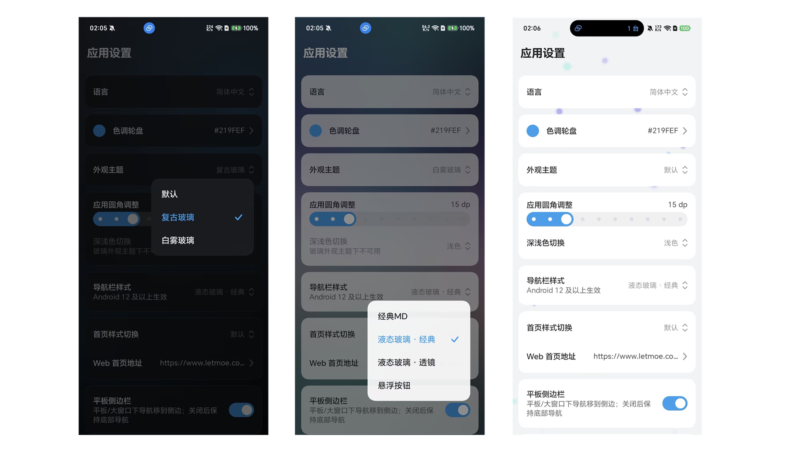
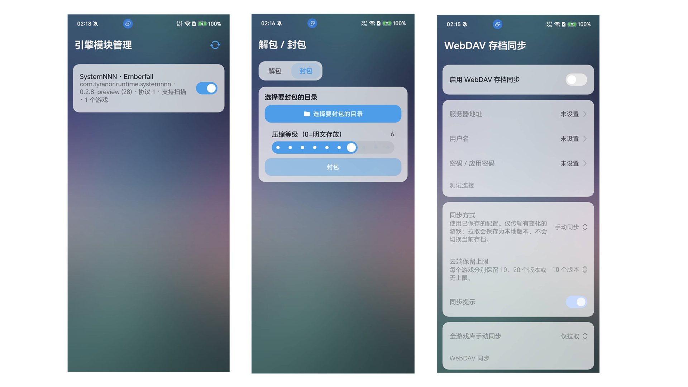
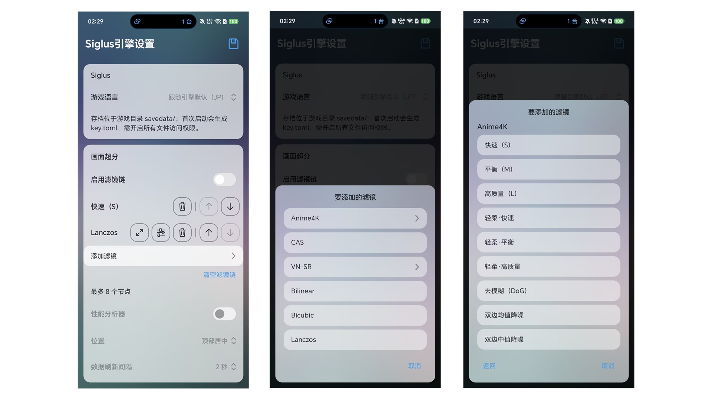

<p align="center">
  
</p>

基于 **Tyranor 模拟器逆向重写** 的多引擎视觉小说（Galgame）模拟器，面向 Android 平台。具体功能与兼容边界见 [SPEC.md](SPEC.md)。

iOS版本计划中...  鸿蒙设备可使用卓易通安装
主打轻便、简单、快捷，不引入其他冗余功能的简约设计思路

企鹅群：364439133   感谢 [@安音](https://www.pixiv.net/users/8182248) 为本项目绘画的logo娘！

默认主题界面（浅色）
<p align="center">
  
</p>

三种不同风格主题（不包含深浅色模式对比）
<p align="center">
  
</p>

多种个性化设置（部分展示）
<p align="center">
  
</p>

更多拓展功能（部分展示，第三方插件支持见 [docs/第三方APK运行时模块接入指南.md](docs/第三方APK运行时模块接入指南.md)）
<p align="center">
  
</p>

画面超分（展示配置）
<p align="center">
  
</p>

## 感谢各位贡献者们！一起成为光吧！

<a href="https://github.com/Weiss-UltimateSavior/Tyranor-Next/graphs/contributors">
  
</a>

## 支持范围

### 引擎与游戏类型

| 游戏类型                 | 典型识别特征                                                              | 运行环境                         |
| -------------------- | ------------------------------------------------------------------- | ---------------------------- |
| Kirikiri / Kirikiri2 | `.xp3`、`startup.tjs`                                                | Kirikiroid2 / krkrsdl3 原生运行时 |
| ONScripter           | `nscript.dat`、`.nsa`                                                | ONScripter 原生运行时             |
| Artemis              | `system.ini`、`.pfs`                                                 | Artemis 原生运行时                |
| SiglusEngine         | `Gameexe.dat`/`Gameexe.ini`、`Scene.pck`（根或 `Data/`）                | Siglus 原生运行时（siglus_rs）      |
| RealLive             | `Gameexe.ini` + `SEEN.TXT`（10000 项 TOC）或 `SEEN####.TXT`             | 内置视觉小说运行时（game_launcher）  |
| AVG32                | `Gameexe.ini` + `SEEN.TXT`（`PACL`）或 `SEEN###.TXT`（`TPC32`）          | 内置视觉小说运行时（game_launcher）  |
| UK2（PC-98）          | `UK2.CFG`、`*.MES`（`<< UK2 TEXT Ver1.00 >>` 头）                       | 内置视觉小说运行时（game_launcher）  |
| FVP                  | `*.hcb`/`*.bch` 脚本、`graph.bin`/`voice.bin` 等资源包                   | 内置 FVP 原生运行时（rfvp）          |
| CMVS                 | `data/pack/script.cpz` + `start.ps3/ps2`（仅 19 部登记作品）              | 内置 CMVS 原生运行时（cmvs-rs，NativeActivity） |
| System35             | `*.ALD`（`SA.ALD` 等；根目录或 `GAMEDATA/`）、`System39.ain`/`System39.ini`/`*.wai`/`*.bgi`/`*.alk` | 内置 System3.x 运行时（xsystem35） |
| System4              | `System40.ini` 或 `AliceStart.ini`（根目录；`*.ain` 为辅助特征）                    | 内置 System4 运行时（xsystem4）      |
| SystemNNN            | 游戏目录下的 `spt/sys.spt`（不区分大小写）                            | 内置 [SystemNNN-Emberfall 0.6.14](https://github.com/PorisRora/SystemNNN-Emberfall)（ARM64） |
| YU-RIS               | `yscfg.dat`、`pac/*.ypf`、`YS*.DLL`、`.ymv`                          | 外置 Winlator（winlator-cn）        |
| CatSystem2           | `config/startup.xml`、`*.int`、`*.cst`、`*.hg3`、`*.kcs` 等组合         | 外置 Winlator（winlator-cn）        |
| PC（手动添加）        | 游戏页顶栏「添加 PC 游戏」选择目录并指定启动 exe                          | 外置 Winlator（winlator-cn）        |
| TyranoBuilder        | `index.html`、`tyrano/`                                              | 内置 Tyrano Web 运行环境           |
| RPG Maker XP         | `.rgssad`、`Game.ini` + `Data/*.rxdata`                              | 外置 RPGM APK 模块               |
| RPG Maker VX         | `.rgss2a`、`Game.ini` + `Data/*.rvdata`                              | 外置 RPGM APK 模块               |
| RPG Maker VX Ace     | `.rgss3a`、`Game.ini` + `Data/*.rvdata2`                             | 外置 RPGM APK 模块               |
| mkxp-z               | 用户选择/内部别名 `internal.mkxp-z`                                         | 外置 RPGM APK 模块               |
| RPG Maker MV         | `www/`、`js/rpg_core.js`                                             | 内置 Web 运行环境                  |
| RPG Maker MZ         | `www/`、`js/rmmz_core.js`                                            | 内置 Web 运行环境                  |
| VN                   | `globalData.vndata`                                                 | 内置 Web 运行环境                  |
| WebOther             | 通用 `index.html` 网页游戏                                                | 内置 Web 运行环境                  |
| Ren'Py               | `.rpa`、`game/script.rpy`、`game/options.rpy`、`renpy/` + `.rpy/.rpyc` | 外置 RenPy APK 模块              |
| Ruffle / Flash       | 顶层 `.swf`；根 `index.html/index.htm` + 唯一 SWF 的叶子目录                   | 外置 Ruffle APK 模块              |
| PSP                  | `.pbp`、`.cso`、`.iso`、`.chd`                                         | 外置 PPSSPP 模拟器                 |
| Nintendo Switch      | `.nsp`、`.xci`、`.nca`、`.nro`                                         | 外置 Eden 模拟器                   |


### 平台与文件要求

- Android 8.0（API 26）及以上。
- 当前原生引擎库仅提供 `arm64-v8a`，设备需为 64 位 ARM 架构。
- SystemNNN 的阅读字号与 PC 存档操作可通过对应页面的悬浮按钮打开。剧情正文字号默认 85%，可选择 100% 恢复原版大小。
- SystemNNN 影片切到后台后暂停，返回时接着播放。剧情音频未取得焦点时，回到播放器或操作即可重试。
- SystemNNN 首次使用时解压运行库包。ZIP 导入和 WebDAV 恢复在独立校验进程读取剧情档的输入日志、原生快照结构和随包全局进度，通过后再替换存档。仅含有效全局进度的备份可恢复到没有剧情档和流程图检查点的目录。
- 使用导入副本的 SystemNNN 游戏可在存档管理中清理资源。移除最后一个库条目时会清理该副本的资源。未入库的残留副本可在「设置 → 游戏目录」中清理。原游戏目录和副本中的全部存档都会保留，再次启动时按原目录授权重新导入资源。
- SystemNNN 的标题、设置、鉴赏和错误提示跟随应用语言。游戏提供的界面文字和贴图按游戏配置显示。
- SystemNNN 从直连目录转入同源 SAF 副本时，WebDAV 可继承原会话基线及已提交的恢复链。Android 10 上，首次复制从游戏库启动，需要用户确认。复制可以取消，旋转屏幕后可继续。手动恢复 ZIP 会在解包后确认当前存档目录。
- 游戏目录需位于 Android 可访问的本地存储，并通过系统文件选择器（SAF）授权；启动时目录必须能够映射为真实文件路径，外置存储上的部分引擎可能需要“所有文件访问”权限。
- 实际兼容性取决于游戏使用的引擎版本、封包/加密方式和脚本特性；特殊修改版可能需要调整引擎设置或补丁。KRKR 游戏的渲染器、FPS 限制、内存占用等引擎偏好按 Kirikiroid2 内核原生键名写入引擎偏好文件，全局与单游戏覆盖均可生效。

## 参与贡献

欢迎参与项目开发与维护！

在提交 Pull Request 前，请先阅读务必阅读遵守 [贡献指南](./CONTRIBUTING.md)。
如果不符合贡献指南的要求，可能会被拒绝合并。
代码务必符合项目整体风格，避免引入新的问题。
提交前请务必使用项目内AGENTS.md文件内的审核方式进行提交前审核。
如果代码一眼丁真，一定拒绝合并。

## 技术架构

开发与维护文档：[仓库规范](AGENTS.md) · [架构说明](ARCHITECTURE.md) · [功能规格与验收清单](SPEC.md) · [领域术语](CONTEXT.md) · [变更记录](CHANGELOG.md)。专题方案与 `.archify/` 图表保留其生成时的上下文；当前实现以源码及上述架构/规格说明为准。


## 可视化文档

`.archify/` 下随仓库提供一组基于当前代码生成、经自动化校验（schema 校验 + 真实浏览器渲染检查）的交互式图表：均为自包含 HTML，浏览器直接打开即可缩放、检索/聚焦节点、切换深浅主题并导出图片；每个目录内同时保留可编辑的 `candidate.json` 源数据与校验回执，可配合 archify skill 重新渲染。

| 图表 | 类型 | 覆盖内容 |
| --- | --- | --- |
| [系统总览](.archify/架构图-系统总览-20261006-022735/architecture-overview.html) | 架构图 | 三层架构、主进程 / 引擎进程族边界、外置模块与模拟器、在线服务集成 |
| [引擎运行时与原生插件体系](.archify/架构图-引擎运行时-20261006-022735/architecture-engine-runtime.html) | 架构图 | 插件供给链、宿主与 JNI 桥接、预编译运行库、Rust XP3 与 Web 壳 |
| [应用功能地图](.archify/功能图-应用功能地图-20261006-022735/architecture-feature-map.html) | 功能图 | 六大功能域 × 18 项能力及对应实现组件 |
| [游戏扫描与入库流程](.archify/流程图-游戏扫描入库-20261006-022735/workflow-scan-import.html) | 流程图 | SAF 授权、目录遍历、引擎识别优先链、差量合并与 Room 落库 |
| [游戏启动编排流程](.archify/流程图-游戏启动编排-20261006-022735/workflow-launch-orchestration.html) | 流程图 | 四级分流（安卓 / 模拟器 / 外置模块 / 内置引擎）与启动前确认 |
| [KiriKiri 启动请求时序](.archify/时序图-KiriKiri启动-20261006-022735/sequence-kirikiri-launch.html) | 时序图 | 插件保障 → SAF 镜像 → Intent → JNI 桥接 → TVP 就绪全链路 |
| [游戏库数据与封面管线](.archify/数据流图-游戏库与封面-20261006-022735/dataflow-library-covers.html) | 数据流图 | 采集、识别、Room 权威存储、prefs 镜像、封面缓存与消费方 |
| [RPG Maker MV/MZ 存档生命周期](.archify/生命周期图-存档互通-20261006-022735/lifecycle-save-interop.html) | 生命周期图 | 互通同步、格式转化、延迟回前台与中止等状态 |

## 构建

```bash
# 编译 Debug APK
./gradlew assembleDebug --no-daemon
```

产物位于 `app/build/outputs/apk/debug/`。需要 Android SDK（本地平台 `android-37.0`）环境。

CI 使用 JDK 17；还需 engine 的 Android 36 平台、Build Tools 37.0.0、NDK 28.0.13004108 与 CMake 3.22.1。Windows 使用 `./gradlew.bat`。JVM 回归运行 `./gradlew testDebugUnitTest --no-daemon`，完整检查命令与设备验收边界见 [AGENTS.md](AGENTS.md#构建)。普通 Gradle 构建使用已提交的运行库，不自动重编所有原生引擎。

## 目录结构

```
app/
├── src/main/java/com/tyranor/next/
│   ├── core/      功能抽象层：扫描、启动、引擎模块、封面、存档、补丁、拆封包、配置、授权、更新
│   ├── ui/        界面 UI 交互层：主界面、游戏页、设置页、弹窗、公共组件
│   └── theme/     Compose / Miuix 主题、色调、深浅色适配
├── src/main/assets/rtp/    App 自有 RTP 资源
├── src/main/nativeplugins/ 插件 manifest 与 app-only 插件源头
├── build/generated/assets/ 构建生成的 engine/ 共享脚本与 nativeplugins/ 插件资产（.zip.xz）
├── schemas/                Room schema（随代码提交）
└── src/{test,androidTest,releaseProbe}/ JVM、设备与 release probe 测试

engine/
├── src/main/java/          底层引擎宿主、桥接代码与运行时入口
├── src/main/cpp/           本地编译的 Native/JNI 与图形桥
├── src/main/assets/        底层引擎资源与共享引擎脚本源头
├── src/main/nativeplugins/ 共享 Native 插件 so 源头
├── src/main/jniLibs/       预编译原生运行库（arm64-v8a）
├── src/test/              JVM 回归与 Node Web 桥 harness
└── rust/                   XP3 解封包 Rust 源码（xp3 解析与 KSD mode-2 隐性解码；许可证见 LICENSE.usefulunpack）

buildSrc/、tools/、.github/workflows/  构建校验、工具与 CI
docs/、.archify/                     专题方案、审查记录与可视化
```

## 许可证

本项目基于 **GNU General Public License v2.0** 发布，详见 [LICENSE](LICENSE)（GPL-2.0-only）。

- `engine/` 引擎运行时基于 Tyranor 模拟器逆向重写，上游涉及 Kirikiroid2 / ONScripter 等 GPL-2.0 项目，因此整个项目以 GPL-2.0 授权分发
- 基于本项目发布的衍生作品须遵循 GPL-2.0 条款，并随发行物提供完整源码
- Miuix 等第三方依赖按各自许可证引入
- Siglus / RealLive / AVG32 / UK2 引擎运行库来自 [siglus_rs](https://github.com/xmoezzz/siglus_rs)（MPL-2.0，上述引擎的非官方 Rust 重写/移植），以其自身许可证引入；相应源码可于上游或其 fork 仓库获取
- FVP 引擎运行库来自 [rfvp](https://github.com/xmoezzz/rfvp)（MPL-2.0，FVP 引擎的非官方 Rust 重写/移植），以其自身许可证引入；相应源码可于上游或其 fork 仓库获取
- CMVS 引擎运行库来自 fork [cmvs-rs](https://github.com/Weiss-UltimateSavior/cmvs-rs)（上游 MIT OR Apache-2.0，Purple SOFTWARE CMVS 引擎的 Rust 重实现），固定上游 commit 并在构建时应用绝对路径补丁；源码与补丁清单见 `tools/cmvs/`
- SystemNNN 运行库 `libsystemnnn.so` 由 PorisRora（Rooboko）维护的 Emberfall 源码构建。Emberfall 自有代码采用 GPL-2.0-only。原版 SystemNNN 由 tinyan 开发。默认碎裂网格由 Emberfall 自行生成，供全屏转场和图层碎裂共用。 [运行库对应源码](https://github.com/PorisRora/SystemNNN-Emberfall/tree/d0170741089e9f29de7329a5e0d4e37d06ff5c71) · [对应构建记录](engine/src/main/assets/licenses/systemnnn/ffmpeg-source.txt) · [归属与许可](engine/src/main/assets/licenses/systemnnn/upstream-source.txt)
- System35 引擎运行库来自 [xsystem35-sdl2](https://github.com/kichikuou/xsystem35-sdl2)（GPL-2.0-or-later，AliceSoft System 3.x 开源重实现的 SDL2 移植），引擎源码与修改声明见 fork [xsystem35-sdl2](https://github.com/Weiss-UltimateSavior/xsystem35-sdl2)；本仓库仅保留预构建运行库、构建剧本与补丁记录（见 `engine/xsystem35/BUILD.md`）；其依赖 SDL2 / SDL2_mixer（zlib）、freetype（FTL/GPLv2）、libwebp（BSD-3-Clause）按各自许可证引入，许可证文本随 `engine/xsystem35/licenses/` 保留
- System4 引擎运行库来自 [xsystem4](https://github.com/nunuhara/xsystem4)（GPL-2.0-or-later，AliceSoft System 4 引擎的开源重实现），引擎源码与修改声明见 fork [xsystem4](https://github.com/Weiss-UltimateSavior/xsystem4)；其依赖 libsys4（GPL-2.0-or-later，上游 [libsys4](https://github.com/nunuhara/libsys4)）同样取自 fork [libsys4](https://github.com/Weiss-UltimateSavior/libsys4)。Android 构建仅参考 `kichikuou/xsystem4-android` 的事实信息，未拷贝其任何文件。静态链入的依赖包括 libsndfile fork [libsndfile](https://github.com/Weiss-UltimateSavior/libsndfile)（`xsystem4` 分支，LGPL-2.1-or-later）、libogg / libvorbis / libwebp（BSD-3-Clause）、libjpeg-turbo（BSD-3-Clause / IJG）、libpng、libffi / libdeflate / cglm（MIT）及 freetype（同 System35）；SDL2（zlib）与 System35 共用 `libSDL2x.so`；xsystem4 与 libsys4 内的第三方例外（如 cJSON、pl_mpeg（MIT）、queue.h、base64.c（BSD）、kvec.h（MIT；`vector.h` 与之同声明）、sts_mixer（Unlicense，公有领域）、mt19937int（libsys4，LGPL-2.0-or-later 声明））按各自许可证引入。预构建运行库、构建剧本与补丁记录见 `engine/xsystem4/BUILD.md`，许可证文本随 `engine/xsystem4/licenses/` 保留
- Anime4K GLSL 着色器（`engine/src/main/assets/anime4k/`）来自 [bloc97/Anime4K](https://github.com/bloc97/Anime4K)，按其 MIT 许可证引入（版权声明保留于各着色器文件头部）
- VN-SR C08 / C12 / C16 原生2X滤镜来自 [AAAA1111-Lab/VN-SR](https://github.com/AAAA1111-Lab/VN-SR)，按 MIT 许可证引入；资源与许可说明见[VN-SR滤镜集](docs/vnsr-filters.md)。

## 致谢
- [Kirikiroid2](https://github.com/zeas2/Kirikiroid2): Kirikiroid2引擎
- **Tyranor 模拟器**：本项目引擎运行时与核心架构的逆向重写基础
- [Artemis-Compat](https://github.com/Weiss-UltimateSavior/artemis-compat)：自研兼容内核
- [siglus_rs](https://github.com/xmoezzz/siglus_rs)（MPL-2.0）：SiglusEngine / RealLive / AVG32 / UK2 的 Rust 重写与多平台移植，四个引擎的运行时
- [rfvp](https://github.com/xmoezzz/rfvp)（MPL-2.0）：FVP 引擎的 Rust 重写与多平台移植，FVP 运行时
- [xsystem35-sdl2](https://github.com/kichikuou/xsystem35-sdl2)（GPL-2.0-or-later）：AliceSoft System 3.x 引擎的开源重实现（SDL2 移植），System35 运行时；依赖 [SDL2](https://github.com/libsdl-org/SDL) / [SDL2_mixer](https://github.com/libsdl-org/SDL_mixer)（zlib）、[freetype](https://freetype.org/)（FTL/GPLv2）、[libwebp](https://chromium.googlesource.com/webm/libwebp)（BSD-3-Clause）
- [xsystem4](https://github.com/nunuhara/xsystem4) 与 [libsys4](https://github.com/nunuhara/libsys4)（GPL-2.0-or-later）：AliceSoft System 4 引擎的开源重实现及其底层库，System4 运行时；Android 构建参考 [xsystem4-android](https://github.com/kichikuou/xsystem4-android)（kichikuou），仅作事实参考。依赖 [libsndfile](https://github.com/kichikuou/libsndfile)（LGPL-2.1-or-later，`xsystem4` 分支）等，见「许可证」
- **RinneMobile**：游戏扫描识别/SAF路径映射逻辑/独立存档映射/krkrsdl3 等多个功能的参考与实现
- [Miuix](https://github.com/compose-miuix-ui/miuix)：设置界面组件库
- [Anime4K](https://github.com/bloc97/Anime4K):（bloc97，MIT）：KRKR 游戏画面实时超分（线条重建 CNN 着色器）
- [OnscripterYuri](https://github.com/YuriSizuku/OnscripterYuri): ONS引擎
- [UsefulUnpack](https://github.com/znso4pa/usefulunpack)（znso4pa，MIT）：XP3 / KSD 解封包 Rust 实现（`engine/rust` 的 `lib.rs` / `common.rs` / `ksd.rs` 来源，许可证见 `engine/rust/LICENSE.usefulunpack`）
