# WebDAV Android 设备验收记录

## 验收基线与后续增量

日期：2026-10-27，Asia/Shanghai。对应 PR #132，本文所有设备执行结果、
截图与通过数均锁定在业务基线 `aad49a2` + 测试快照 `60690ad4`（`aad49a2` 本身尚未包含这两个设备测试文件）。当时 `SaveSyncDeviceTest` 为 6 项，
`SaveRecoveryDeviceTest` 为 3 项；这两类历史结果是同轮 **9 通过、0 失败、0 跳过**，
后文保留原记录，不因当前源码增加用例而改写历史计数。

`a528183` 起 `SaveSyncDeviceTest` 新增 2 项、总数增至 8 项，新增
`oldNativeLaunchEvidenceCannotRejectReplacementAfterQuickReenable` 与
`oldExternalYurisTicketCannotRejectReplacementAfterQuickReenable`。这两项 quick-reenable
用例以及该提交及后续修复只完成编译，尚未在本文记录的真机、AVD 或独立服务器场景
中执行，不能计入上述设备通过数。

## 环境与隔离边界

| 项目 | 本次记录 |
| --- | --- |
| 设备 | PPG-AN00，arm64-v8a |
| 系统 | Android 17 / API 37 |
| 系统构建 | `PPG-AN00 11.0.0.110(SP5C00E110R104P1)` |
| 安全补丁 | 2026-09-01 |
| 原始屏幕 | 1264 × 2800，density 560，无 override |
| 原始字体比例 | 0.85 |
| 验收包 | `com.tyranor.next.webdavacceptance20261027` |
| 测试包 | `com.tyranor.next.webdavacceptance20261027.test` |
| 样本 | 唯一 UUID 的合成 ONS 存档、Artemis 资源及 ZIP，不含商业游戏数据 |
| WebDAV | 测试 APK 内 loopback 服务；另以独立 WsgiDAV 4.4.0 / Cheroot 11.1.2 服务验证手机与模拟器并发，均用合成账号 |

验收包为新安装的专用包，没有安装或清除正式包、旧的 `webdavtest` 包及其游戏存档。
测试必须同时满足专用 application ID 和 `-e webdav_device_acceptance true`，否则跳过；
UI 测试另要求初始游戏库为空、没有既有 WebDAV 加密载荷。各独立 profile 导出截图后再清理专用包。

`-PwebdavDeviceProbe=true` 仅给专用包的 debug 变体加入非导出的辅助 Activity：
它在独立进程触发真实 Application 生命周期回调，数秒后销毁 Activity，进程保持缓存。
它没有加载原生游戏运行库，也不代表 Siglus/FVP 等真实游戏兼容性验收。
未启用该参数的 Debug 和正式 Release manifest 均确认不含辅助 Activity。

旧版系统另使用 `-PwebdavFrameworkProbe=true`，仅供同一专用 Debug 包：目标与测试 APK
均不打包 JNI `.so`，不注册 AndroidTest JNI probe，禁用 Release 变体并拒绝 Release 构建命令。
构建项目本身仍需要仓库规定的 NDK。此参数让 x86_64 模拟器执行 Android 框架、存档与 UI
代码，不能运行或证明 arm64 游戏引擎。无专用设备探针参数、或请求 Release 时的拒绝分支已实际验证。

## 实测结果

### 存档与生命周期

测试快照 `60690ad4` 的 `SaveSyncDeviceTest` 6 项、`SaveRecoveryDeviceTest` 3 项，
最终同轮 **9 通过、0 失败、0 跳过**，
耗时 39.568 秒。使用实际 Android Context、AndroidKeyStore、GameSaveManager、
SaveSyncService、SaveSyncRuntime、WorkManager、OkHttp 与 Android XML 解析器。
独立复核后补强首次宿主用例的空记录前提并再次执行，真机仍为 **9 通过、0 跳过**；
该轮因 OEM 后台暂停，分次返回验收应用后完成，耗时 238.741 秒，不能作为后台时限证据。

| 用例 | 断言 |
| --- | --- |
| 加密设置与显式切换 | 真实 Keystore 保存/解密；PULL 不覆盖活动存档；只有显式激活才导入 |
| S 先上传后继续游玩为 N | 保留 S→N 的来源时间；发布 N 后替代云端 S；其他版本保留 |
| 上传失败与缓存淘汰 | PUT 500 后成功重试；已见云端最新 ZIP 丢失后重新 GET 并校验 |
| 损坏 journal 救档 | 关闭 WebDAV 后仍可恢复；保护 ZIP 先救回历史，活动存档保持原样 |
| 启动失败 | 真实 prepare/finish 回滚 session 与启动宽限，不产生上传 |
| 首次启动前切换 | 从未产生宿主记录也可完成恢复版本上传；不会永久 busy |
| 缓存宿主退出与 Worker | Activity 活跃时 busy；退出后 PID 仍存在、Activity 数为 0，经过宽限变为空闲；无变化零 PUT，有变化由实际 Worker 上传并清除 session |
| Artemis 无提交证据恢复 | 当前新存档保留，缺失的 `system/data.pfs` 补回；旧存档保留到 `import_orphan_*` |
| 真实文件权限失败 | 对测试目录施加 0500 后复制确实失败；原备份和事务记录保留，无半个目标文件；恢复 0700 后重试成功 |
| 丢失目录与已证明提交 | 缺失目标回滚备份；匹配 marker/token 的提交完成资源收尾并清理 sidecar |

缓存宿主/Worker 用例覆盖“退出宿主后返回应用”的流程，并确认退出立即链出现 `SUCCEEDED`。
完全没有主界面 Activity 的后台试跑中，该 OEM 的 JobScheduler 显示 RARE 待机分组和未满足的
TIMING_DELAY，测试进程计时也出现长时间停滞。因此不能把本次结果解释为所有 OEM、
熄屏/省电状态下均可在固定秒数内上传。持久化 fallback 和下次前台补偿仍是必要边界。
没有为通过测试修改设备的全局省电策略。

### API 26 / 27 与独立服务器

两套新建 x86_64 AVD 分别使用 Google APIs API 26、AOSP API 27 系统镜像，
均运行最终的存档、恢复和 UI 三个测试类：

| 系统 | 执行数 | 通过 | 条件跳过 | 失败 | 耗时 |
| --- | --- | --- | --- | --- | --- |
| Android 8.0 / API 26 | 15 | 14 | 1 | 0 | 62.376 秒 |
| Android 8.1 / API 27 | 15 | 14 | 1 | 0 | 61.562 秒 |

唯一跳过项均是要求系统字体为 2.0 的横屏长弹窗用例；普通 profile 不假装具备此条件。
其余 9 项存档/进程/Worker 测试与 5 项 UI 测试均真实通过，覆盖 API 28 前的进程名读取分支、
AndroidKeyStore、文件事务和密码输入组件的 API 26/27 分支。两处默认浅色截图已人工查看。
这些是框架测试，不包括在 x86_64 上加载 arm64 引擎。

独立服务器为 Windows 上的 WsgiDAV 4.4.0 + Cheroot 11.1.2，使用独立短路径临时目录、
loopback 监听、Basic 合成账号，通过两台设备各自的 `adb reverse tcp:18763 tcp:18763`
访问。未认证请求确认为 401；服务未暴露到局域网，也没有借用用户的云端配置。

`IndependentWebDavDeviceTest` 在真机与 API 26 模拟器中同时运行，共享一次性 run ID，
使用 UTC 名称发布同一不可变对象，再分别发布各自的存档。两端均读取同样的 3 个版本，
逐包下载并核对存档内容哈希；重复 PUT 实际返回 412，再通过 GET 校验已有对象。
两端分别 **1 通过、0 失败**，耗时 3.022 秒、1.600 秒；服务器日志也核对了 207/201/412/200。
这是“一台真机 + 一台模拟器”的独立客户端互通，不能写成双实体手机或外部云服务商验收。
初始化试跑发现了 Windows 服务根路径过长及测试两端时区不同的问题，已修正夹具的
短路径与统一 UTC 身份后使用新的 run ID 完整重跑，失败试跑未计入通过数。

### 界面

普通手机 profile 的 6 个方法中 **5 通过、1 按条件跳过**；跳过的唯一方法要求真实系统字体 2.0。
随后将设备字体暂设为 2.0，单独执行该方法，**1 通过、0 跳过**。因此六个不同 UI 用例均已有实际通过记录。

- 密码输入有正确 label、遮罩和 `Password` 语义，语义树不显示合成明文密码。
- 整库手动同步方向在 Activity 重建后保持。
- 初始不自动选择历史版本，激活按钮不可用；显式选中后才启用。
- 确认弹窗展示与列表一致的 S→N 两个时间。
- WebDAV 关闭后仍显示未完成切换的恢复入口。
- 两处页面均采集默认浅色、默认深色、复古玻璃、高级玻璃。
- 真正的 2.0 字体比例、横屏下，确认正文的滚动范围大于零；执行 ScrollBy 后正文位置改变，
  确认按钮仍可见且坐标保持不变。截图为滚动后的正文。

另外在同一手机上临时将 density 设为 240，约 842dp 宽，再跑两页四种主题截图用例，**1 通过**。
这是宽屏/平板宽度模拟，**不是实体平板验收**。结束后再次读取设备设置：
`font_scale=0.85`，`Physical density: 560`，无 density override。

### TalkBack 实际焦点反馈

从 Google Play 安装 Google LLC 的 Android 无障碍套件
`17.1.0.1003738110`，完成 TalkBack 教程并启用“显示语音输出”。
确认系统实际绑定 TalkBack、touch exploration 为 1，停止 Android CLI 的
UiAutomation 服务后再用真实触摸聚焦密码输入框，避免自动化连接压制读屏服务。
实际 TalkBack 绿色焦点框与语音输出字幕显示“密码、编辑框、密码 / 应用密码”，
与字段 label 和密码语义一致，原始截图附后。

此证据是 TalkBack 实际焦点朗读的字幕，不是语义树替代结果，也不声称已录制音频、
覆盖所有读屏路径或证明所有系统键盘的密码朗读偏好。密码遮罩和合成明文不出现在语义树的
断言由 UI 测试单独覆盖。临时安装的 TalkBack 与两个验收包均已卸载；
原有无障碍服务列表、accessibility 开关、touch exploration、自动旋转与旋转值全部恢复并读回核对。
原有正式包与用户既有测试包均保留。

### 独立复核

协作子代理的后端任务解密失败后，改用两个独立、临时、只读 Codex CLI 进程，
对提供的源代码快照分别检查运行时/回归和 UI/构建/隔离边界。复核发现并已修正：
首次宿主用例依赖前序宿主残留记录、清理步骤异常导致后续步骤跳过、
框架测试仍注册 JNI 测试探针，以及截图缺少独立运行目录。
修正后的测试代码已用于上述 API 26/27 最终轮次。复核没有执行设备测试或代替主验收。

### 构建与回归

- Windows 同步包 JVM 回归：**108 通过、0 失败、0 跳过**。
- `:app:assembleDebug`、`:app:assembleDebugAndroidTest` 通过，包含 Windows NDK 编译测试探针。
- 无验收参数的 `:app:assembleRelease` 通过，包含 R8 与 `lintVitalRelease`；未安装正式包。
- `python tools/check-hardcoded-ui-strings.py` 通过。
- `aad49a2` 的 Linux Android CI 与 macOS 全量 app JVM 均通过；macOS XML 汇总
  **921 项，920 通过、1 跳过、0 失败/错误**。
- 本次没有重跑完整 Android lint；此前报告的仓库既有 29 项 lint 错误不因 `lintVitalRelease`
  通过而被视为消失。

## 原始截图

PNG 直接来自设备 UiAutomation，没有裁切、缩放或重绘；`images/webdav-20261027/sha256.json`
列出所附 16 张原图的 SHA-256 与字节数。截图上的账号、游戏名和时间均为合成夹具。

| 主题 | WebDAV 设置 | 存档管理 |
| --- | --- | --- |
| 默认浅色 | 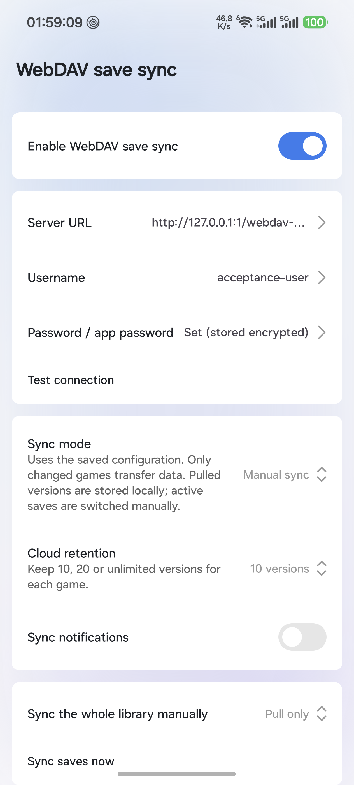 | 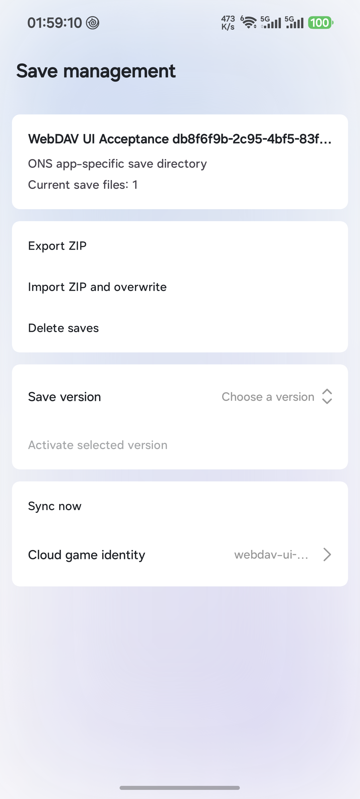 |
| 默认深色 | 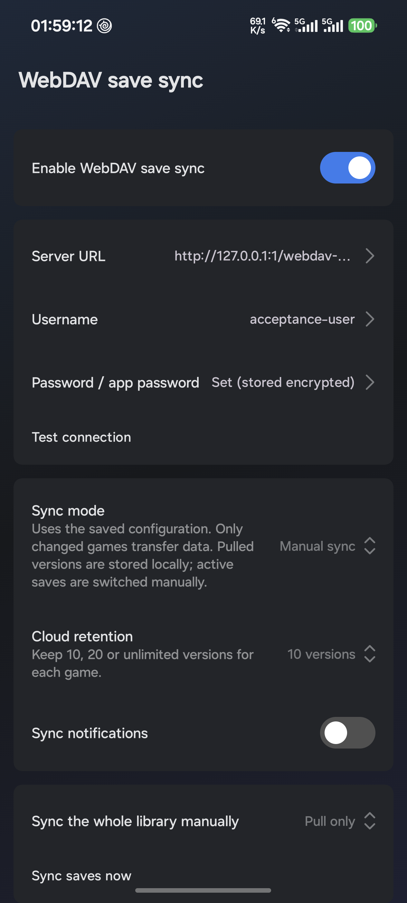 | 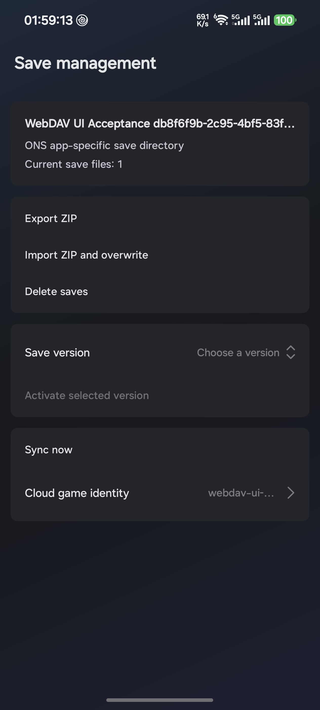 |
| 复古玻璃 | 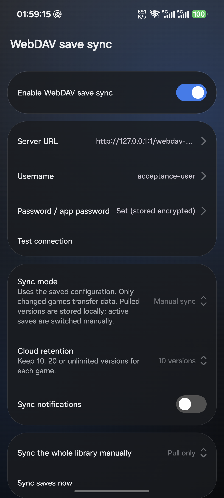 | 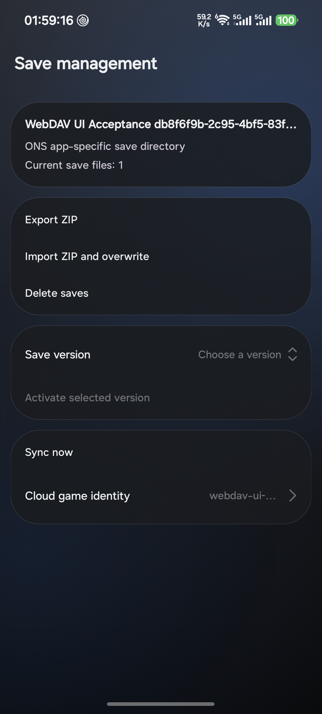 |
| 高级玻璃 | 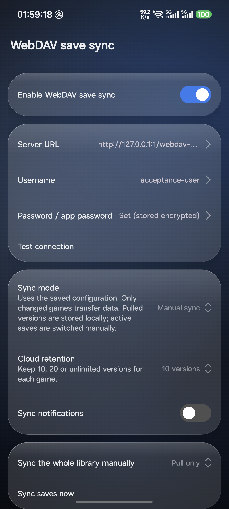 | 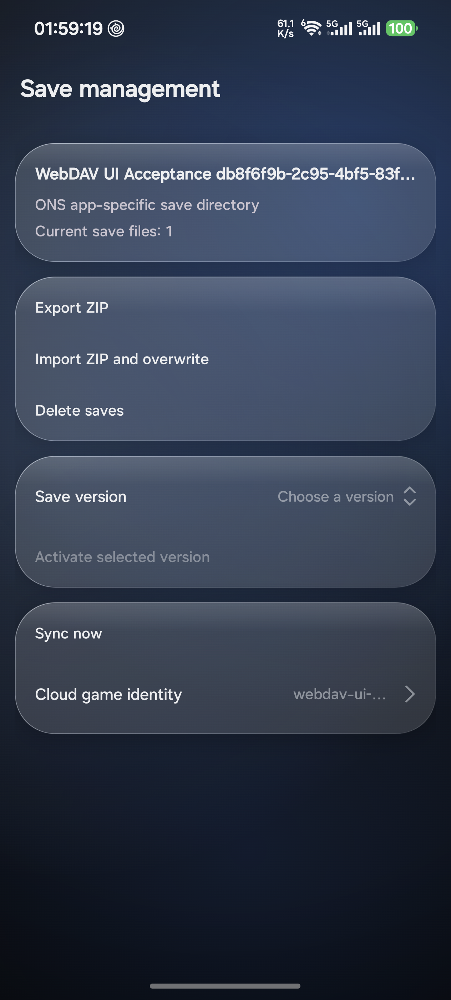 |

| 场景 | 截图 |
| --- | --- |
| 版本下拉展开 | 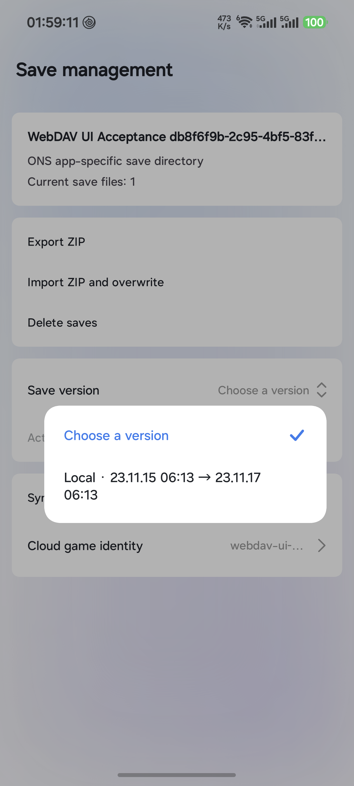 |
| S→N 切换确认 | 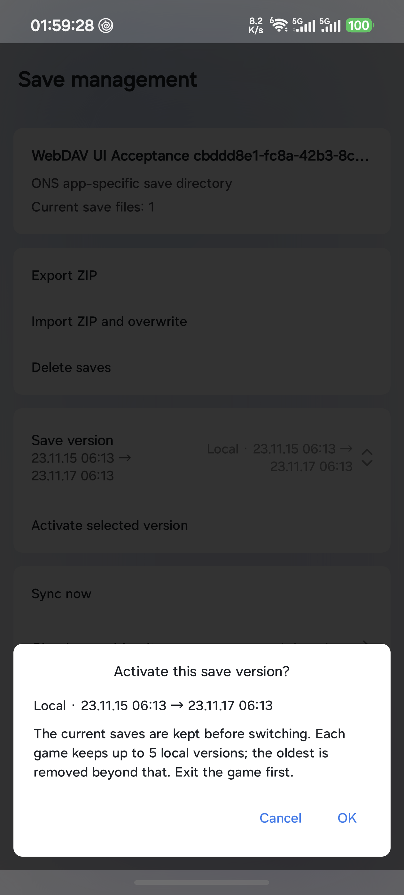 |
| 真实 2 倍字体、横屏、正文滚动后 | 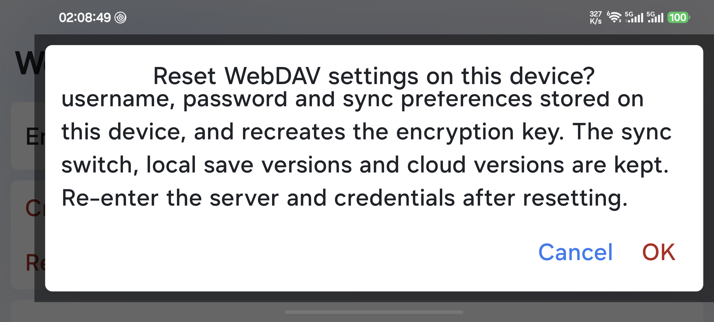 |
| 宽屏模拟：WebDAV 设置 | 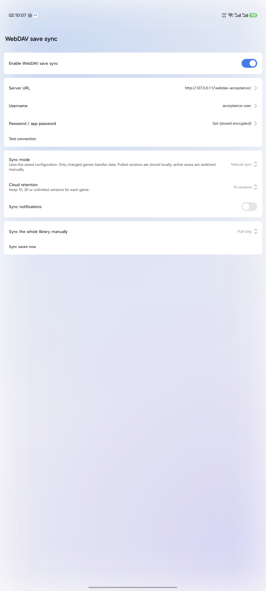 |
| 宽屏模拟：存档管理 | 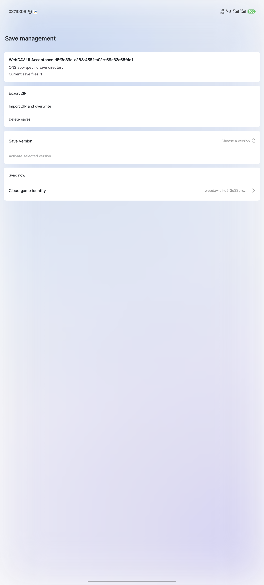 |
| API 26：WebDAV 设置 | 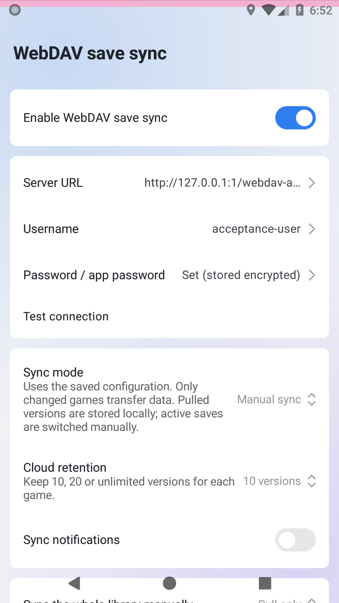 |
| API 26：存档管理 | 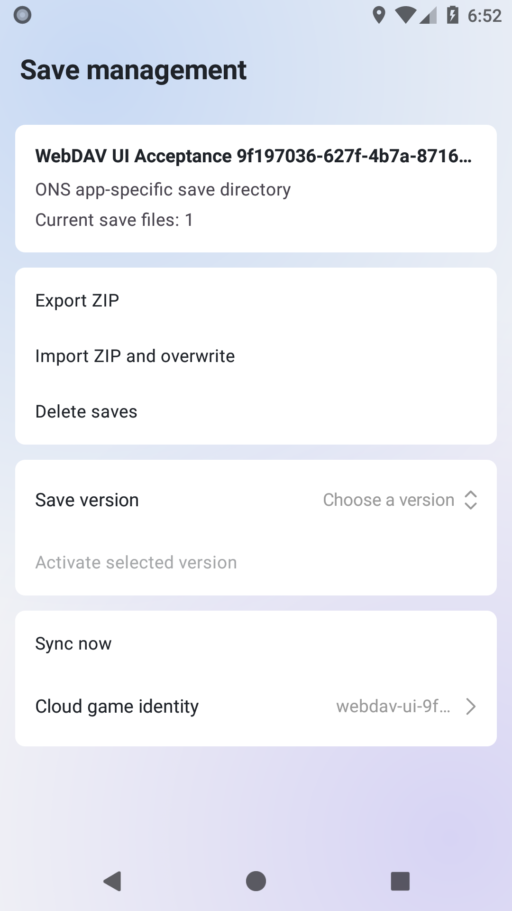 |
| 真机 TalkBack：密码角色与字段 label 的实际语音输出字幕 | 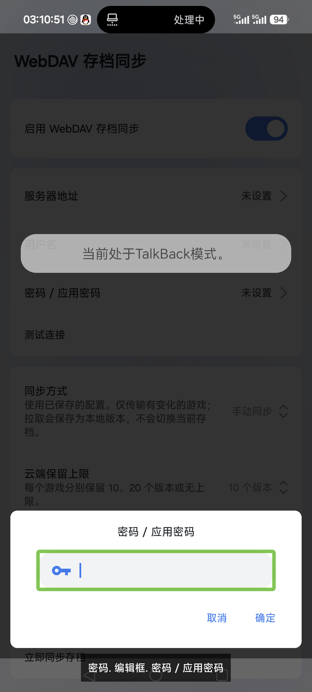 |

## 复现入口

不要用已经包含个人配置或游戏库的包执行。准备新的专用安装：

```powershell
.\gradlew.bat :app:assembleDebug :app:assembleDebugAndroidTest --no-daemon `
  -PwebdavDeviceProbe=true `
  -PTYRANOR_APPLICATION_ID=com.tyranor.next.webdavacceptance20261027

adb -s $device install -r app/build/outputs/apk/debug/app-debug.apk
adb -s $device install -r app/build/outputs/apk/androidTest/debug/app-debug-androidTest.apk

adb -s $device shell am instrument -w -r `
  -e webdav_device_acceptance true `
  -e class com.tyranor.next.core.game.save.sync.SaveSyncDeviceTest,com.tyranor.next.core.game.save.SaveRecoveryDeviceTest `
  com.tyranor.next.webdavacceptance20261027.test/androidx.test.runner.AndroidJUnitRunner
```

UI 类为 `com.tyranor.next.ui.save.WebDavUiDeviceTest`，截图输出到专用包的
`getExternalFilesDir("webdav-acceptance-evidence")/<run>/`。`webdav_run` 显式指定运行目录，
省略则每个测试实例使用新 UUID，避免混入旧截图。切换 profile 前先导出图片并清理该专用包；
不要清理正式包或用户既有的测试包。`webdav_evidence_profile` 参数用于区分截图文件名。

2 倍字体专项方法为 `longResetPolicyDialogScrollsAtTwiceFontInLandscape`。
驱动端必须先保存原 `settings get system font_scale`，在 `try` 中设为 2.0 并执行专项，
在 `finally` 恢复原值；原值为 `null` 时删除覆盖值而不是写入字符串 `null`。恢复后重新读取确认。
宽屏 profile 同理先读取 `wm density`，临时设为 240，结束后恢复原 override 或执行 `wm density reset`。

API 26/27 构建在上述命令中再加入 `-PwebdavFrameworkProbe=true`；只执行本文三个专项类，
不要执行要求真实 JNI/VM/GPU 的 Ethornell 测试。

独立服务用例另需安装 `WsgiDAV==4.4.0` 与 `cheroot==11.1.2`，配置 `host=127.0.0.1`、
`port=18763`、全新短路径 `provider_mapping`，`simple_dc.user_mapping["*"]` 配置合成
`acceptance` / `synthetic-only`，关闭 digest、启用 Basic。两个设备设置上述 adb reverse，
同时执行 `IndependentWebDavDeviceTest` 并传入相同的：
`webdav_device_acceptance=true`、`webdav_independent_server=true`、
`webdav_run=<32 位十六进制 UUID>`、`webdav_epoch=<当前毫秒时间>`，
以及分别为 `phone` / `emulator` 的 `webdav_role`。使用新 run ID，不能复用前一轮远端历史。
服务目录和日志保留在本地构建输出，不提交账号配置或游戏数据。完成后移除 reverse、停止服务与模拟器。

## 未被本记录覆盖

外部 WebDAV 提供商、双实体设备并发、实体平板，以及合法真实游戏在
Siglus/FVP/Framebuffer/ONS 等运行库中的保存/读取兼容性，
均不在本次通过声明内。密码语义断言、合成资源恢复、宿主辅助 Activity 和 Release 构建
不能代替这些项目的验收。现有手机可读的游戏库仅有 KRKR 样本，没有以不匹配的游戏
冒充这些引擎的真实样本，也未修改原游戏或原存档。
