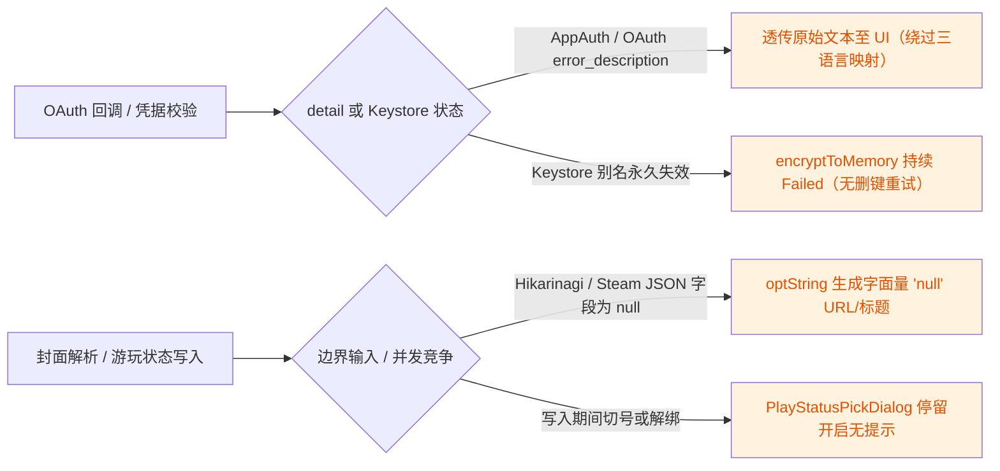

# `codex/bangumi-vndb-play-status` 分支审计报告（2026-11-15）

- **审计对象**：`codex/bangumi-vndb-play-status`（HEAD `79a4160e`，基线 `origin/main` `709687a3`），共 84 个变更文件、`+14570 / -661` 行（提交范围 `c122d821..79a4160e`）。
- **审计基准**：[AGENTS.md](../AGENTS.md)、[CONTEXT.md](../CONTEXT.md)、[ARCHITECTURE.md](../ARCHITECTURE.md)、[SPEC.md](../SPEC.md)。
- **审计方式**：按 `AGENTS.md` 强制要求，分派 5 个相互独立的审查子 Agent（代码逻辑、架构、代码健壮性、回归风险、代码与 UI 规范）逐文件实证审查，主 Agent 交叉核对关键代码行并执行本地静态检查、单元测试与 Lint。

> 注：工作区既有未跟踪文件 `docs/play-status-audit-20261114.md` 对应重整提交前基线（`a4f4280c..HEAD`）。当时列出的 4 项高严重度问题（`CredentialTokenDialog` 缺 `dismissEnabled`、`BangumiAuthService`/`HikarinagiAuthService` 快路径未检 `needsReauth`、`NextMoeAuthService` 环回启动竞态、`AndroidManifest.xml` 启动别名 `label` 写死）在当前 HEAD `79a4160e` 中均已修复；本报告基于当前分支重整后的完整状态重新独立审计。

---

## 一、已执行验证

- `python tools/check-hardcoded-ui-strings.py` → **通过**（zh / en / ja 三语言各 1154 个键完全对齐，Kotlin 无硬编码 CJK 文案）。
- `python tools/check-motion-boundaries.py` → **通过**（366 个 Kotlin 文件，0 违规）。
- `python tools/test-hardcoded-ui-strings.py`（5 用例）& `python tools/test_motion_boundaries.py`（11 用例）→ **通过**。
- `./gradlew.bat :app:testDebugUnitTest --tests "com.tyranor.next.core.auth.*" --tests "com.tyranor.next.core.cover.*" --tests "com.tyranor.next.core.status.*" --tests "com.tyranor.next.core.net.*" --tests "com.tyranor.next.core.backup.*" --tests "com.tyranor.next.core.game.scan.*" --tests "com.tyranor.next.ui.auth.*" --tests "com.tyranor.next.ui.cover.*" --tests "com.tyranor.next.ui.game.PlayStatus*" --no-daemon` → **通过**（382 用例，0 失败，0 跳过）。
- 全量 `./gradlew.bat :app:testDebugUnitTest --no-daemon` → 1761 用例中 31 个失败、18 个跳过；失败全部集中于既有 `RuffleRuntimeEnvironmentTest`、`EthornellOperationGateTest`、`LaunchEntryPathTest`、`EthornellSaveStoreTest`、`EthornellSettingsTest`（Windows 宿主符号链接/权限与路径环境差异，非本分支改动引入）。
- `./gradlew.bat :app:lintDebug --no-daemon` + `python tools/check-lint-diff.py --base origin/main app/build/reports/lint-results-debug.xml` → `Lint errors in reports: 1. Errors on changed sources: 0.`（唯一 Error 为本机 `local.properties:1` Windows 反斜杠 `[PropertyEscape]`，变更文件无新增 Error 或 `[StaticFieldLeak]`）。
- **未执行项**：真机设备 Room v3→v6 迁移、真实浏览器 OAuth 回调闭环、360dp 窄屏设备及多语言实际 Compose UI 渲染实测、`:engine` 相关检查（本分支未改动 `engine/`）。

---

## 二、结论摘要

**当前结论：无阻断（Blocker / High）级缺陷，可作为功能候选分支，但存在 8 项中严重度（Medium）与多项低严重度（Low）/单测缺口问题，建议合入前优先修复中严重度问题。**

- 三层架构（`ui -> core -> engine` 与 `core/net` 中性边界）、Room v3→v6 迁移与 schema 导出、OAuth PKCE S256 与环回监听并发锁、Keystore 加密与备份排除、`CancellationException` 传播及核心 UI 动效/组件规范整体实现扎实。
- 主要风险集中于：**部分封面来源仍残留 `optString` `"null"` 强转**、**Keystore 永久失效别名无自愈重建**、**OAuth 失败路径将底层英文/未本地化 `detail` 透传至 UI**、**Hikarinagi ID Token 省略时的 nonce 跳过**、**并发写放弃乐观更新后弹窗未关闭**，以及 **UI 规范细节（`needsReauth` 兜底提示误配、窄屏折行截断、绑定弹窗布局权重/空搜抖动）与持久化文档滞后**。

---

## 三、问题清单总览

| No. | 级别 | 维度 | 问题摘要 | 位置 |
|---|---|---|---|---|
| 1 | 中 | 健壮性 | `HikarinagiCoverSource` 与 `SteamCoverSource` 漏防 `optString` `"null"` 强转 | `CoverScraperService.kt:389,405-411,448,460` |
| 2 | 中 | 健壮性 | `SecureAuthStore.encryptToMemory` 在 Keystore 密钥永久失效时无删键自愈 | `SecureAuthStore.kt:158-170,189-204` |
| 3 | 中 | 架构 | OAuth 失败路径把底层异常 `message` 与 `error_description` 透传给 UI，绕过三语言本地化 | `HikarinagiAuthService.kt:179,208`、`NextMoeAuthService.kt:260,278,567,645` 等 |
| 4 | 中 | 逻辑 | `HikarinagiAuthService.validateIdTokenNonceRaw` 在响应省略 `id_token` 时跳过 nonce 校验 | `HikarinagiAuthService.kt:212-218,465-482` |
| 5 | 中 | 逻辑 | `PlayStatusDialog.writeStatus` 在并发写被决策跳过乐观更新时未关停 `PlayStatusPickDialog` | `PlayStatusDialog.kt:461-508` |
| 6 | 中 | UI/逻辑 | `CoverScraperSettingsActivity` Bangumi/NextMoe `needsReauth` 兜底文案误指安全存储，且窄屏 `maxLines = 2` 截断 | `CoverScraperSettingsActivity.kt:526-535,714-721,749-756` |
| 7 | 中 | UI 规范 | `SubjectBindDialog` 缺少 `weight(1f, fill = false)` 与空搜 `shakeOnTrigger`；`CredentialTokenDialog` 眼睛按钮缺 `pressSquish` 与换行保护 | `PlayStatusDialog.kt:956-960,1023-1075`、`CredentialTokenDialog.kt:188-196,248-272` |
| 8 | 中 | 架构/文档 | `docs/应用持久化数据清单.md` 及多处注释/文档与 `79a4160e` 现状漂移 | `docs/应用持久化数据清单.md:3-4,71,235-250`、`AppSettingsStore.kt:138,457` 等 |
| 9–17 | 低 | 综合 | 手工 `vndbId` 覆盖、Hikarinagi 登出/安全存储区分、NextMoe 静默置灰、空白 ID 门控、缓存清理、无效标签 ID、协程取消日志、URL 日志、坏味道与重复代码 | 见第五节 |

---

## 四、重点问题说明（中严重度）

**1.【中】`HikarinagiCoverSource` 与 `SteamCoverSource` 漏防 `JSONObject.optString` 返回字面量 `"null"`**

- **位置与证据**：
  - `app/src/main/java/com/tyranor/next/core/cover/CoverScraperService.kt:389, 405-411`
  - `app/src/main/java/com/tyranor/next/core/cover/CoverScraperService.kt:448, 458-462`
- **现象**：`HikarinagiCoverSource` 在 `:386, 391, 392` 显式用 `if (item.isNull(...))` 防护了 `id`、`subtitle`、`developer`，但遗漏了 `:389` 的 `cover.optString("url", "")`。当服务端返回 `"cover": {"url": null}` 时，`optString` 返回字面量 `"null"`，`resolveHikarinagiImageUrl("null")`（`:405-411`）将其视为相对路径并拼出 `IMAGE_BASE_URL/null`，使 `requireCover && coverUrl.isBlank()`（`:390`）失效。同理，`:448`（`SteamCoverSource.searchCandidates` 的 `item.optString("name", "")`）与 `:460`（`SteamCoverSource.downloadSteamHeader` 的 `?.optString("header_image", "")`）也会在 JSON 显式返回 `null` 时产出 `"null"` 字符串。
- **建议**：统一改用 `core/net/HttpJson.kt:135-136` 已提供的 `optNonBlankString(...)`。

**2.【中】`SecureAuthStore.encryptToMemory` 在 Android Keystore 别名永久失效时无法自愈**

- **位置与证据**：`app/src/main/java/com/tyranor/next/core/auth/SecureAuthStore.kt:158-170, 189-204`
- **现象**：`decryptField`（`:87-99`）在解密失败时保留密文（防止临时解锁期误删），但加密路径 `encryptToMemory`（`:158-170`）在 `secretKey(keyAlias)` 抛出 `UnrecoverableKeyException` 或 `cipher.init(Cipher.ENCRYPT_MODE, ...)` 抛出 `KeyPermanentlyInvalidatedException` / `InvalidKeyException` 时，直接落入 `PendingCipherField.Failed` 而未尝试清理坏死 alias。
- **影响**：一旦某台设备因系统安全状态/生物识别/Keystore 异常导致对应 alias 永久失效，即使用户在设置页重新登录或重贴 token，加密路径也会持续失败并死锁在 `SECURE_STORAGE_ERROR` 状态。
- **建议**：在 `SecureAuthStore.encryptToMemory` 的 `synchronized(this)` 内捕获上述密钥失效异常，调用 `keyStore.deleteEntry(keyAlias)` 后重新生成一次密钥并重试加密，仍失败再返回 `PendingCipherField.Failed`。

**3.【中】OAuth 授权失败回调穿透底层异常 `message` 与未本地化 `error_description` 至 UI**

- **位置与证据**：
  - `app/src/main/java/com/tyranor/next/core/auth/HikarinagiAuthService.kt:179, 208`
  - `app/src/main/java/com/tyranor/next/ui/auth/HikarinagiAuthMessages.kt:31-34`
  - `app/src/main/java/com/tyranor/next/core/auth/NextMoeAuthService.kt:260, 278, 567, 645`
  - `app/src/main/java/com/tyranor/next/ui/auth/NextMoeAuthMessages.kt:27-30`
- **现象**：`HikarinagiAuthService` 将 `exception.errorDescription ?: exception.message`、`tokenException?.errorDescription ?: tokenException?.message` 作为 `detail` 传入回调；`NextMoeAuthService` 将 OAuth 服务端 `error_description` 放入 `NextMoeAuthEvent.detail`。两处 `*AuthMessages.authErrorMessage` 只要 `detail` 非空就直接 `return customDetail`，绕过 `authErrorResource()` 的三语言资源映射。
- **影响**：违反 `AGENTS.md:128-135`「core 不得输出未本地化或底层技术错误文本，文案组装一律上移 UI」约束，用户在中文/日语环境下会直接看到英文异常信息或服务器原始英文描述。
- **建议**：在 `core/auth` 改用 `Log.w` 记录 `errorDescription` / `exception.message`，不再经 `detail` 传给 UI（必要时细化错误码枚举）；`*AuthMessages.authErrorMessage` 统一由 `authErrorResource()` 映射三语言文案。

**4.【中】`HikarinagiAuthService.validateIdTokenNonceRaw` 在响应省略 `id_token` 时跳过 OIDC `nonce` 校验**

- **位置与证据**：`app/src/main/java/com/tyranor/next/core/auth/HikarinagiAuthService.kt:59, 212-218, 465-482`（对照 `NextMoeAuthService.kt:652-654, 908-915`；测试固化于 `HikarinagiNonceValidationTest.kt:18-23`）
- **现象**：`HikarinagiAuthService` 请求包含 `openid` scope（`:59`），由 AppAuth 生成随机 `nonce`；但 `validateIdTokenNonceRaw` 第 468 行写为 `if (idToken.isBlank() || nonce.isBlank()) return null`。若令牌响应省略或剥离 `id_token`，校验会直接放行，弱于同批实现的 `NextMoeAuthService`（`nonce` 非空而 `idToken` 为空时返回 `ID_TOKEN_INVALID_FORMAT`）。
- **建议**：确认 Hikarinagi `/oidc/token` 在 `openid` scope 下必定签发 `id_token` 后，收紧为「`nonce` 非空时 `id_token` 缺失即失败」并同步更新 `HikarinagiNonceValidationTest.kt:18-23`；若服务端确实不返 `id_token`，应移除冗余 `nonce` 校验并在注释说明。

**5.【中】`PlayStatusDialog.writeStatus` 在写入因会话/绑定变更被决策跳过时，未关闭 `PlayStatusPickDialog`**

- **位置与证据**：`app/src/main/java/com/tyranor/next/ui/game/PlayStatusDialog.kt:461-508`
- **现象**：`writeStatus` 在 IO 写入无报错后调用 `evaluatePlayStatusWriteDecision(...)`，仅在 `if (decision.applyOptimisticResult)` 分支中执行乐观更新与 `pickSource = null`（`:506`），缺少 `else` 分支。若请求在途期间用户切号/登出或解绑了目标来源，`decision.applyOptimisticResult` 为 `false`，此时 `writingSource` 已复位为 `null`，但 `pickSource` 仍保持非空且无提示，`PlayStatusPickDialog` 会停留在原界面展示陈旧选中态。
- **建议**：补充 `!decision.applyOptimisticResult` 的 `else` 分支：清零 `pickSource = null` 并通过 `AppNotice` 给出中性提示（如 `play_error_auth_session_changed` 或绑定已失效提示）。

**6.【中】`CoverScraperSettingsActivity` 中 Bangumi/NextMoe `needsReauth` 兜底文案误配，且窄屏 `maxLines = 2` 截断长权限引导**

- **位置与证据**：`app/src/main/java/com/tyranor/next/ui/cover/CoverScraperSettingsActivity.kt:526-535, 714-721, 749-756`
- **现象**：
  1. `sourceSummary`（`:714-721` Bangumi 与 `:749-756` NextMoe）在 `needsReauth == true` 且非 `EXPIRED`、非 `isSecureStorageError` 时，`else` 分支均误写为 `R.string.cover_bangumi_secure_storage_summary` / `R.string.cover_nextmoe_secure_storage_summary`（对比 VNDB 在 `:739` 回落为 `play_error_vndb_token_invalid`）。虽然当前写入方仅存 `EXPIRED` 或安全存储哨兵，但一旦存在历史值或新增错误码就会向用户误报 Android Keystore 故障。
  2. `CoverSourceRow`（`:528-534`）对摘要文本固定 `maxLines = 2, overflow = TextOverflow.Ellipsis`。在 360dp 宽手机（中间列可用宽度约 214dp）及英文/日文语境下，较长的 `play_error_vndb_token_permission`（EN 161 字符）、`cover_nextmoe_summary` 等会被截断，用户看不到完整权限定位与操作步骤。
- **建议**：将 `:720` 与 `:755` 的 `else` 分支改为 `cover_bangumi_reauth_summary` / `cover_nextmoe_reauth_summary`；放宽或取消 `CoverSourceRow` 摘要 `maxLines` 上限（或对错误/权限提示不截断）。

**7.【中】`SubjectBindDialog` 弹窗布局弹性与空搜索抖动缺失；`CredentialTokenDialog` 眼睛图标与三按钮排布待收口**

- **位置与证据**：
  - `app/src/main/java/com/tyranor/next/ui/game/PlayStatusDialog.kt:956-960, 1023-1031, 1042-1075`
  - `app/src/main/java/com/tyranor/next/ui/cover/CredentialTokenDialog.kt:188-196, 248-272`
- **现象**：
  1. `SubjectBindDialog` 将 `ExpandVisibility` 包裹的 `LazyColumn(heightIn(max = 320.dp))` 直接置于弹窗 `Column` 中而未加 `Modifier.weight(1f, fill = false)`，在输入法弹出、高度受限的小屏弹窗内无法随 `textMaxHeight` 弹性让位（对照 `AndroidGameAddDialog.kt:171`）。
  2. `SubjectBindDialog.search()`（`:959`）在输入为空时静默 `return`，未配合 `shakeOnTrigger` 给予拒绝反馈（对照 `AGENTS.md:263` 与 `GameScreen.kt:1397, 1577`）。
  3. `CredentialTokenDialog`（`:188-196`）密码显隐切换 `Box` 仅使用 `padding(6.dp)`（24dp 图标总触控区约 36dp），且未挂 `.pressSquish()`（对照 `EmbeddedSearchInputField.kt:106` 与 `AGENTS.md:264, 548-549`）；底部操作区（`:248-272`）在存在已存凭据时放入 3 个按钮，而 `NoRippleActionText` 无 `maxLines = 1` 约束，在大字体/窄弹窗下存在换行风险。
- **建议**：为 `SubjectBindDialog` 的 `ExpandVisibility` 容器补充 `Modifier.weight(1f, fill = false)`，空查询时触发 `shakeOnTrigger`；为 `CredentialTokenDialog` 显隐按钮补充 `.pressSquish()` 并扩充至 44–48dp 触控区，同时为 3 按钮场景评估横向溢出收口。

**8.【中】`docs/应用持久化数据清单.md` 及部分文档/注释与 `79a4160e` 现状存在漂移**

- **位置与证据**：
  - `docs/应用持久化数据清单.md:3-4`（仍标 `2026-10-26`、`versionName 1.61`，而 `app/build.gradle.kts:48` 已为 `1.65`）
  - `docs/应用持久化数据清单.md:71`（`app_settings.xml` 仍写 `nav_style` 缺失时默认外观=透镜，与 `AppSettingsStore.kt:460-466`、`CONTEXT.md:203`、`SPEC.md:21` 返回 `NAV_STYLE_LIQUID_GLASS` 相悖，且漏列 `appearance_style`、`app_corner_radius`、`home_page_enabled`、`classic_icon_enabled`、`engine_card_icon`、`motion_enhanced`、`vndb_large_cover` 等键）
  - `docs/应用持久化数据清单.md:235-250`（第八节 XML 代码片段漏列已生效的 `engine_plugins/` 与 `engine_runtime/` 排除规则）
  - `docs/应用持久化数据清单.md:287-288, 340-349`（附录速查表漏列 `databases/game_playtime.db`、`shared_prefs/game_playtime_order.xml` 及 `no_backup/save_sync/{workers,external_launches}/*.json`）
  - 代码注释与根文档零星漂移：`AppSettingsStore.kt:138` 仍注释 NextMoe「匿名来源，无需登录」、`:457` `resolveNavStyle` KDoc 仍写默认外观→透镜；`CHANGELOG.md:110`「外观只保留默认与复古玻璃」与同节第 47 行「新增白雾玻璃」矛盾；`README.md:47-76` 引擎表漏列 `Ethornell / BGI`；`AGENTS.md:499-506` `AppSidePanel` 表漏列 `MainScreen.kt:311-320`「引擎模块管理」条目。
- **建议**：同步修订 `docs/应用持久化数据清单.md` 对应章节与版本元信息，并顺带对齐上述注释与文档表项。

---

## 五、其余低严重度（Low）问题与代码坏味道

9. **【低】`CoverScraperService.bindCoverCandidate` 选 NextMoe 封面时可能覆写既有手工 `vndbId`**（`CoverScraperService.kt:226-235`）：`vndbId = candidate.vndbId ?: game.vndbId` 在用户从 NextMoe 选封面（其 `parseWork` 带出关联 `vndbId`）时会覆盖原本手工绑定的 `game.vndbId`，与 `mergeScrapedCover`「已有绑定优先，不静默覆写」策略不完全一致；建议仅无条件写入 `candidate.source` 自身来源 ID，其余来源保留 `game.<id>?.takeIf { it.isNotBlank() } ?: candidate.<id>`。
10. **【低】`CoverScraperSettingsActivity` 中 Hikarinagi 处于 `needsReauth` 时缺清空/登出按钮且摘要未区分 `isSecureStorageError`**（`CoverScraperSettingsActivity.kt:551-567, 708-713`）：对比 NextMoe 在 `authorized && needsReauth` 时保留「清除/登出」入口，Hikarinagi 仅剩「授权」按钮，无法在设置页直接清理失效凭证；且 `:709` 未分支区分 `authStatus.isSecureStorageError`。
11. **【低】`PlayStatusPickDialog` 对 NextMoe 读取中/失败场景静默置灰全部分类选项**（`PlayStatusDialog.kt:661`）：`optionsEnabled` 为 `false` 时 5 个状态条目直接 `alpha = 0.4f` 不可点，弹窗内无原因说明或重试动作，建议改为展示加载/错误提示+重试，或限制父行仅在读成功后弹出。
12. **【低】`GameActionsSheet` 逐源门控与删游缓存清理边缘情况**（`GameScreen.kt:353-374, 849-868`）：`LaunchedEffect` 逐源授权门用 `?.let` 而非 `?.takeIf { it.isNotBlank() }`，若某字段为空白字符串会多余读取 Keystore；`cleanupDeletedGame` 未调用 `PlayStatusSummaryCache.invalidate(target.uri)`，同路径 5 分钟内重扫/重建会命中旧摘要缓存。
13. **【低】`parseVndbUlistStatus` 未过滤非正数标签 ID**（`PlayStatusService.kt:138-142`）：`labels.optJSONObject(it)?.optInt("id")` 在 `"id": null` 或缺失时返回 `0` 写入 `labelIds`（当前靠 UI 只遍历 `VndbLabels.ALL` 1..4 兜底），建议改 `.optInt("id", -1)?.takeIf { id -> id > 0 }`。
14. **【低】`GameLibraryRepository.schedulePrefsMirror` 吞掉 `CancellationException` 并打错误日志**（`GameLibraryRepository.kt:333-343`）：防抖取消在 `writePrefsMirror` 挂起点期间触发时会被 `runCatching` 捕获并打印 `Log.e("Prefs mirror write failed")`，建议显式重抛 `CancellationException`。
15. **【低】`HttpJson.kt:77` 警告日志输出完整 `url`**：当前 OAuth 密钥与 token 均位于 POST body / `Authorization` header，未出现在 URL query 中；作纵深防御建议脱敏 query 参数后再记日志。
16. **【低】重复代码、未使用 import 与小坏味道**：
    - 未使用 import（5 处）：`CredentialTokenDialog.kt:22`、`GameScreen.kt:166`、`HikarinagiAuthService.kt:23`、`NextMoeAuthService.kt:23`、`ScanGame.kt:4`；
    - 重复逻辑：`HikarinagiAuthService.kt:465-482` 与 `NextMoeAuthService.kt:908-926` 重复实现 JWT `nonce` 校验，`Bangumi/Hikarinagi/NextMoeAuthService` 重复实现 `HttpURLConnection` 表单刷新请求；
    - 一致性与注释：`PlayStatusDialog.kt:838` 绕过 `CoverSourceUi` 获取 NextMoe 标题、`:991` 保留旧 `Toast` 注释；`GameScreen.kt:1787` `CoverCandidateCard` 命中 Lint `[ModifierParameter]` 警告；
    - 旋转/生命周期体验：`CoverScraperSettingsActivity.kt:138-139` 用 `remember` 保存 token 弹窗开关（旋转后弹窗消失）；`Bangumi/HikarinagiOAuthCallbackActivity` 无 `configChanges`，换码期间旋转会销毁重开再立即 `finish()`。

---

## 六、单元测试覆盖缺口

核查 `app/src/test/` 下全部 22 个相关测试文件后，以下行为尚无 JVM 回归覆盖：

1. **Room `MIGRATION_4_5` 与 `MIGRATION_5_6`**：`GameLibraryDatabase` 从 v3→v4→v5→v6 的表结构迁移及 `GameEntity.from()` / `toModel()` 对 `hikarinagiId` / `nextmoeId` 的往返测试缺失（当前仅测了 `GameRecordCodecTest` 文本编解码）。
2. **`NextMoeCoverService` 异常与回退路径**：`NextMoeCoverServiceTest` 仅覆盖 HTTP 200；缺少 `fetchBestCover`（`ids` 优先 + 回退搜索）、`requestJson` 401 携带令牌后匿名回退且不置 `needsReauth`、HTTP 429 / `RATE_LIMITED` / `QUOTA_EXCEEDED`、以及 `listCovers` 与 `requestWorks` 对 404 的差异处理。
3. **`CoverScraperService.bindCoverCandidate` 与 `HikarinagiCoverSource`**：缺少手工选封面保持其他源绑定、NextMoe 二级选图保留父 `nextmoeId`、Hikarinagi 401/429 分级测试。
4. **`PlayStatusService` HTTP 副作用矩阵**：缺少 `bangumiRequest` 401 置 `needsReauth` vs 403 不置位、`read*Status` 403 写入 `permission_error` vs `write*Status` 不回写授权态、以及 `writeNextMoeStatus` 保留/剥离 `completion` 的端到端请求体校验。
5. **`NextMoeAuthService` 环回边界与 Bangumi 代次校验**：缺少超过 `MAX_IGNORED_LOOPBACK_REQUESTS`（32）、请求行超 16KB 返回 431、新旧 `flowId` 竞争关闭 socket、以及 `BangumiAuthService.completeOAuthTokenExchange` 拒绝过期 `expectedGeneration` 的测试。
6. **UI 映射与个人令牌生命周期**：缺少 `BangumiAuthMessages`、`NextMoeAuthMessages`、`CoverErrorMessages`、`PlayStatusMessages` 与 `CoverScraperSettingsActivity.sourceSummary` 单测（若覆盖可提前拦截第 6 项 `else` 分支错误）；缺少 Bangumi 个人令牌（`expiresAt == 0L`, `refreshToken == ""`）在 401 后 `needsReauth` 短路不删 token 的单测。

---

## 七、已核验通过的关键规范与功能

- **三层架构与错误协议**：`core/` 无 Compose/UI 依赖，`core/net/` 无任何业务域依赖，`ui/` 无底层引擎包引用；除第 3 项 OAuth `detail` 外，`CoverScraperService`、`PlayStatusService` 与核心 Auth 接口均遵守类型化错误码协议，协程挂起点均正确重抛 `CancellationException`，无跨层魔法哨兵字符串泄漏。
- **OAuth 安全与凭据存储**：NextMoe `127.0.0.1:0` 环回绑定 + PKCE S256 + 常量时间 `state` 校验（先验 `state` 再判 `error`）+ HTML 转义 + 16KB/4MB 请求体上限；`BangumiAuthStore` / `HikarinagiAuthStore` / `NextMoeAuthStore` / `VndbAuthStore` 均持有 `storeLock` 并发防护、单 editor 批量写与 `credentialEpoch` / `sessionEpoch` 防覆盖，4 个 `*_auth_secure.xml` 与 `game_library.db*` 均已纳入云备份/换机排除规则。
- **Room 与游玩状态主链路**：`GameLibraryDatabase` v3→v6 迁移与 `app/schemas/` JSON 定义完全一致，`GameRecordCodec` 兼容旧版 3~15 字段且重扫/改名保留多源绑定；`SingleFlightRefresh`、Bangumi 只写乐观更新、VNDB/Hikarinagi/NextMoe 读后写与 `PlayStatusSummaryCache`（结构化 `CacheKey` + `invalidationGenerations` + locale/epoch 键控）主链路成立。
- **UI 核心规范**：`AppSecondaryTopBar`、`AppAlertDialog` + `DialogTextButton` + `NoIndication`、`AppSearchField`（密码掩码 + 密码键盘 + `ContentType.Password`）、Miuix `Switch`/`SwitchPreference`、两档文字尺寸（`titleMedium`/`bodyMedium`，含 `AppNavItem` 既有 `bodySmall` 例外）、动态色彩常量（`NavWhite`/`DialogItemSurface`/`PageTextColor`）、`AppNotice` 与 `collectSettingAsState()` 均符合 `AGENTS.md` 要求。
