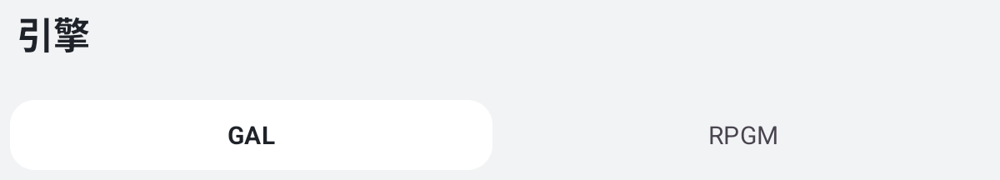
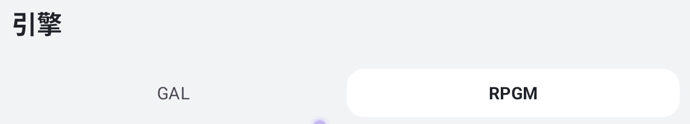

# 平板横竖屏：状态恢复与覆盖范围

在 API 36 Pixel Tablet 模拟器（320 dpi，横屏 2560 × 1600、竖屏 1600 × 2560）上，分别检查横竖布局，并在操作中实际旋转显示。下面区分移植前的旧包、修正后的中间包和该轮最终 release。静止截图可核对布局，不能证明草稿在旋转中保留。

## 引擎分类：同一次操作的前后对照

在竖屏点选 RPGM，再转为横屏。旧包回到默认 GAL；修正后的 release 保持 RPGM。两图取自各自横屏结果的相同区域，只保留应用标题、分类和选中指示器。

| 修正前：GAL 被选中 | 修正后：RPGM 仍选中 |
| --- | --- |
|  |  |

最终 release 也在同一进程内从横屏转竖屏：添加游戏弹窗和色调轮盘仍打开，旧包在相同步骤回到了父页面。轮盘只验证保持打开，没有核证具体色值。普通档竖屏下，“妙妙工具”的标题及五个入口的边界与基线一致。横竖屏均另有游戏→引擎→游戏、游戏抽屉和应用设置进退的操作记录。

## 有交互断言的场景

| 场景 | 实际验证 | 边界 |
| --- | --- | --- |
| 单游戏设置 | 用有效游戏参数进入 ONS 设置，横竖屏均核对标题、保存按钮及引擎控件 | 不代表所有引擎设置和字体选择器 |
| 手柄映射和新建方案 | 未确认的按键集合（含空集）与保持开关随旋转恢复；区分清空与取消。新建方案名称草稿单项复跑通过 | 不验证实际手柄硬件 |
| Web 首页地址 | 在生产设置页编辑地址，竖→横→竖仍保留草稿；取消后已存地址未改 | 未连接外站 |
| 图标裁剪 | 用三色图平移，中心像素从绿变蓝，旋转后仍蓝；正方形预览和操作按钮均可见。此前蓝色断言曾失败 | 在真实窗口挂生产裁剪弹窗，未发布桌面快捷方式 |
| 添加游戏 | PC 目录重读后仍是所选 EXE；Android 应用列表加载失败再重试，保留查询和有效选择 | 两项为组件恢复用例；父弹窗另有真实旋转记录 |
| 图形与输入布局 | 滤镜分类按实际宽度布局，旋转后仍选原分类；双栏可分别滚动，取消未改变设置 | 参数滑条和重排取消未逐项验收 |
| 存档、同步与封包 | 取消删除后原文件字节未变；取消 WebDAV 地址编辑未写入；封包模式及压缩等级经旋转保留，未选目录不能提交 | 未实际同步、恢复或生成归档 |
| 补丁搜索 | 早期专项在离线数据上验证搜索草稿旋转；后续受影响组因前提不满足跳过该项 | 未验证线上索引、下载及安装 |

代表用例在 `MotionTabletPagesDeviceTest`。前三类页面使用生产 Activity；旋转通过 UiAutomation 并核对实际窗口宽高。弹窗边界和添加游戏恢复另有 `TabletOverlayBoundsDeviceTest`、`AddGameRestorationDeviceTest`。

## 怎么读样本数

- 通用 instrumentation 在横屏、竖屏各为 **43/43**，是同一组用例分方向执行。专项首轮 **16/17**，仅新建输入方案草稿超时；修正测试定位后该项单独通过。不能记成一次 17/17。
- 同轮手机最终包 **56/56**，不计入平板样本。另一轮平板失败与复测另见[最后一轮复核](motion-v2-abstraction-back.md)。
- 18 个基线检查点各有普通/增强 × 横/竖四组截图与窗口记录，涵盖首页、游戏、引擎两类、设置、弹窗、菜单、目录、色轮及提示。资料齐全不等于每项完成交互，更不等于旋转时保持了状态。

长列表和多选、WebView 网络错误重试、引导中途旋转、各引擎字体、封面授权、真实同步和模块启停尚无逐项横竖屏验收。模拟器不能证明实体平板振感、系统选择器或原生游戏窗口表现；性能数字另见[手机 release 对照](motion-v2-tablet-perf-20261111.md)。
