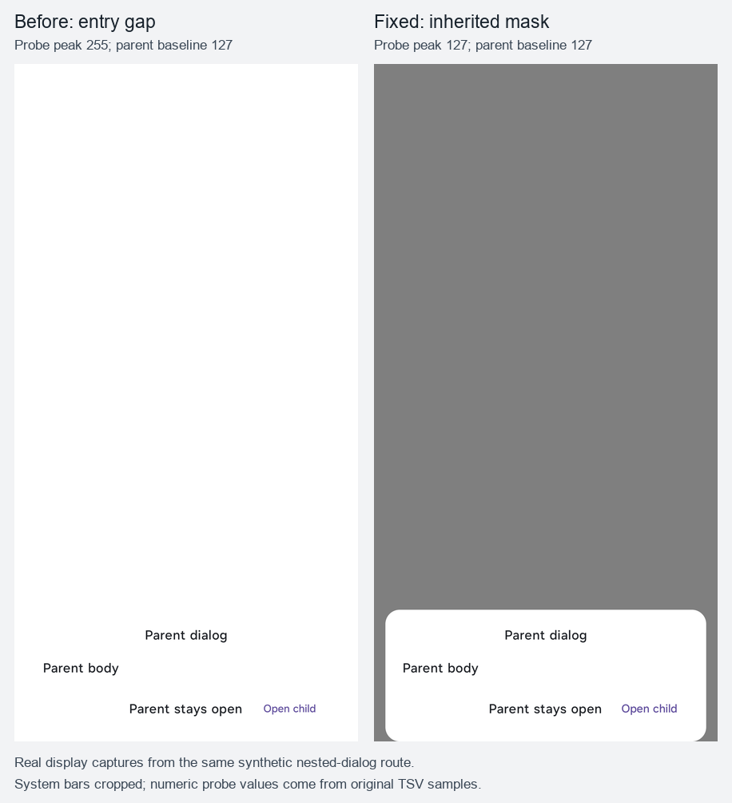
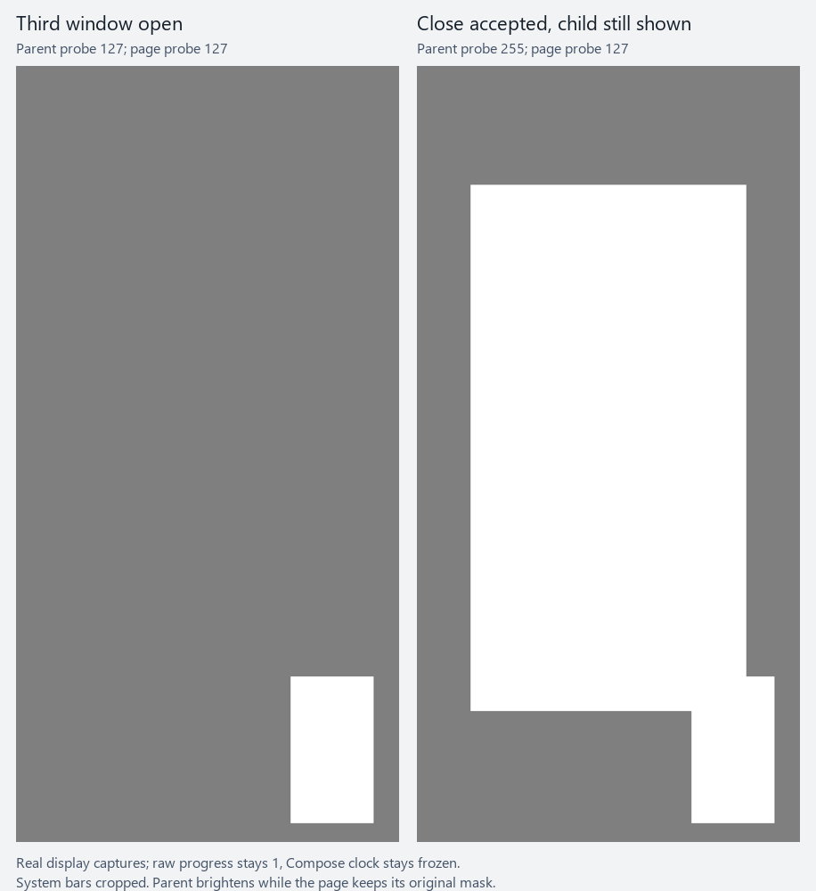

# PR #162：最终遮罩实现的真机复验

用户在暂停设备操作后重新授权真机验证，并进一步要求三级窗口开始关闭时立即恢复二级面板亮度。本记录对应 `79edea3924916377a15966d768f04136514d1c91` 的维护者整改，以及本记录所在提交的即时遮罩交还补丁。SystemNNN 启动结果仍按用户要求排除。

设备为 HONOR PPG_AN00、API 37，使用隔离包 `com.tyranor.next.motionv2`。正式包、真实游戏文件均未操作；模拟器未参与本轮验收。

## 构建与身份

| 产物 | SHA-256 |
|---|---|
| debug 应用 | `bffeac32adb2036f1da7edcbd3946ea99acb7aceb93b98cb96b2d22d94ff83d6` |
| androidTest | `f8797d15a6b66fd3b76fb1252da2008ec9ed97ec356943644730c9dc47a7a6e7` |
| release 应用 | `e6b3a89328523239507ec3bc75fe70be0d5f5b7926b8c77601ade92266892ea0` |

debug 与 androidTest 分别安装后运行 instrumentation，不能把 debug 测试写成 release 自动化结果。最终冻结后构建命令：

```powershell
$env:TYRANOR_APPLICATION_ID = 'com.tyranor.next.motionv2'
./gradlew.bat :app:assembleDebug :app:assembleDebugAndroidTest :app:testDebugUnitTest --tests 'com.tyranor.next.ui.*' :app:assembleRelease :app:lintDebug --offline --no-daemon --max-workers=4 --console=plain
```

结果为 `BUILD SUCCESSFUL`，29 类、194 项 UI JVM 全通过，0 失败/错误/跳过；其中遮罩协调回归从 8 项增加至 15 项。release/R8、`compileReleaseArtProfile` 均成功；app lint 0 错误、402 个警告、10 个 hint，不宣称零警告。离线动效边界为 347 个 Kotlin 文件、0 违规，检查器回归 11/11，字符串检查与 diff 检查通过。

## 竖屏设备测试

执行命令（`<device-serial>` 为本轮专用真机）：

```powershell
$classes = 'com.tyranor.next.ui.common.motion.ClosingWindowScrimDeviceTest,com.tyranor.next.ui.common.motion.NestedWindowScrimDeviceTest,com.tyranor.next.ui.common.motion.DialogWindowDimDeviceTest,com.tyranor.next.ui.engine.EnginePageInteractionDeviceTest,com.tyranor.next.ui.game.MotionCoverSearchDialogDeviceTest,com.tyranor.next.ui.game.MotionCropDialogDeviceTest,com.tyranor.next.ui.common.MotionDialogDeviceTest,com.tyranor.next.ui.common.MotionLifecycleDeviceTest,com.tyranor.next.ui.game.MotionGameInteractionsDeviceTest,com.tyranor.next.ui.common.AppBottomSheetDeviceTest'
adb -s <device-serial> shell am instrument -w -r -e class $classes -e motion_device_acceptance true -e motion_target_package com.tyranor.next.motionv2 com.tyranor.next.motionv2.test/androidx.test.runner.AndroidJUnitRunner
```

结果：`OK (40 tests)`，298.781 秒，0 失败。包含 2 项关闭时机双探针、12 项屏幕遮罩、2 项真实 Window dim、1 项引擎切页输入、4 项封面搜索、2 项裁剪、2 项弹窗、7 项生命周期、4 项游戏 UI 交互和 4 项抽屉测试。

前期两条搜索成功用例使用了旧的 `dimAmount > 0` 前提。共享抽屉已自绘足额遮罩时，搜索窗口的 native dim 为 0 是合法结果，因此改为检查窗口仍有 `FLAG_DIM_BEHIND` 协调资格；绑定前的 attached/可触摸断言，以及回调中同一 Window 的 attached/已释放断言均保留。

关闭时机的新专项首次试跑有 5 项失败：2 项是父面板 tag 位于公共 scrim 合并语义下，改用 unmerged 语义树定位，实际窗口与像素断言不变；另 3 项确实暴露普通取消按钮未先撤回 dim 的产品遗漏，已修复公共按钮路径。上述失败均保留本地日志，不计为通过；最终包完整 40 项重跑通过。

另以不匹配的 `motion_target_package` 运行负控，门禁按预期明确失败，未进入 UI；此负控不计入上述功能测试数。

## 横屏设备测试

自动旋转仍锁定为 0，只将 `user_rotation` 临时设为 1，实际截图为 2800×1264。保留相同两个门禁参数，执行以下四类：

```powershell
$classes = 'com.tyranor.next.ui.common.motion.ClosingWindowScrimDeviceTest,com.tyranor.next.ui.common.motion.NestedWindowScrimDeviceTest,com.tyranor.next.ui.common.AppBottomSheetDeviceTest,com.tyranor.next.ui.engine.EnginePageInteractionDeviceTest'
adb -s <device-serial> shell am instrument -w -r -e class $classes -e motion_device_acceptance true -e motion_target_package com.tyranor.next.motionv2 com.tyranor.next.motionv2.test/androidx.test.runner.AndroidJUnitRunner
```

结果：`OK (19 tests)`，282.575 秒，0 失败。与竖屏合计 59 次实际用例执行，不将先前中间包或失败试跑重复计入。

## 屏幕像素判据

用例使用 `UiAutomation.takeScreenshot()` 获取系统实际合成的显示内容，包含 WMS dim；不是 Compose `captureToImage()`。白底正控与父遮罩基线先通过检查，再以真实屏幕触摸打开子层，通过取消或 BACK 关闭，最后复开并检查父子 Window 释放与白底恢复。

每项对入场、稳态、退场和窗口移除采集 155 个显示样本，同时约束不能比父基线更亮或更暗超过 8/255。竖屏 12 项共 1,860 个样本，实际最小值与最大值均等于各自父基线：

| 父窗口 | 档位 | 取消 / BACK 的基线、最小、最大亮度 |
|---|---|---|
| dialog | 增强 | `127 / 127 / 127` |
| dialog | 普通 | `51 / 51 / 51` |
| sheet | 增强、普通 | `173 / 173 / 173` |
| side-panel | 增强 | `127 / 127 / 127` |
| side-panel | 普通 | `51 / 51 / 51` |

普通弹窗的 51 是设备当前主题原有 native 与自绘遮罩的组合基线，不把不同父类型的暗度强行改成相同值；验收约束是打开二层后保持该父基线。

横屏同样 12 项、1,860 个样本，父基线与竖屏一致；除增强 dialog BACK 的最小值为 124、最大值为 127 外，其余最小/最大均等于基线。该例偏暗 3/255，在既定双向 8/255 容差内，未出现比基线更亮的样本；不把横屏结果写成每个像素值完全不变。横竖屏合计 3,720 个受测显示样本。



图中是遮罩基础修复时同一合成嵌套弹窗路线的真实屏幕截图，系统栏已裁除。旧实现负对照从父基线 127 变亮至 255；基础修复保持 127。本次即时交还的实际图在下一节单列。数字来自原始 TSV，图片只作说明；不包含用户录像、用户媒体或应用私有数据。

这些采样可检查采到的显示帧，不能宣称覆盖每个物理 vsync，也不能据此推导帧率提升。实际应用的 release 操作另行记录，不把合成夹具当作真实游戏兼容性。

## 不等待退场的双探针验证

`ClosingWindowScrimDeviceTest` 使用公共 `DialogWindowScrim`、真实父/子 Dialog，以及父面板内和底层页面上的两个白色探针。子窗口完全展开后，冻结 Compose 时钟并保持 raw progress=1，调用公共接受关闭入口；子窗口必须仍在组合内、attached 且 shown，不能靠移除或动画渐隐通过检查。

横竖屏实际结果一致：增强档父面板探针从 127 恢复至 255，页面探针保持 127；普通档父面板从 102 恢复至 255，页面保持 51。关闭前后 Compose 时间均为 96ms。raw 随后更新为 0.75 时遮罩仍未复活；明确重开后，同一子窗口重新压暗父面板。测试等待平台合成提交，不把“立即”解释为无需 WMS/SurfaceFlinger 提交，也不声称测得 0ms 物理延迟。



退出锁存保留 raw/full 请求与实际窗口排序，detach 后重挂也继承 released。单窗口保持原渐隐；普通取消按钮同步先撤回遮罩再交付动作；finally 只清理输入，不重新启用遮罩。抽屉收起只交接遮罩，保留抓回和点击接回；普通档监听实际 target，关闭守卫的预检查不改变遮罩。两名独立子 Agent 复核了本轮退出实现，其中发现并修正了 ordinary sheet 预检提前释放的问题。

## release 实际界面与恢复

全部 instrumentation 结束后 force-stop 隔离包，恢复验证前的 shared_prefs 与 databases，20 个文件的内容 SHA-256 与原备份逐一相同；恢复自动旋转/用户旋转为 `0/0`。随后安装上表最终 release，反向拉取手机 `base.apk`，确认 SHA-256 与本地 release 一致，并执行 `cmd package compile -m speed -f` 成功。

在默认外观、浅色、增强档检查了实际游戏长按管理 → 删除确认 → 取消 → 再开确认 → BACK，父面板恢复后仍可操作；未确认删除、未启动真实游戏。12 秒原速录屏完整结束后拉取，已实际抽帧核对，并用 ffmpeg 全解码；保留微秒输出 timebase 后退出 0、无解码错误。另验证设置 → 应用设置 → 返回设置、左缘系统返回打开妙妙工具 → BACK 关闭。最后保留修复后的 release，默认/浅色/增强设置不变，无运行中的录屏或模拟器。

录屏、实际游戏名称/封面截图、APK 和私有数据备份仅留本地，不公开提交。

## 验收边界

尚未做默认分类栏与原 Miuix TabRow 的像素对照、平板和全部深浅色矩阵、release 性能对照、真实游戏启动/删除/兼容性验收，以及同一真实 Window detach/reattach、普通抽屉双次守卫改变和嵌套抽屉退场中抓回的专门设备矩阵。后几项有源码复核或纯状态回归，不替代专项设备证明。维护者第 2 项 SystemNNN 不在修复范围内。

本地保留 instrumentation 日志、逐样本 TSV、原始截图和隔离包数据备份；这些资料不提交仓库。公开内容限本记录、测试源码和不含私有信息的合成前后图。
