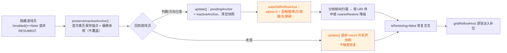

## 按 AGENTS.md 的审核结果

审查范围：PR head [`5af6fc81`](https://github.com/Weiss-UltimateSavior/Tyranor-Next/commit/5af6fc810da27f0440982b5d6f2c8d0a76d434c9)（PR 记录的基线 `main` @ `03634f45`；当前 `main` 已前进到 `3de494b5`，PR 落后 6 个提交），38 个文件、+4458/−70。相对上一轮审核 head `6804195b` 的增量为 28 个文件、+710/−26。按要求由 6 个相互独立的子审查（代码逻辑、架构、健壮性、回归风险、代码规范、上一轮返修核对）分别核对，结论已合并去重并逐条回源码复核。

已执行验证：

- `gh pr view 195 --json mergeable,mergeStateStatus,reviewDecision,baseRefOid,headRefOid` → `MERGEABLE` / `CLEAN` / `CHANGES_REQUESTED`（后者是本账号上一轮 review 的结果），base `03634f45`、head `5af6fc81`
- `gh run list --branch feat/card-layout-adjustments` → head `5af6fc81` 的 `Android CI` success（17m35s）、`WebDAV macOS regression` success（8m39s）
- `git merge-tree --write-tree main 5af6fc81` → exit 0，无冲突，合并树 `c84f303b`
- 合并树编译验证：`git commit-tree c84f303b -p main` 后 `./gradlew :app:compileDebugKotlin --no-daemon` → BUILD SUCCESSFUL（说明与 main@`3de494b5` 合入后仍可编译）
- `./gradlew :app:compileDebugKotlin --no-daemon`（head 本身）→ BUILD SUCCESSFUL
- `./gradlew :app:testDebugUnitTest --tests '*GameCardStyleSettingsTest' --tests '*GridReflowSnapshotTest' --tests '*CoverDecodeTierTest' --tests '*GameCardBadgeSettingsTest' --tests '*GameCardCornerSettingsTest'` → BUILD SUCCESSFUL，**41 项全部通过**（14 + 15 + 9 + 2 + 1，0 失败 0 跳过）
- 隔离包 `TYRANOR_APPLICATION_ID=com.tyranor.next.pr195fix ./gradlew :app:assembleDebug :app:assembleDebugAndroidTest` → BUILD SUCCESSFUL
- `MAA-AN10`（Android 17 / API 37，1224×2700）实机 `am instrument -e motion_device_acceptance true -e motion_target_package com.tyranor.next.pr195fix`：`GridReflowDeviceTest` OK(12)、`MotionSliderDeviceTest` OK(14)、`WaterfallRotationScrollDeviceTest` OK(20)、`WaterfallRestoreResponsivenessDeviceTest` OK(4)、`GameScreenMainActivityAcceptanceDeviceTest` OK(1，`default-light`/`default-dark`/`milk-glass` 各跑一次) → 合计 **51 项通过**
- 新验收用例清理卫生：连跑 4 次不同主题后 `run-as` 检查 `files/pr195-game-screen-fixtures` 为空、`pr195-game-screen-evidence` 累积 4 个目录
- `python3 tools/check-hardcoded-ui-strings.py` → `Hardcoded UI string check passed.`
- `python3 tools/check-motion-boundaries.py` → `399 Kotlin files, 0 violations`
- `git diff --check 03634f45..HEAD` → 无输出
- 独立复核 `CoverDecodeTier.forDisplay`：脚本穷举 21 个比例 × 宽度 1–1399，未发现「选出档位的解码目标小于显示盒」的必要性缺口（仅 >819×1365 的巨大盒回落到最大档）；`456/0.67 → FLOW(666×1024)`、`493/0.60 → FLOW`、`0 → GRID` 与作者描述一致
- 独立复核 `forDisplay` 的高度量化口径：穷举 21 比例 × 宽度 1–1399，268 个分桶边缘宽度会多升一档（最大 32px / 3.2%）
- 独立复核证据截图：`docs/pr195-evidence/` 8 张 PNG 均为真实系统截图（3040×1904 横 / 1904×3040 竖），抽看 `default-light-portrait`（竖屏 4 列瀑布）与 `retro-glass-landscape`（横屏 7 列）与文档描述相符
- 未执行：`:app:lintDebug`（CI 已跑、报告为作者自述 421 Warning / 0 Error）、全量 `testDebugUnitTest`、真机 TB323FU 复跑、修复前对照截图、手机矩阵与深浅色人工视觉审看、发布包流畅度与大库内存实测

### 结论摘要

本轮修复完成了上一轮 16 条中的 3 条（封面档位、竖屏平板标注、统计口径），并把「隐藏游戏页旋转后返回丢失触底」这一核心场景用真实 `MainActivity` 设备用例 + 平板四主题截图闭环了，CI 与我的实机复核（51 项设备 + 41 项 JVM）全通过；但仍有 4 条上一轮「中」级问题未动（公共滑条取消语义、同一列表双 owner、`Entrance` 反向依赖、`restore()` 无 `finally`），且新增 8.2MB 截图未按 `docs/README.md` 索引规则登记。整体方向成立、可合并性已从「冲突」改善为「干净」，但建议先处理这 4 条结构性项与证据入库方式。迟到子审查另指出两条「中」级问题（隐藏期快照缺布局代际校验、2 列瀑布封面档位重复驻留），我已用脚本独立复核成立并并入第 5、6 条；故本轮「中」级共 8 条，无「高」级阻断项。

### 问题清单

| No. | 级别 | 问题 | 建议 | 位置 |
|---|---|---|---|---|
| 1 | 中 | 公共离散滑条增强档新增「拖动中途事件被消费即取消」，既有 6 处调用点未传取消回调，取消时不落盘 | 只在 `onValueChangeCancelled != null` 时启用新判定，或为既有调用点逐一验收 | [MotionSlider.kt:281-296](https://github.com/Weiss-UltimateSavior/Tyranor-Next/blob/5af6fc810da27f0440982b5d6f2c8d0a76d434c9/app/src/main/java/com/tyranor/next/ui/common/MotionSlider.kt#L281-L296) |
| 2 | 中 | `restore()` 仍无 `finally`：`isRestoring=false` 只在正常路径；协程取消穿出或数据始终不就绪时页面保持 alpha=0 且输入被吞 | `try/finally` 按 `gridState === state` 复位，`snapshotFlow.first{}` 加超时 | [WaterfallReflowState.kt:112-155](https://github.com/Weiss-UltimateSavior/Tyranor-Next/blob/5af6fc810da27f0440982b5d6f2c8d0a76d434c9/app/src/main/java/com/tyranor/next/ui/common/motion/WaterfallReflowState.kt#L112-L155) |
| 3 | 中 | 同一瀑布列表仍被 `waterfallReflowHost` 与 `gridReflowHost` 双 owner 写 `alpha` | 只保留一个 owner：`gridReflowHost` 只管重排入场 | [GameScreen.kt:2277-2278](https://github.com/Weiss-UltimateSavior/Tyranor-Next/blob/5af6fc810da27f0440982b5d6f2c8d0a76d434c9/app/src/main/java/com/tyranor/next/ui/game/GameScreen.kt#L2277-L2278) |
| 4 | 中 | 通用入场原语仍反向依赖具体网格状态（`staggeredEntrance(reflow: GridReflowState?)`、`checkReflow`） | 抽接口或回调注入 | [Entrance.kt:265-277](https://github.com/Weiss-UltimateSavior/Tyranor-Next/blob/5af6fc810da27f0440982b5d6f2c8d0a76d434c9/app/src/main/java/com/tyranor/next/ui/common/motion/Entrance.kt#L265-L277) |
| 5 | 中 | 隐藏期快照无布局代际校验，且 `pendingAnchor` 非空时新快照被无条件丢弃 | 快照随 `columns/landscape` 存、消费时校验；明确离页快照与旧 `pendingAnchor` 的优先级 | [WaterfallReflowState.kt:88-106](https://github.com/Weiss-UltimateSavior/Tyranor-Next/blob/5af6fc810da27f0440982b5d6f2c8d0a76d434c9/app/src/main/java/com/tyranor/next/ui/common/motion/WaterfallReflowState.kt#L88-L106) |
| 6 | 中 | 2 列竖屏瀑布封面升到 FLOW（≈2.6MB），与网格卡 CARD（≈1.2MB）重复驻留两档 | 按面积/字节预算切档，或让 `forDisplay` 接收长边 | [GameScreen.kt:2337](https://github.com/Weiss-UltimateSavior/Tyranor-Next/blob/5af6fc810da27f0440982b5d6f2c8d0a76d434c9/app/src/main/java/com/tyranor/next/ui/game/GameScreen.kt#L2337) |
| 7 | 中 | UI 验收仍不完整：只有修复后平板截图，无手机矩阵、无修复前对照、无人工视觉审看 | 补手机与修复前对照，或在 PR 明确声明验收范围 | [docs/pr195-evidence/README.md:16](https://github.com/Weiss-UltimateSavior/Tyranor-Next/blob/5af6fc810da27f0440982b5d6f2c8d0a76d434c9/docs/pr195-evidence/README.md#L16) |
| 8 | 中 | 8 张 PNG（合计 8.2MB）进仓库，且 `docs/README.md` 明写子目录须单独列出却无 `pr195-evidence/` 条目 | 补索引并说明入库理由，或改 WebP/外链 | [docs/README.md:5](https://github.com/Weiss-UltimateSavior/Tyranor-Next/blob/5af6fc810da27f0440982b5d6f2c8d0a76d434c9/docs/README.md#L5) |
| 9 | 低 | `forDisplay` 为消除约 2.7% 放大把 456px/0.67 从 CARD 提到 FLOW，解码像素约 2.25 倍 | 允许 5% 容差，仅超出时升档 | [CoverDecodeGeometry.kt:56-63](https://github.com/Weiss-UltimateSavior/Tyranor-Next/blob/5af6fc810da27f0440982b5d6f2c8d0a76d434c9/app/src/main/java/com/tyranor/next/ui/game/CoverDecodeGeometry.kt#L56-L63) |
| 10 | 低 | `forDisplay` 需求高度用原始 `aspect`、目标盒用量化比例，分桶边缘多升一档（实测 268 个边界，最大 32px / 3.2%） | `heightPx` 同样量化 | [CoverDecodeGeometry.kt:56-63](https://github.com/Weiss-UltimateSavior/Tyranor-Next/blob/5af6fc810da27f0440982b5d6f2c8d0a76d434c9/app/src/main/java/com/tyranor/next/ui/game/CoverDecodeGeometry.kt#L56-L63) |
| 11 | 低 | PR 基线仍是 `03634f45`，main 已到 `3de494b5`（#208 同改抽屉头部） | rebase 并补一张抽屉截图 | [GameScreen.kt:1191](https://github.com/Weiss-UltimateSavior/Tyranor-Next/blob/5af6fc810da27f0440982b5d6f2c8d0a76d434c9/app/src/main/java/com/tyranor/next/ui/game/GameScreen.kt#L1191) |
| 12 | 低 | `rememberSaveable` 的 saver `restore` 仍零校验 | 长度/类型校验 + 回退 `create(...)` | [WaterfallReflowState.kt:268-285](https://github.com/Weiss-UltimateSavior/Tyranor-Next/blob/5af6fc810da27f0440982b5d6f2c8d0a76d434c9/app/src/main/java/com/tyranor/next/ui/common/motion/WaterfallReflowState.kt#L268-L285) |
| 13 | 低 | 死字段 `layoutGeneration` / `Slot.order` 仅测试读取 | 删除或 KDoc 注明 | [GridReflowMotion.kt:112](https://github.com/Weiss-UltimateSavior/Tyranor-Next/blob/5af6fc810da27f0440982b5d6f2c8d0a76d434c9/app/src/main/java/com/tyranor/next/ui/common/motion/GridReflowMotion.kt#L112) |
| 14 | 低 | `isVisible` 硬编码 Tab 下标 `== 1` | 具名常量或派生 | [MainScreen.kt:611-612](https://github.com/Weiss-UltimateSavior/Tyranor-Next/blob/5af6fc810da27f0440982b5d6f2c8d0a76d434c9/app/src/main/java/com/tyranor/next/ui/main/MainScreen.kt#L611-L612) |
| 15 | 低 | core 仍有 4 条列数 `StateFlow` + 8 读写函数，`initGameCardStyle` 兼管 5 字段 | 合并单载荷或改名 | [AppSettingsStore.kt:406-411](https://github.com/Weiss-UltimateSavior/Tyranor-Next/blob/5af6fc810da27f0440982b5d6f2c8d0a76d434c9/app/src/main/java/com/tyranor/next/core/settings/AppSettingsStore.kt#L406-L411) |
| 16 | 低 | `forDisplay` 与 `forWidth` 两套选档并存；`coverWidthPx: Int = 0` 哨兵静默落到 GRID | 统一到 `forDisplay`；去默认值或补 KDoc | [CoverDecodeGeometry.kt:48-63](https://github.com/Weiss-UltimateSavior/Tyranor-Next/blob/5af6fc810da27f0440982b5d6f2c8d0a76d434c9/app/src/main/java/com/tyranor/next/ui/game/CoverDecodeGeometry.kt#L48-L63) |
| 17 | 低 | `docs/pr195-revision.md` 头部仍写旧 head 与 Windows 路径；CHANGELOG 仍含内部预算 | 更新头部、预算下沉 SPEC | [docs/pr195-revision.md:3](https://github.com/Weiss-UltimateSavior/Tyranor-Next/blob/5af6fc810da27f0440982b5d6f2c8d0a76d434c9/docs/pr195-revision.md#L3) |
| 18 | 低 | `MainScreen.kt:656` 缩进 19 空格（同级 18） | 对齐 | [MainScreen.kt:656](https://github.com/Weiss-UltimateSavior/Tyranor-Next/blob/5af6fc810da27f0440982b5d6f2c8d0a76d434c9/app/src/main/java/com/tyranor/next/ui/main/MainScreen.kt#L656) |
| 19 | 低 | 验收用例 `timeout=180_000` 可能跳过 `finally`；证据目录只增不删（连跑 4 次累积 4 个） | 清理下沉 `@After`，内部 watchdog；按 runId 清理 | [GameScreenMainActivityAcceptanceDeviceTest.kt:78](https://github.com/Weiss-UltimateSavior/Tyranor-Next/blob/5af6fc810da27f0440982b5d6f2c8d0a76d434c9/app/src/androidTest/java/com/tyranor/next/ui/game/GameScreenMainActivityAcceptanceDeviceTest.kt#L78) |
| 20 | 低 | 提交历史 9 条全 `fix:`，含 3 个「同步/整合主分支」merge | 合并时 squash | `git log --oneline --graph 03634f45..HEAD` |
| 21 | 低 | `preserveInactiveAnchor` 在「未换布局」时被 `update()` 提前 return 丢弃，文档未说明隐藏期窗口重测的影响 | 文档补一句，或按窗口宽度校验后保留 | [WaterfallReflowState.kt:94-98](https://github.com/Weiss-UltimateSavior/Tyranor-Next/blob/5af6fc810da27f0440982b5d6f2c8d0a76d434c9/app/src/main/java/com/tyranor/next/ui/common/motion/WaterfallReflowState.kt#L94-L98) |

### 重点问题说明

**1.【中】公共离散滑条的取消语义仍在影响既有调用点**

现象与证据：增强档拖动循环把「指针消失」与「移动事件已被消费」都判为取消（[MotionSlider.kt:281-296](https://github.com/Weiss-UltimateSavior/Tyranor-Next/blob/5af6fc810da27f0440982b5d6f2c8d0a76d434c9/app/src/main/java/com/tyranor/next/ui/common/MotionSlider.kt#L281-L296)），收尾改为 `if (cancelled) onCancelled?.invoke() else onFinished?.invoke()`（[:351](https://github.com/Weiss-UltimateSavior/Tyranor-Next/blob/5af6fc810da27f0440982b5d6f2c8d0a76d434c9/app/src/main/java/com/tyranor/next/ui/common/MotionSlider.kt#L351)）。`grep -rn "onValueChangeCancelled" app/src/main/java` 只有新增的 `GameFilterSheet.kt:328` 传参；基线对应的 6 个离散调用点（`SettingsScreen.kt:358`、`SettingsScreen.kt:1973`、`SettingsScreen.kt:1984`、`AppSettingsActivity.kt:297`、`AppSettingsActivity.kt:807`、`ArchiveUnpackActivity.kt:477`）都不传，于是它们同样走新判定。基线里「拖动后指针消失」算提交（`cancelled = !moved`），现在算取消且静默。

影响：设置页扫描深度/选项、应用圆角、单游戏圆角、解包等级在指针事件丢失或被父容器消费抬手时不再落盘这一次提交。普通档不受影响（`release == null` 时 `onValueChangeFinished` 原样透传）。本轮新增的设备用例只覆盖新调用点。

建议：方案 A（推荐）：仅在 `onValueChangeCancelled != null` 时启用新判定，其余调用点保持基线语义；方案 B：为这 6 处补「抽屉/滚动容器内横拖」设备用例并把行为变更写进 CHANGELOG。

**2.【中】`restore()` 缺 `finally`，异常/取消会让整页长期不可用**

现象与证据：`isRestoring = false` 与 `pendingAnchor = null` 只在 `while(true)` 正常 `break` 之后执行（[WaterfallReflowState.kt:152-155](https://github.com/Weiss-UltimateSavior/Tyranor-Next/blob/5af6fc810da27f0440982b5d6f2c8d0a76d434c9/app/src/main/java/com/tyranor/next/ui/common/motion/WaterfallReflowState.kt#L152-L155)）；`catch` 只接 `CancellationException` 并 `ensureActive()` 重抛（[:142-143](https://github.com/Weiss-UltimateSavior/Tyranor-Next/blob/5af6fc810da27f0440982b5d6f2c8d0a76d434c9/app/src/main/java/com/tyranor/next/ui/common/motion/WaterfallReflowState.kt#L142-L143)），`snapshotFlow{…}.first{}`（[:120-123](https://github.com/Weiss-UltimateSavior/Tyranor-Next/blob/5af6fc810da27f0440982b5d6f2c8d0a76d434c9/app/src/main/java/com/tyranor/next/ui/common/motion/WaterfallReflowState.kt#L120-L123)）也没有超时。

影响：`LaunchedEffect` 因切页/切后台被取消时，`isRestoring` 会短暂保持为真，靠回到前台重新启动 effect 自愈；真正不可自愈的是「数据永远不满足 `totalItemsCount > 0 || contentReady`」——页面 `alpha=0`、触摸/焦点/键盘/无障碍全被拦（`waterfallReflowHost`），且无降级出口。

建议：`try/finally` 包住等待与扫描，在 `finally` 里按 `gridState === state` 复位；给 `first{}` 加超时并在超时后按 `coarseRestore` 或直接放行。

**3.【中】同一瀑布列表的「隐藏-恢复」仍有两个 owner；`Entrance` 仍反向依赖网格状态**

现象与证据：`GameScreen.kt:2277-2278` 仍同时挂 `.waterfallReflowHost(waterfallReflow)`（[WaterfallReflowState.kt:334-360](https://github.com/Weiss-UltimateSavior/Tyranor-Next/blob/5af6fc810da27f0440982b5d6f2c8d0a76d434c9/app/src/main/java/com/tyranor/next/ui/common/motion/WaterfallReflowState.kt#L334-L360)，按 `isRestoring` 写 alpha）与 `.gridReflowHost(reflow)`（[GridReflowMotion.kt:243-246](https://github.com/Weiss-UltimateSavior/Tyranor-Next/blob/5af6fc810da27f0440982b5d6f2c8d0a76d434c9/app/src/main/java/com/tyranor/next/ui/common/motion/GridReflowMotion.kt#L243-L246)，按 `isReady` 写 alpha）。`staggeredEntrance` 的公共签名仍然带 `reflow: GridReflowState?`（[Entrance.kt:265-277](https://github.com/Weiss-UltimateSavior/Tyranor-Next/blob/5af6fc810da27f0440982b5d6f2c8d0a76d434c9/app/src/main/java/com/tyranor/next/ui/common/motion/Entrance.kt#L265-L277)），节点内直接调 `flow.entranceDelayMillis` / `flow.placementDelta`。

影响：可见性由两层 `graphicsLayer` 链式相乘、顺序敏感，任一状态机改动都可能让列表提前显形或双重延迟；公共入场原语与具体网格状态互相知道，后续任何重排效果都要再改 `Entrance`。与 AGENTS「同一种效果只有一处实现」「不在页面另写补位/恢复流程」的要求相悖。

建议：`gridReflowHost` 剥离 alpha 职责（只做重排入场），可见性交给瀑布状态暴露的合成值；`Entrance` 侧抽 `ReflowEntranceSource` 接口或改回调注入。

**5.【中】隐藏期快照没有布局代际校验，`pendingAnchor` 非空时新快照被无条件丢弃**

现象与证据：`preserveInactiveAnchor()` 的守卫是「已有快照或 `pendingAnchor` 非空就 return」（[WaterfallReflowState.kt:88-92](https://github.com/Weiss-UltimateSavior/Tyranor-Next/blob/5af6fc810da27f0440982b5d6f2c8d0a76d434c9/app/src/main/java/com/tyranor/next/ui/common/motion/WaterfallReflowState.kt#L88-L92)），而消费侧 `update()` 只在 `pendingAnchor == null` 时才吃快照，随后无条件清空（[:99-106](https://github.com/Weiss-UltimateSavior/Tyranor-Next/blob/5af6fc810da27f0440982b5d6f2c8d0a76d434c9/app/src/main/java/com/tyranor/next/ui/common/motion/WaterfallReflowState.kt#L99-L106)）。快照里只存 `Anchor` 与 offsets，没有 `columns/landscape` 布局代，`capture()` 读的又是当前 `gridState.layoutInfo`，无法判断这份位置是否已被新窗口重测覆盖。

影响：Activity 重建带上来的 `pendingAnchor` 与本次隐藏期快照并存时，后者被丢弃、仍按旧锚点恢复，本轮想修的「离页触底」在该组合下依然会丢；这也是 `docs/pr195-revision.md` 只写「未换布局则丢弃快照」而未覆盖的情形。

建议：快照随 `columns/landscape` 一起存，消费时校验布局代；明确「离页快照优先于旧 `pendingAnchor`」，或至少在 `pendingAnchor` 存在时说明为何不采信。

**6.【中】2 列瀑布的封面档位抬升带来重复驻留**

现象与证据：`forDisplay(523, 0.67f)` 返回 FLOW，目标是 666×1024（ARGB_8888 约 2.6MB）；同一 URI 在网格卡走 `forWidth(523)` 得到 FLOW、在 3 列手机宽度 256px 时为 GRID、在 495px 时为 FLOW。缓存 key 含档位，不会错图，但同一封面在瀑布与网格两套列数下会各存一份不同档位。

影响：2 列瀑布 + 网格混用时解码量与 LRU 占用约翻倍，可能加剧 2–3 列大库滚动时的抖动（字节预算仍是固定 32MiB，见 [CoverDecodeGeometry.kt:10](https://github.com/Weiss-UltimateSavior/Tyranor-Next/blob/5af6fc810da27f0440982b5d6f2c8d0a76d434c9/app/src/main/java/com/tyranor/next/ui/game/CoverDecodeGeometry.kt#L10)）。这是「列数可调」新可达的路径。

建议：切档改为按面积或字节预算而不是「整盒覆盖」；或让 `forDisplay` 接收长边而非完整盒子，避免高瘦盒无谓升档。

**7.【中】UI 与证据口径：验收仍只覆盖「平板 + 修复后」**

现象与证据：本轮补了 8 张系统截图与分主题观察上界（[docs/pr195-evidence/README.md](https://github.com/Weiss-UltimateSavior/Tyranor-Next/blob/5af6fc810da27f0440982b5d6f2c8d0a76d434c9/docs/pr195-evidence/README.md)），我独立核对：PNG 为真实 3040×1904 / 1904×3040，抽看的竖屏 4 列瀑布与横屏复古玻璃 7 列确实符合描述，文档也诚实写明「未支持人工图像审看」「观察上界不代表首个可交互时刻」。但该 README 自己列明「手机矩阵、修复前对照、Activity 重建和逐帧零闪现仍未验收」，而 [AGENTS.md:32](https://github.com/Weiss-UltimateSavior/Tyranor-Next/blob/main/AGENTS.md#L32) 要求 UI 改动附「前后截图及相关手机/平板、深浅色场景」。

影响：列数 2/4/6/10 在手机窄屏、以及「修复前」的观感差异仍无可核对材料；合并后无法据此判断是否回归。

建议：至少补手机竖屏 4 列 + 修复前对照各一组；若确实无法补齐，在 PR 与 `pr195-revision.md` 中把「本 PR 的 UI 验收范围 = 平板修复后」作为显式结论声明，并给出后续跟踪方式。

**8.【中】8.2MB 截图入库与 docs 索引规则不自洽**

现象与证据：`docs/pr195-evidence/` 下 8 张 PNG 合计 8.2MB（单张最大 2.25MB）进入版本库；`docs/README.md:5` 明写「本索引按类别列出 `docs/*.md`……子目录在末尾单独列出」，但全文没有 `pr195-evidence/` 条目（`grep -c pr195-evidence docs/README.md` = 0）。仓库既有做法是截图留本机不入库（`app/src/androidTest/README.md` 里既有记录均写「截图保存在本机 `/tmp/…`，未纳入仓库」；`docs/reviews/README.md` 也明确禁止把证据放进审核目录）。

影响：仓库体积与 clone 成本永久增加；索引规则与实际内容不一致，后续评审会以为该目录已被登记。

建议：方案 A（推荐）：转 WebP/JPEG 降采样后入库并补 `docs/README.md` 子目录索引；方案 B：移出仓库改挂 PR 评论/Release 资产，仅保留 README 与观察数据表。

**9.【低】`forDisplay` 为消除约 2.7% 放大把 456px/0.67 从 CARD 提到 FLOW。** 解码像素约 2.25 倍，见 [CoverDecodeGeometry.kt:56-63](https://github.com/Weiss-UltimateSavior/Tyranor-Next/blob/5af6fc810da27f0440982b5d6f2c8d0a76d434c9/app/src/main/java/com/tyranor/next/ui/game/CoverDecodeGeometry.kt#L56-L63)；建议允许 5% 容差。

**10.【低】`forDisplay` 高度量化口径不一致。** 需求高度用原始 `aspect`、目标盒用 `quantizedCoverAspect`，我穷举 21 比例 × 宽度 1–1399 实测 268 个分桶边缘宽度会多升一档（最大 32px / 3.2%，如 665px / 0.63）；建议 `heightPx` 同样量化。

**15.【低】core 设置 API 仍膨胀。** 4 条列数 `StateFlow` + 8 读写函数，`initGameCardStyle` 兼管 5 字段（[AppSettingsStore.kt:406-411](https://github.com/Weiss-UltimateSavior/Tyranor-Next/blob/5af6fc810da27f0440982b5d6f2c8d0a76d434c9/app/src/main/java/com/tyranor/next/core/settings/AppSettingsStore.kt#L406-L411)、[:883-940](https://github.com/Weiss-UltimateSavior/Tyranor-Next/blob/5af6fc810da27f0440982b5d6f2c8d0a76d434c9/app/src/main/java/com/tyranor/next/core/settings/AppSettingsStore.kt#L883-L940)）；建议合并单载荷或改名。

**16.【低】两套选档规则并存。** `forDisplay` 与 `forWidth` 同时存在（网格/封面流仍用 `forWidth`），`GameCard.coverWidthPx: Int = 0` 静默落到 GRID 且无 KDoc（[CoverDecodeGeometry.kt:48-63](https://github.com/Weiss-UltimateSavior/Tyranor-Next/blob/5af6fc810da27f0440982b5d6f2c8d0a76d434c9/app/src/main/java/com/tyranor/next/ui/game/CoverDecodeGeometry.kt#L48-L63)、[GameScreen.kt:2323](https://github.com/Weiss-UltimateSavior/Tyranor-Next/blob/5af6fc810da27f0440982b5d6f2c8d0a76d434c9/app/src/main/java/com/tyranor/next/ui/game/GameScreen.kt#L2323)）。

**18.【低】`MainScreen.kt:656` 缩进 19 空格**（同级 18），建议对齐。

**21.【低】`preserveInactiveAnchor` 在「未换布局」时被 `update()` 提前 return 丢弃。** `docs/pr195-revision.md` 只写「未换布局则丢弃快照」，未说明隐藏期窗口重测的影响（[WaterfallReflowState.kt:94-98](https://github.com/Weiss-UltimateSavior/Tyranor-Next/blob/5af6fc810da27f0440982b5d6f2c8d0a76d434c9/app/src/main/java/com/tyranor/next/ui/common/motion/WaterfallReflowState.kt#L94-L98)）。

### 非阻塞建议

- `forDisplay` 为消除约 2.7% 放大把 `456px/0.67` 从 CARD 提到 FLOW，解码像素约 2.25 倍；可考虑留 5% 容差，仅在超出容差时升档。
- `forDisplay` 与 `forWidth` 并存（网格与封面流仍用 `forWidth`），建议统一到 `forDisplay`（网格传 3:4），把 `forWidth` 收敛为薄适配或删除。
- `GameCard.coverWidthPx: Int = 0` 的 0 会静默落到 GRID 档，建议去掉默认值强制显式传入，或补 KDoc 说明「0 = 未知宽度，按最小档解码」。
- `GameCardColumnsControl` 无条件订阅四组列数，可只订阅当前风格对应的两组。
- `tools/check-motion-boundaries.py` 的 `OWNERS` 仍未登记 `GridReflowMotion.kt` / `WaterfallReflowState.kt`（当前 399 文件 0 违规，是因为两文件未直接构造动画原语）；建议登记，避免后续在实现里加 `MotionTokens` 时被当成业务页违规。
- `waterfallReflowHost` 用 `composed` 而非 `Modifier.Node`，与 AGENTS「新增逐元素动效优先 Modifier.Node」偏好不一致，可评估迁移。

### 已核对无问题的部分

- **上一轮 3 条已修**：①`CoverDecodeTier.forDisplay` 按「量化后的真实解码目标」选档，`456px/0.67` 现为 `FLOW(666×1024)`、`493px/0.60` 为 FLOW，我穷举 21 个比例 × 宽度 1–1399 复核未发现「解码目标小于显示盒」的必要性缺口；②竖屏平板 6→4 列已在 `CHANGELOG.md:13`、`SPEC.md:71`、PR 正文写明；③统计口径已自洽（JVM 41 项与源码 `@Test` 14+15+9+2+1 完全一致，设备 50 项为 Parameterized 展开，PR 正文已注明差异）。
- **核心场景已闭环且有证据**：隐藏游戏页旋转再返回的触底恢复，现在有 `preserveInactiveAnchor()`（首次离页保存、隐藏期不覆盖、换布局时优先使用）+ 真实 `MainActivity` 单测（`hiddenGameTabRotatesAndReturnsToInteractiveCards`，断言 `anchorIndex=99`、触底、系统截图封面像素、单次原生触摸打开生产抽屉、清理后全库一致），并在四主题 × 两方向留下截图与观察上界；我在实机上复跑 4 次均通过。
- **合并可行性改善**：`merge-tree` 无冲突、`mergeStateStatus=CLEAN`，且我把合并树（main@`3de494b5` + PR）单独编译通过；本轮增量不含任何 main 侧特性的回退（`cardShape`/`rememberCoverBitmap(coverUri, tier, targetAspect)` 签名与 main 一致，`isScrolling` 全仓 0 命中）。
- **测试零删改、门禁未削弱**：`git diff 03634f45..HEAD -- '*src/test*' '*androidTest*'` 删除行 0，无 `@Ignore`、无放宽的 `assumeTrue`；`tools/`、`.github/` 无改动；硬编码文案、动效边界（399 文件 0 违规）、`git diff --check` 全通过；CI 的 Android CI 与 WebDAV 回归在 head `5af6fc81` 上均 success。
- **分层与依赖方向未破坏**：`core/settings` 仍无 Compose 依赖；重排/恢复原语在 `ui/common/motion`，游戏 URI 身份由页面注入；`app/src/main` 全量 grep 无 `pr195`/`@VisibleForTesting`/测试开关。
- **列数功能与文档一致**：四项独立持久化、2–10 归一、默认竖屏 4/横屏 6、重置筛选保留列数、封面流隐藏滑条，与 `SPEC.md:71`、`AGENTS.md:239/297`、`README.md:5`、三语 strings（`%1$d` 一致）逐条对得上。
- **滑条新语义本身正确**：`onValueChangeCancelled` 的 KDoc 与实现一致（未传时取消不回调），`GameFilterSheet` 的草稿回滚路径覆盖系统取消、手势被吞、抽屉关闭重入；`MotionSliderDeviceTest` 14 项在本机实机全通过。
- **新增设备测试未向生产代码要后门**：`GameScreenMainActivityAcceptanceDeviceTest` 仅通过既有 `MotionDeviceAcceptance` 隔离包门槛运行，`finally` 里恢复 prefs/方向/Locale/动效档并断言全库回到原集合（实跑 `cleanupAfterCount == existingCount`、`ownedRemainingCount=0`）。
