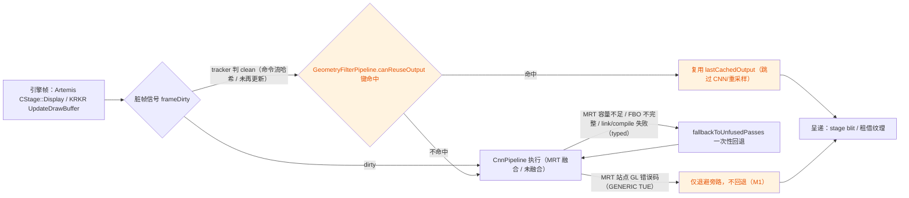

## 按 AGENTS.md 的审核结果

审查范围：PR head [`e30b7908`](https://github.com/Weiss-UltimateSavior/Tyranor-Next/blob/e30b7908edd3d03425e61fe4c5485428f152a2c9)（PR base ref `main` @ `3de494b5`，merge-base `d1584d0d`），61 个文件、+15039/−5070。

按要求由 8 个相互独立的子审查分别核对：① Java 管线逻辑（`CnnPipeline`/`GlErrors`/`GlOps`/基线 `Anime4kPostProcessor` 对等性）② GLSL 解析与着色器变换（`MpvHookShader`/`GraphicsShaderTransforms`/`GraphicsShaderTargets`）③ 架构分层与各引擎宿主接入回归 ④ Artemis 生命周期/线程/Hook 安装/阶段呈递 ⑤ Artemis GL 状态镜像与脏帧哈希语义 ⑥ VN-SR 着色器资产/生成器/buildSrc/离线校验 ⑦ 测试质量与覆盖 ⑧ 文档/多语言/流程。结论已合并去重，并由 lead 逐条回 head 源码复核；编译、JVM 回归、离线校验、ELF 导入面扫描与合并性由 lead 独立执行。

已执行验证：

- `gh pr view 206` → `MERGEABLE` / `CLEAN`（base `3de494b5`、head `e30b7908`；`CHANGES_REQUESTED` 来自 `coderabbitai[bot]` 的旧提交 review）
- `git merge-tree --write-tree main pr-206-ref` → exit 0，合并树 `ca781009`，与当前 `main` 无冲突
- `git diff --check d1584d0d..pr-206-ref` → 无输出（无空白错误）
- `./gradlew :engine:testDebugUnitTest --tests "com.core.gl.*" --no-daemon`（head 检出）→ `BUILD SUCCESSFUL`，22 个测试类 / **162 用例，0 失败 / 0 错误 / 0 跳过**（PR 描述写 157 例，本机实测 162，描述数字未同步）
- `./gradlew :app:compileDebugKotlin --no-daemon`（head 检出）→ `BUILD SUCCESSFUL`（3m53s）
- `./gradlew -p buildSrc graphicsResourcesRegression --no-daemon` → `Graphics resource regressions passed: 26`
- `python3 tools/check-hardcoded-ui-strings.py` → `Hardcoded UI string check passed.`
- `python3 tools/check-motion-boundaries.py` → `396 Kotlin files, 0 violations.`
- `python3 tools/generate-vnsr-filters.py --check` → `Verified three VN-SR host shaders`
- `python3 tools/test-vnsr-coordinates.py` → 三档 `residual error=0.0, final max error=2.22e-16`
- `python3 tools/test-anime4k-coordinates.py` → 6 模型 `corrected max=0.0`、`2xFP16 PSNR=71.10–74.75 dB`、`max8bitLSB=1`
- `python3 tools/test-vnsr-generator.py` → 结构守卫 + 30 项篡改负例全部 PASS
- 独立扫描 `libartemis.so` / `libartemis-v6.so` 的 `.dynsym`：48 个非 Display 强制 hook 全部以 `JUMP_SLOT` 导入（`+kDisplay` = 49）、optional 仅命中 `glClearStencil`/`glDeleteFramebuffers`、deny 集 103 项 0 命中；两内核未导入 `glBlendFunc`/`glBlendEquation`/`glDepthMask`/`glTexParameterf`/`glStencilFuncSeparate` 等残余状态入口，与 SPEC §12「未导入的 blend/depth/cull 等状态入口不可达」一致
- 逐字节核对 `engine/patches/vnsr/sources/*.glsl` 与 `engine/src/main/assets/vnsr/*.glsl`：三对 `cmp`/sha256/git blob 完全一致
- 未执行：真机/模拟器 GL 与 UI 验收（Adreno 840/740 未复采）、全量 `:app:testDebugUnitTest`、`:app:lintDebug` / `:engine:lintDebug`、Release/R8 构建、Mali/非 Adreno 与无 `EXT_color_buffer_half_float` 旁路实测、视频类样本的静态复用专项、C++ 编译链接验证（本机无 arm64 EGL 运行库）

### 结论摘要

改动方向成立，**未发现「高」级阻断项**：管线预算/分配、GL 状态快照恢复、GLSL 解析与融合、VN-SR 资产一致性、1.2.6 移除、分层与依赖方向均经独立核对通过，JVM 回归 162 例、app 编译、buildSrc 回归与全部离线脚本通过。但仍有 **6 条「中」**需要合并前闭环：3 条属管线/静态复用的正确性与证据缺口（MRT 回退分类不全、舞台窗口外状态设置未记账、Kirikiroid 单一脏帧信号缺视频样本与有界兜底），2 条属错误路径（Artemis 上下文丢失后 Java 资源滞留、残留 surface 注册项的新黑屏模式），1 条属验证口径（文档把 11-21 的设备数据写成 head「当前修订」实测，而 head 提交晚于该记录且相关文件已被重写）。总体建议：先处理 3 条错误路径/记账类「中」，再补设备验收记录归属与视频样本验收，即可合并。

> 图中高亮为需要确认的分支：`frameDirty` 判 clean 的正确性依赖原生命令流哈希与宿主信号（M2/M3），MRT 回退只覆盖类型化失败（M1）。

### 问题清单

| No. | 级别 | 问题 | 建议 | 位置 |
|---|---|---|---|---|
| 1 | 中 | 运行时 MRT 融合回退只认 `FailureKind.MRT_*`；MRT 站点若以 GL 错误码（OOM / INVALID_FRAMEBUFFER_OPERATION / INVALID_OPERATION）失败，得到的是 `GENERIC` 异常，不会回退未融合单输出 | 让 MRT 专属站点（`MRT FBO setup`、融合 shader 编译/链接）携带 MRT 分类，或在 attempt 0 对融合计划下的任意 TUE 尝试一次回退（最多一次、代价有界） | [CnnPipeline.java:1796-1805](https://github.com/Weiss-UltimateSavior/Tyranor-Next/blob/e30b7908edd3d03425e61fe4c5485428f152a2c9/engine/src/main/java/com/core/gl/CnnPipeline.java#L1796-L1805)、[GlErrors.java:57-65](https://github.com/Weiss-UltimateSavior/Tyranor-Next/blob/e30b7908edd3d03425e61fe4c5485428f152a2c9/engine/src/main/java/com/core/gl/GlErrors.java#L57-L65)、[CnnPipeline.java:699-702](https://github.com/Weiss-UltimateSavior/Tyranor-Next/blob/e30b7908edd3d03425e61fe4c5485428f152a2c9/engine/src/main/java/com/core/gl/CnnPipeline.java#L699-L702) |
| 2 | 中 | 舞台窗口外的状态设置未记账：`glEnable/glDisable`、`glStencilFunc/Op/Mask`、`glDepthFunc` 在 `!stageFrame` 时既不进哈希也不递增外部计数器（而 viewport/cull/blend func/clear 值都有窗外 delta 记账），两帧间切换这些状态可能误判 clean | 按 `noteBlendFunc` 同口径补窗外值 delta 记账（或把它们并入 draw 快照）；同时把 DEPTH/STENCIL 的「整表面确定性复位」与颜色同等要求，或启用这两个 cap 时 fare-closed | [artemis_official_graphics.cpp:1716-1741](https://github.com/Weiss-UltimateSavior/Tyranor-Next/blob/e30b7908edd3d03425e61fe4c5485428f152a2c9/engine/src/main/cpp/artemis_official_graphics.cpp#L1716-L1741)、[:1831-1849](https://github.com/Weiss-UltimateSavior/Tyranor-Next/blob/e30b7908edd3d03425e61fe4c5485428f152a2c9/engine/src/main/cpp/artemis_official_graphics.cpp#L1831-L1849)、[:726-755](https://github.com/Weiss-UltimateSavior/Tyranor-Next/blob/e30b7908edd3d03425e61fe4c5485428f152a2c9/engine/src/main/cpp/artemis_official_graphics.cpp#L726-L755) |
| 3 | 中 | Kirikiroid 静态复用只依赖 `UpdateDrawBuffer` hook 的单一 `frameDirty`，Java 侧无复用帧数/时长上限：内容更新若不经该入口会**持续冻结**；设备记录里没有视频/开场动画类样本 | 用视频/开场动画在 1.3.4 + 1.3.9 各跑一次并留 `frameDirty` 序列；给 pipeline 加有界复用（同缓存连续命中 N 帧强制重跑），把最坏表现降为偶发一帧刷新 | [krkr_raw_frame_bridge.cpp:82-113](https://github.com/Weiss-UltimateSavior/Tyranor-Next/blob/e30b7908edd3d03425e61fe4c5485428f152a2c9/engine/src/main/cpp/krkr_raw_frame_bridge.cpp#L82-L113)、[:183-191](https://github.com/Weiss-UltimateSavior/Tyranor-Next/blob/e30b7908edd3d03425e61fe4c5485428f152a2c9/engine/src/main/cpp/krkr_raw_frame_bridge.cpp#L183-L191)、[GraphicsFilterPipeline.java:105-107](https://github.com/Weiss-UltimateSavior/Tyranor-Next/blob/e30b7908edd3d03425e61fe4c5485428f152a2c9/engine/src/main/java/com/core/gl/GraphicsFilterPipeline.java#L105-L107) |
| 4 | 中 | Artemis stage 上下文丢失后只降级 native 直出，不通知 Java：`singlePipeline` 的整链目标不释放、`singleMode` 与 `healthy()` 仍为真，直到 next launch/Activity 销毁 | native 在 `handleStageContextLost` 或后续 `eglDestroyContext` 中调用 Java `contextDestroyed()`（`abandonContext` 跨线程安全），同步清 `singleMode`/`singleOutputSize` | [artemis_official_graphics.cpp:1029-1043](https://github.com/Weiss-UltimateSavior/Tyranor-Next/blob/e30b7908edd3d03425e61fe4c5485428f152a2c9/engine/src/main/cpp/artemis_official_graphics.cpp#L1029-L1043)、[:2289-2321](https://github.com/Weiss-UltimateSavior/Tyranor-Next/blob/e30b7908edd3d03425e61fe4c5485428f152a2c9/engine/src/main/cpp/artemis_official_graphics.cpp#L2289-L2321)、[ArtemisOfficialBridge.java:235-271](https://github.com/Weiss-UltimateSavior/Tyranor-Next/blob/e30b7908edd3d03425e61fe4c5485428f152a2c9/engine/src/main/java/com/core/gl/ArtemisOfficialBridge.java#L235-L271) |
| 5 | 中 | 设备验收归因错误：`docs/vnsr-filters.md` 把 2026-11-21 的 Adreno 740 数据写成「当前修订实机复核」，但 head 的 6 个提交全部生成于 2026-11-22 09:15–09:16，且相对 11-21 分支 tip 改写了 `CnnPipeline`/`GlErrors`/`artemis_official_graphics.cpp` 等 17 个文件；同 PR 的 `docs/graphics-filters.md:146` 又写「本轮只通过 CI」 | 给 740 节加提交级时效限定（标明对应修订并注明其后未重跑），或降级为历史样本；同时统一 `graphics-filters.md` 的验证口径 | [docs/vnsr-filters.md:119-134](https://github.com/Weiss-UltimateSavior/Tyranor-Next/blob/e30b7908edd3d03425e61fe4c5485428f152a2c9/docs/vnsr-filters.md#L119-L134)、[docs/graphics-filter-coordinates.md:27-36](https://github.com/Weiss-UltimateSavior/Tyranor-Next/blob/e30b7908edd3d03425e61fe4c5485428f152a2c9/docs/graphics-filter-coordinates.md#L27-L36)、[docs/graphics-filters.md:141-146](https://github.com/Weiss-UltimateSavior/Tyranor-Next/blob/e30b7908edd3d03425e61fe4c5485428f152a2c9/docs/graphics-filters.md#L141-L146) |
| 6 | 中 | `createSurface` 命中「注册表非空」时不做单上下文降级：新 surface 不入注册表、全局 `singleContextMode` 仍为真，绘制继续重定向进旧 surface 的 stage FBO，而新 surface 的 `swap` 直接 `eglSwapBuffers` → 无绘制后台缓冲（黑屏且不可自恢复）；基线同路径是普通直出 | 命中 `!noSurfaces()` 时 fail-closed：同步 `singleContextMode=false`/`directOutput=true`/`stageFrame=false` 并 `invalidateHistory()`；`destroySurface` 失败分支标记 state 不可用 | [artemis_official_graphics.cpp:2341](https://github.com/Weiss-UltimateSavior/Tyranor-Next/blob/e30b7908edd3d03425e61fe4c5485428f152a2c9/engine/src/main/cpp/artemis_official_graphics.cpp#L2341)、[:2505-2506](https://github.com/Weiss-UltimateSavior/Tyranor-Next/blob/e30b7908edd3d03425e61fe4c5485428f152a2c9/engine/src/main/cpp/artemis_official_graphics.cpp#L2505-L2506)、[:2581-2586](https://github.com/Weiss-UltimateSavior/Tyranor-Next/blob/e30b7908edd3d03425e61fe4c5485428f152a2c9/engine/src/main/cpp/artemis_official_graphics.cpp#L2581-L2586) |
| 7 | 低 | MRT 回退闩锁在 `release()` 复位：KRKR 每次 onPause 都会 `release()`，受影响设备每次回前台都重试一次注定失败的融合编译再全量重编 | 融合失败按 renderer/设备缓存，或仅在显式 `setRuntimeMrtFusionEnabled(true)` 时重试 | [CnnPipeline.java:1005-1015](https://github.com/Weiss-UltimateSavior/Tyranor-Next/blob/e30b7908edd3d03425e61fe4c5485428f152a2c9/engine/src/main/java/com/core/gl/CnnPipeline.java#L1005-L1015)、[:704-717](https://github.com/Weiss-UltimateSavior/Tyranor-Next/blob/e30b7908edd3d03425e61fe4c5485428f152a2c9/engine/src/main/java/com/core/gl/CnnPipeline.java#L704-L717) |
| 8 | 低 | 两个静态开关生产代码零调用点，且运行期切换不会让已加载管线重新编译（只有 `release()` 周期后生效） | setter 内 `releasePrograms()+mPlanVersion++`，或文档标注「需重启引擎」 | [CnnPipeline.java:76-105](https://github.com/Weiss-UltimateSavior/Tyranor-Next/blob/e30b7908edd3d03425e61fe4c5485428f152a2c9/engine/src/main/java/com/core/gl/CnnPipeline.java#L76-L105)、[:669](https://github.com/Weiss-UltimateSavior/Tyranor-Next/blob/e30b7908edd3d03425e61fe4c5485428f152a2c9/engine/src/main/java/com/core/gl/CnnPipeline.java#L669) |
| 9 | 低 | `passThroughBlit` 缺 read FBO 完整性检查与错误边界，失败会经 `requireGlSuccess(...false)` → `fail()` 永久锁存整链（当前被计划期裁掉，属防御路径） | 与 `normalizeBorrowedTexture` 对齐：attach → `glCheckFramebufferStatus` → 抛 `TargetUnavailableException` | [CnnPipeline.java:1429-1443](https://github.com/Weiss-UltimateSavior/Tyranor-Next/blob/e30b7908edd3d03425e61fe4c5485428f152a2c9/engine/src/main/java/com/core/gl/CnnPipeline.java#L1429-L1443) |
| 10 | 低 | `recheckChainBudgetAfterFallback` 改小 tile 后未 `discardTargets()`，`targetBytes` 账面低于实际 GL 占用（仅诊断口径，无功能影响） | 改小后 discard 或按 max(旧,新) 记账 | [GraphicsFilterPipeline.java:436-450](https://github.com/Weiss-UltimateSavior/Tyranor-Next/blob/e30b7908edd3d03425e61fe4c5485428f152a2c9/engine/src/main/java/com/core/gl/GraphicsFilterPipeline.java#L436-L450) |
| 11 | 低 | 每次 draw 的脏帧哈希开销未量化：2~3 次同步 `glGet*` + 每 draw 一次 `std::vector` 拷贝/排序 + 客户端数组逐顶点 memcpy，全部在引擎渲染线程 | 改为镜像记账（scissor/colorMask 已有 hook）、缓存 uniform 快照；补 release 包帧时间对照 | [artemis_official_graphics.cpp:795-808](https://github.com/Weiss-UltimateSavior/Tyranor-Next/blob/e30b7908edd3d03425e61fe4c5485428f152a2c9/engine/src/main/cpp/artemis_official_graphics.cpp#L795-L808)、[:2006-2108](https://github.com/Weiss-UltimateSavior/Tyranor-Next/blob/e30b7908edd3d03425e61fe4c5485428f152a2c9/engine/src/main/cpp/artemis_official_graphics.cpp#L2006-L2108) |
| 12 | 低 | program 生命周期未纳入 hook/清理：`glDeleteProgram`/`glLinkProgram`/`glCreateProgram` 既未挂钩也未 deny，同名重建/relink 时 `programUniforms` 等映射不失效（引擎启动期可用，运行期可达性待确认） | `glDeleteProgram` 加入 optional hook 并清三张表 / relink 置 unknown | [artemis_official_graphics.cpp:506-512](https://github.com/Weiss-UltimateSavior/Tyranor-Next/blob/e30b7908edd3d03425e61fe4c5485428f152a2c9/engine/src/main/cpp/artemis_official_graphics.cpp#L506-L512)、[:3072-3140](https://github.com/Weiss-UltimateSavior/Tyranor-Next/blob/e30b7908edd3d03425e61fe4c5485428f152a2c9/engine/src/main/cpp/artemis_official_graphics.cpp#L3072-L3140) |
| 13 | 低 | `glFramebufferRenderbuffer` 是两个受支持内核导入、却既未 hook 也未 deny 的唯一渲染目标绑定入口，与 SPEC §12 / `docs/graphics-filters.md:93` 的覆盖措辞不符（当前方向安全） | 加入 optional hook（颜色附件变更时置 `frameValid=false`），或修正文档措辞 | [artemis_official_graphics.cpp:1324-1340](https://github.com/Weiss-UltimateSavior/Tyranor-Next/blob/e30b7908edd3d03425e61fe4c5485428f152a2c9/engine/src/main/cpp/artemis_official_graphics.cpp#L1324-L1340)、[:2954-2994](https://github.com/Weiss-UltimateSavior/Tyranor-Next/blob/e30b7908edd3d03425e61fe4c5485428f152a2c9/engine/src/main/cpp/artemis_official_graphics.cpp#L2954-L2994) |
| 14 | 低 | `skipUnwrittenStage` 用 `externalMutationCounter` 判定「跳过覆盖呈递」，但该计数器包含任意窗外非 FB0 变更；命中时本帧不向 surface 画任何东西就交换，理论上会呈现未绘制后台缓冲 | 呈递判定只保留 `windowWrittenOutsideStage`；外部计数只参与 clean/dirty | [artemis_official_graphics.cpp:2618-2633](https://github.com/Weiss-UltimateSavior/Tyranor-Next/blob/e30b7908edd3d03425e61fe4c5485428f152a2c9/engine/src/main/cpp/artemis_official_graphics.cpp#L2618-L2633) |
| 15 | 低 | `thread_local stageFrame/stageTarget` 作为重定向与呈递决策输入，与注释「Permit valid EGL thread migration」存在张力：Display 与 swap 若不同线程，swap 侧会走未绘制交换（黑屏） | 舞台状态按 context 归属提升为受 mutex 保护的全局状态，或在 SPEC 明确「Display 与 Swap 必须同线程」 | [artemis_official_graphics.cpp:80](https://github.com/Weiss-UltimateSavior/Tyranor-Next/blob/e30b7908edd3d03425e61fe4c5485428f152a2c9/engine/src/main/cpp/artemis_official_graphics.cpp#L80)、[:106](https://github.com/Weiss-UltimateSavior/Tyranor-Next/blob/e30b7908edd3d03425e61fe4c5485428f152a2c9/engine/src/main/cpp/artemis_official_graphics.cpp#L106)、[:2752-2754](https://github.com/Weiss-UltimateSavior/Tyranor-Next/blob/e30b7908edd3d03425e61fe4c5485428f152a2c9/engine/src/main/cpp/artemis_official_graphics.cpp#L2752-L2754) |
| 16 | 低 | `es3UpgradeFailed` 是一次性进程级闩锁：`eglCreateContext` 临时失败（`EGL_BAD_ALLOC` 等）或一次 GLES2 上下文即永久关闭 ES3 升级/单上下文/滤镜；三处置 true（`1076`/`1153`/`2276`），全文件无 reset | 仅对确定不支持（`EGL_BAD_MATCH`/`BAD_CONFIG`）闩锁，`EGL_BAD_ALLOC` 等下次重试 | [artemis_official_graphics.cpp:1073-1080](https://github.com/Weiss-UltimateSavior/Tyranor-Next/blob/e30b7908edd3d03425e61fe4c5485428f152a2c9/engine/src/main/cpp/artemis_official_graphics.cpp#L1073-L1080)、[:2271-2277](https://github.com/Weiss-UltimateSavior/Tyranor-Next/blob/e30b7908edd3d03425e61fe4c5485428f152a2c9/engine/src/main/cpp/artemis_official_graphics.cpp#L2271-L2277) |
| 17 | 低 | 强制 hook 全有全无校验失败时不打印缺失项，只报 `status(1)`；强制集从基线 9 项扩到 49 项后现场不可诊断 | 按 deny 门同格式 WARN 缺失项并区分失败原因 | [artemis_official_graphics.cpp:3157-3179](https://github.com/Weiss-UltimateSavior/Tyranor-Next/blob/e30b7908edd3d03425e61fe4c5485428f152a2c9/engine/src/main/cpp/artemis_official_graphics.cpp#L3157-L3179) |
| 18 | 低 | PR 描述写「59 项 `kDeniedContentChangeImports`」，代码实际 103 项（强制 49 / optional 16 与描述一致） | 更新 PR 描述或在注释写分族计数 | [artemis_official_graphics.cpp:2954-2994](https://github.com/Weiss-UltimateSavior/Tyranor-Next/blob/e30b7908edd3d03425e61fe4c5485428f152a2c9/engine/src/main/cpp/artemis_official_graphics.cpp#L2954-L2994) |
| 19 | 低 | `ensureStageResources` 在 `stageResourcesMutex` 临界区内完成 shader 编译/链接与全部 GL 对象创建，锁区间偏长（当前单线程，不构成 ANR） | 先按 context 判定、锁外创建，再加锁发布；或注释说明允许覆盖驱动调用 | [artemis_official_graphics.cpp:1052-1216](https://github.com/Weiss-UltimateSavior/Tyranor-Next/blob/e30b7908edd3d03425e61fe4c5485428f152a2c9/engine/src/main/cpp/artemis_official_graphics.cpp#L1052-L1216) |
| 20 | 低 | 非终端单 SAVE 的 `void hook()` 只认 `fragColorN`：mpv 惯例的 `fragColor = ...` 会被拒（同一文件终端 Pass 却接受该写法），随包资产不受影响 | 单 SAVE 时把 `fragColor` 视为 `fragColor0` 的等价写法，或登记为第三方资产限制并补测试 | [MpvHookShader.java:481-485](https://github.com/Weiss-UltimateSavior/Tyranor-Next/blob/e30b7908edd3d03425e61fe4c5485428f152a2c9/engine/src/main/java/com/core/gl/MpvHookShader.java#L481-L485)、[:512-513](https://github.com/Weiss-UltimateSavior/Tyranor-Next/blob/e30b7908edd3d03425e61fe4c5485428f152a2c9/engine/src/main/java/com/core/gl/MpvHookShader.java#L512-L513) |
| 21 | 低 | 不可解析的 `#ifdef/#if` 分支里的 `mat4(` 仍被算作卷积 Pass，非卷积 Pass 会被注入 `precision mediump float;`（精度分类 fail-open） | `mat4` 命中落在 unknown-conditional span 内视为不可判定、回落 highp；补 `#ifdef` 包裹 `mat4` 负例 | [MpvHookShader.java:97-104](https://github.com/Weiss-UltimateSavior/Tyranor-Next/blob/e30b7908edd3d03425e61fe4c5485428f152a2c9/engine/src/main/java/com/core/gl/MpvHookShader.java#L97-L104)、[:346-352](https://github.com/Weiss-UltimateSavior/Tyranor-Next/blob/e30b7908edd3d03425e61fe4c5485428f152a2c9/engine/src/main/java/com/core/gl/MpvHookShader.java#L346-L352) |
| 22 | 低 | 解析入口不做输入规范化（BOM / 制表符分隔指令 / 仅 CR 换行均会整链解析失败），属存量问题 | 读入剥 BOM、`\R` 分行、`\s` 切指令 key；补三态测试 | [MpvHookShader.java:187-193](https://github.com/Weiss-UltimateSavior/Tyranor-Next/blob/e30b7908edd3d03425e61fe4c5485428f152a2c9/engine/src/main/java/com/core/gl/MpvHookShader.java#L187-L193) |
| 23 | 低 | 分析器在静态复用区间无限期显示上次有效 GPU 计时，UI 无「保持值」标识；恢复后的第一段静态区间又只能显示 `—` | 给保持值加极轻的过期/保持标识，或在 SPEC 注明 | [ArtemisGraphicsStats.java:211-330](https://github.com/Weiss-UltimateSavior/Tyranor-Next/blob/e30b7908edd3d03425e61fe4c5485428f152a2c9/engine/src/main/java/com/core/gl/ArtemisGraphicsStats.java#L211-L330) |
| 24 | 低 | `gpu(-1)` = 「本帧无整链计时」与 `nodeGpu(-1)` = 「节点计时失败」同哨兵相反语义，四个宿主每帧依赖这一不对称 | 拆具名入口（`noWholeChainTimerThisFrame()` / `gpuFailed()`） | [ArtemisGraphicsStats.java:49-69](https://github.com/Weiss-UltimateSavior/Tyranor-Next/blob/e30b7908edd3d03425e61fe4c5485428f152a2c9/engine/src/main/java/com/core/gl/ArtemisGraphicsStats.java#L49-L69)、[:107-120](https://github.com/Weiss-UltimateSavior/Tyranor-Next/blob/e30b7908edd3d03425e61fe4c5485428f152a2c9/engine/src/main/java/com/core/gl/ArtemisGraphicsStats.java#L107-L120) |
| 25 | 低 | 名为「宿主脏帧静态复用契约」的用例只测 JNI 方法签名，未测 `frameDirty` 从 `process`/`renderStage` 的转发；MRT 能力门禁只覆盖 `maxDrawBuffers`、`RGBA16F` 探测被 `setField` 短路、非 indexed 状态恢复无断言 | 用可记录 `frameDirty` 的 pipeline 子类断言转发；补 `maxColorAttachments` 维度、半浮点三分支与非 indexed 状态断言 | [CnnPipelineTest.java:1094-1107](https://github.com/Weiss-UltimateSavior/Tyranor-Next/blob/e30b7908edd3d03425e61fe4c5485428f152a2c9/engine/src/test/java/com/core/gl/CnnPipelineTest.java#L1094-L1107)、[:1048-1057](https://github.com/Weiss-UltimateSavior/Tyranor-Next/blob/e30b7908edd3d03425e61fe4c5485428f152a2c9/engine/src/test/java/com/core/gl/CnnPipelineTest.java#L1048-L1057)、[:1514-1516](https://github.com/Weiss-UltimateSavior/Tyranor-Next/blob/e30b7908edd3d03425e61fe4c5485428f152a2c9/engine/src/test/java/com/core/gl/CnnPipelineTest.java#L1514-L1516)、[:2218-2219](https://github.com/Weiss-UltimateSavior/Tyranor-Next/blob/e30b7908edd3d03425e61fe4c5485428f152a2c9/engine/src/test/java/com/core/gl/CnnPipelineTest.java#L2218-L2219) |
| 26 | 低 | 可分离重采样执行路径（`buildScaleProgram`/`drawScale`/`passThroughBlit`）全走直调 `GLES30`，`StrictStubGlOps` 零覆盖，链接失败/同尺寸直通/裁剪归一化成功路径无 JVM 回归（ARCHITECTURE 已声明该边界） | 将该段收敛到 `mGl` 后补用例，或在测试注释登记覆盖边界 | [CnnPipeline.java:1380-1458](https://github.com/Weiss-UltimateSavior/Tyranor-Next/blob/e30b7908edd3d03425e61fe4c5485428f152a2c9/engine/src/main/java/com/core/gl/CnnPipeline.java#L1380-L1458) |
| 27 | 低 | 测试卫生：`reviewFixesRegressionSuite` 265 行混装约 20 个无关断言（以 review 编号命名）；全文 110 处 `setField` 白盒耦合；一条断言消息与条件不符（「shrink below 1024」实际允许 `<=1024`） | 按行为拆分用例、把状态装配收敛到 helper、修正断言条件 | [CnnPipelineTest.java:2643-2908](https://github.com/Weiss-UltimateSavior/Tyranor-Next/blob/e30b7908edd3d03425e61fe4c5485428f152a2c9/engine/src/test/java/com/core/gl/CnnPipelineTest.java#L2643-L2908)、[:2609-2611](https://github.com/Weiss-UltimateSavior/Tyranor-Next/blob/e30b7908edd3d03425e61fe4c5485428f152a2c9/engine/src/test/java/com/core/gl/CnnPipelineTest.java#L2609-L2611) |
| 28 | 低 | 坐标校验脚本不解析真实 PixelShuffle 相位/采样中心（`*2.0`、`center 0.5`），把资产改成 `*4.0`/`0.25` 后脚本仍 exit 0；`//!WIDTH`/`//!BIND` 也不校验 | 解析 `phase`/`center` 表达式并加定点负例，或把文档口径收窄为「仅校验残差/索引公式与坐标翻转」 | [tools/test-vnsr-coordinates.py:228-252](https://github.com/Weiss-UltimateSavior/Tyranor-Next/blob/e30b7908edd3d03425e61fe4c5485428f152a2c9/tools/test-vnsr-coordinates.py#L228-L252) |
| 29 | 低 | Anime4K 的 Python 2xFP16 模型末层 residual 加法按 FP64 而非 binary16 舍入（与 JVM 模型/运行时 mediump 不一致，属更宽松模型）；VN-SR 来源记录缺 `gitBlob`，`--check` 无法复验上游树对象；生成器负例只断言退出码、缺删除/多余资产/幂等性覆盖；buildSrc 生成器侧同义规则无测试 | 末层也做 `fp16(value+main)`；按 CAS 约定补 `gitBlob`/`--verify-upstream`；断言 stderr 关键字并补 case | [tools/test-anime4k-coordinates.py:72-107](https://github.com/Weiss-UltimateSavior/Tyranor-Next/blob/e30b7908edd3d03425e61fe4c5485428f152a2c9/tools/test-anime4k-coordinates.py#L72-L107)、[engine/patches/vnsr-filters.json:13-28](https://github.com/Weiss-UltimateSavior/Tyranor-Next/blob/e30b7908edd3d03425e61fe4c5485428f152a2c9/engine/patches/vnsr-filters.json#L13-L28)、[tools/test-vnsr-generator.py:53-114](https://github.com/Weiss-UltimateSavior/Tyranor-Next/blob/e30b7908edd3d03425e61fe4c5485428f152a2c9/tools/test-vnsr-generator.py#L53-L114) |
| 30 | 低 | 文档残留/不一致：`docs/krkr-local-raw-filters.md` 标题与接入表仍以已移除的 1.2.6 为现行路线（`docs/README.md:52` 索引同）；README 图注改「画质滤镜链」但 `screenshots/index6.png` 仍是「画面超分」；`ARCHITECTURE.md:187` 把包级私有 `forFilter`/`forLanczos` 表述为「跨包创建强制走」且称「不可变工厂」；CONTEXT 的「原始帧滤镜桥接」限定 Kirikiroid2 与 CHANGELOG 用法冲突、「宿主脏帧静态复用」定义强于 SPEC 信任边界 | 为 1.2.6 内容统一加历史标记并改标题/索引；重截图或回退图注；修正 ARCHITECTURE 表述；收敛术语定义 | [docs/krkr-local-raw-filters.md:1-15](https://github.com/Weiss-UltimateSavior/Tyranor-Next/blob/e30b7908edd3d03425e61fe4c5485428f152a2c9/docs/krkr-local-raw-filters.md#L1-L15)、[README.md:32](https://github.com/Weiss-UltimateSavior/Tyranor-Next/blob/e30b7908edd3d03425e61fe4c5485428f152a2c9/README.md#L32)、[ARCHITECTURE.md:187](https://github.com/Weiss-UltimateSavior/Tyranor-Next/blob/e30b7908edd3d03425e61fe4c5485428f152a2c9/ARCHITECTURE.md#L187)、[CONTEXT.md:128-138](https://github.com/Weiss-UltimateSavior/Tyranor-Next/blob/e30b7908edd3d03425e61fe4c5485428f152a2c9/CONTEXT.md#L128-L138) |
| 31 | 低 | 提交聚焦度：`c250101f feat(artemis,krkr)` 混装脏帧复用/上下文丢失处理与 1.2.6 死代码移除，`7640eac4 refactor(gl)` 混装 buildSrc 校验改动 | 后续把「移除/清理」与「新增能力」拆开；本次可不改 | `git log --oneline d1584d0d..HEAD` |

### 重点问题说明

**1.【中】MRT 融合回退只覆盖「类型化」失败，GL 错误码路径永不回退**

`canFallbackFromRuntimeFusion` 要求 `mrtFailure == true`（[CnnPipeline.java:699-702](https://github.com/Weiss-UltimateSavior/Tyranor-Next/blob/e30b7908edd3d03425e61fe4c5485428f152a2c9/engine/src/main/java/com/core/gl/CnnPipeline.java#L699-L702)），而回退闸门只有两处：`ensureTargets` 返回 false 时的 `mLastTargetRejectionIsMrt`（[:805](https://github.com/Weiss-UltimateSavior/Tyranor-Next/blob/e30b7908edd3d03425e61fe4c5485428f152a2c9/engine/src/main/java/com/core/gl/CnnPipeline.java#L805)）与 `catch TargetUnavailableException` 的 `isMrtTargetFailure(unavailable)`（[:829](https://github.com/Weiss-UltimateSavior/Tyranor-Next/blob/e30b7908edd3d03425e61fe4c5485428f152a2c9/engine/src/main/java/com/core/gl/CnnPipeline.java#L829)）。问题在于 MRT 专属站点上还有一条「先查 GL 错误码」的路径：

- `runPasses` 的 MRT FBO 配置在 `glCheckFramebufferStatus` 之前先执行 `GlErrors.requireGlSuccess("MRT FBO setup", true, mGl::glGetError)`（[:1800](https://github.com/Weiss-UltimateSavior/Tyranor-Next/blob/e30b7908edd3d03425e61fe4c5485428f152a2c9/engine/src/main/java/com/core/gl/CnnPipeline.java#L1800)）。若出现 `GL_OUT_OF_MEMORY` 或 `GL_INVALID_FRAMEBUFFER_OPERATION`，`GlErrors` 抛的是 `new TargetUnavailableException(detail)`（[GlErrors.java:64](https://github.com/Weiss-UltimateSavior/Tyranor-Next/blob/e30b7908edd3d03425e61fe4c5485428f152a2c9/engine/src/main/java/com/core/gl/GlErrors.java#L64)），即 `FailureKind.GENERIC`（[TargetUnavailableException.java:31-33](https://github.com/Weiss-UltimateSavior/Tyranor-Next/blob/e30b7908edd3d03425e61fe4c5485428f152a2c9/engine/src/main/java/com/core/gl/TargetUnavailableException.java#L31-L33)）。只有 `status != GL_FRAMEBUFFER_COMPLETE` 分支才带 `MRT_FBO_INCOMPLETE`（[:1802-1805](https://github.com/Weiss-UltimateSavior/Tyranor-Next/blob/e30b7908edd3d03425e61fe4c5485428f152a2c9/engine/src/main/java/com/core/gl/CnnPipeline.java#L1802-L1805)）。
- 融合 shader 编译同理：`compileShader` 先经 `requireGlSuccess(...)` 抛出 GENERIC，`buildPrograms` 只在捕获 `GlOps.ShaderCompileException` 时才改标 `MRT_FRAGMENT_SHADER_COMPILE`（[:1576-1586](https://github.com/Weiss-UltimateSavior/Tyranor-Next/blob/e30b7908edd3d03425e61fe4c5485428f152a2c9/engine/src/main/java/com/core/gl/CnnPipeline.java#L1576-L1586)）；驱动在编译期 OOM 时不会走到该 catch。
- 其它 GL 错误码（如 `glDrawBuffers` 的 `INVALID_OPERATION`）在 `targetFailure=true` 下仍被 `GlErrors` 判为不可重试 → `IllegalStateException` → `fail()` 把**整条链永久锁存**（[:1058-1064](https://github.com/Weiss-UltimateSavior/Tyranor-Next/blob/e30b7908edd3d03425e61fe4c5485428f152a2c9/engine/src/main/java/com/core/gl/CnnPipeline.java#L1058-L1064)），而本可回退未融合路径继续工作。

影响：在「MRT 能力可用但融合 FBO/编译在驱动侧报 GL 错误」的设备上，滤镜会以 2s→30s 退避持续旁路或永久关闭；画面方向安全，但功能失效，与 PR 与 `ARCHITECTURE.md:187`「运行时双附件 MRT FBO 不完整或能力受限可自动回退未融合单输出路径」的表述不一致。

建议：给 `GlErrors.requireGlSuccess` 增加可选 `FailureKind` 参数，在 MRT 专属调用点传 `MRT_FBO_INCOMPLETE`/`MRT_FRAGMENT_SHADER_COMPILE`；或把回退条件放宽为「attempt 0 且融合计划已启用时，对任意 TUE 尝试一次回退」——`mRuntimeFusionFallback` 保证最多一次，代价有界。待确认：真机上 MRT 设置/融合编译是否以 GL 错误码而非 `glCheckFramebufferStatus` 呈现。

**2.【中】舞台窗口外的状态设置未记账，静态复用存在误判 clean 的窗口**

`hashOp` 在 `!stageFrame` 时直接 return（[artemis_official_graphics.cpp:995-996](https://github.com/Weiss-UltimateSavior/Tyranor-Next/blob/e30b7908edd3d03425e61fe4c5485428f152a2c9/engine/src/main/cpp/artemis_official_graphics.cpp#L995-L996)）。作者已为 `glViewport`、`glCullFace`、`glFrontFace`、`glBlendFuncSeparate`、`glBlendEquationSeparate`、clear 值、窗外 uniform 实现了「值 delta → `externalMutationCounter++`」的窗外记账（[:757-874](https://github.com/Weiss-UltimateSavior/Tyranor-Next/blob/e30b7908edd3d03425e61fe4c5485428f152a2c9/engine/src/main/cpp/artemis_official_graphics.cpp#L757-L874)），但以下入口只做 `hashOp`、没有窗外记账：

- `glEnable` / `glDisable`（[:1716-1741](https://github.com/Weiss-UltimateSavior/Tyranor-Next/blob/e30b7908edd3d03425e61fe4c5485428f152a2c9/engine/src/main/cpp/artemis_official_graphics.cpp#L1716-L1741)）——包括 `GL_BLEND`、`GL_DEPTH_TEST`、`GL_STENCIL_TEST`、`GL_CULL_FACE` 的开关；
- `glStencilFunc` / `glStencilOp` / `glStencilMask` / `glDepthFunc`（[:1831-1849](https://github.com/Weiss-UltimateSavior/Tyranor-Next/blob/e30b7908edd3d03425e61fe4c5485428f152a2c9/engine/src/main/cpp/artemis_official_graphics.cpp#L1831-L1849)）。

若引擎在两帧之间于 `CStage::Display` 之外改变这些状态（作者为同类状态实现窗外记账，说明窗外改状态确实存在），而窗内命令流完全相同，`finishFrame` 的哈希与外部计数都不变 → 判 clean → 复用上一帧滤镜输出，画面与真实渲染不一致。此外 `beforeStageColorWrite`/`noteStageColorClear` 只要求 `GL_COLOR_BUFFER_BIT` 的全表面清除（[:726-755](https://github.com/Weiss-UltimateSavior/Tyranor-Next/blob/e30b7908edd3d03425e61fe4c5485428f152a2c9/engine/src/main/cpp/artemis_official_graphics.cpp#L726-L755)），DEPTH/STENCIL 从未要求同等「确定性复位」；若引擎启用深度/模板测试且不全清，也同样缺少「输出是命令流纯函数」的保证。支持的两个内核都导入了 `glStencilFunc/Op/Mask`、`glDepthFunc`、`glClearStencil`，所以不是理论不可达。

影响：误判 clean 会显示过期画面（冻结/残影），属方向不安全的失败模式。当前设备样本未覆盖该组合。

建议：按 `noteBlendFunc` 同口径为上述入口补窗外值 delta 记账（enable 位可复用已有的镜像入口）；DEPTH/STENCIL 启用时要求全表面清除或 fail-closed。待确认：需要真机 GL 调用序列（可在对应 hook 打一次性 `stageFrame`/帧序号日志）证明内核确实在窗外改这些值。

**3.【中】Kirikiroid 静态复用只依赖单一脏帧信号，Java 侧没有有界兜底**

KRKR 的 `frameDirty` 只在两个 `TVPWindowLayer::UpdateDrawBuffer` hook 里置真（[krkr_raw_frame_bridge.cpp:108-113](https://github.com/Weiss-UltimateSavior/Tyranor-Next/blob/e30b7908edd3d03425e61fe4c5485428f152a2c9/engine/src/main/cpp/krkr_raw_frame_bridge.cpp#L108-L113)），本帧首个合格命令消费后立即置假（[:183-191](https://github.com/Weiss-UltimateSavior/Tyranor-Next/blob/e30b7908edd3d03425e61fe4c5485428f152a2c9/engine/src/main/cpp/krkr_raw_frame_bridge.cpp#L183-L191)）；`GraphicsFilterPipeline` 的唯一复用判据是 `!frameDirty && canReuseOutput(...)`，全类没有复用帧数/时长上限（[GraphicsFilterPipeline.java:227-229](https://github.com/Weiss-UltimateSavior/Tyranor-Next/blob/e30b7908edd3d03425e61fe4c5485428f152a2c9/engine/src/main/java/com/core/gl/GraphicsFilterPipeline.java#L227-L229)、[:304-315](https://github.com/Weiss-UltimateSavior/Tyranor-Next/blob/e30b7908edd3d03425e61fe4c5485428f152a2c9/engine/src/main/java/com/core/gl/GraphicsFilterPipeline.java#L304-L315)、[:353-360](https://github.com/Weiss-UltimateSavior/Tyranor-Next/blob/e30b7908edd3d03425e61fe4c5485428f152a2c9/engine/src/main/java/com/core/gl/GraphicsFilterPipeline.java#L353-L360)）。PR 自己把「不经该入口的内容变更不可见」登记为信任边界（SPEC.md §12），但设备验收只覆盖 VN 静帧/动画场景，没有视频/开场动画类样本。

影响：若 1.3.4/1.3.9 上存在不经 `UpdateDrawBuffer` 的内容更新（视频、引擎内 RTT 合成等），滤镜输出会**持续**停在上一帧且不会自愈；基线是每帧重跑，这是本 PR 新增的失败模式。

建议：合并前用视频/开场动画样本在 1.3.4 与 1.3.9 各跑一次并留 `frameDirty` 序列日志；给 pipeline 加有界复用（同一缓存连续命中 N 帧强制重跑一次），把最坏表现从「持续冻结」降为「偶发一帧刷新」。

**4.【中】Artemis stage 上下文丢失后 Java 侧管线资源滞留、状态不一致**

`handleStageContextLost`（[artemis_official_graphics.cpp:1029-1043](https://github.com/Weiss-UltimateSavior/Tyranor-Next/blob/e30b7908edd3d03425e61fe4c5485428f152a2c9/engine/src/main/cpp/artemis_official_graphics.cpp#L1029-L1043)）只做 `stageResources.abandon()`、`invalidateHistory()`、`directOutput=true`、`status(3)`（[artemis_official_graphics.cpp:1029-1043](https://github.com/Weiss-UltimateSavior/Tyranor-Next/blob/e30b7908edd3d03425e61fe4c5485428f152a2c9/engine/src/main/cpp/artemis_official_graphics.cpp#L1029-L1043)），不调用 Java `contextDestroyed()`；后续 `hookEglDestroyContext` 只有在 `stageResources.context == context` 时才通知 Java（[:2289-2321](https://github.com/Weiss-UltimateSavior/Tyranor-Next/blob/e30b7908edd3d03425e61fe4c5485428f152a2c9/engine/src/main/cpp/artemis_official_graphics.cpp#L2289-L2321)），而 `abandon()` 已把 `stageResources.context` 置为 `EGL_NO_CONTEXT` → 该上下文销毁时只会递增 generation，不会通知 Java。Java 侧只在 `contextDestroyed()`/`close()`/`prepare()` 里 dispose pipeline（[ArtemisOfficialBridge.java:235-262](https://github.com/Weiss-UltimateSavior/Tyranor-Next/blob/e30b7908edd3d03425e61fe4c5485428f152a2c9/engine/src/main/java/com/core/gl/ArtemisOfficialBridge.java#L235-L262)、[:280-290](https://github.com/Weiss-UltimateSavior/Tyranor-Next/blob/e30b7908edd3d03425e61fe4c5485428f152a2c9/engine/src/main/java/com/core/gl/ArtemisOfficialBridge.java#L280-L290)），`disconnect()` 只把 `singleMode=false`（[:264-271](https://github.com/Weiss-UltimateSavior/Tyranor-Next/blob/e30b7908edd3d03425e61fe4c5485428f152a2c9/engine/src/main/java/com/core/gl/ArtemisOfficialBridge.java#L264-L271)）不动 `singlePipeline`。结果：这次降级后整链目标（最多 256 MiB 预算）一直保留到 next launch/Activity 销毁，且 `healthy()` 因 `singleMode` 仍为真而继续返回 true（[:108-111](https://github.com/Weiss-UltimateSavior/Tyranor-Next/blob/e30b7908edd3d03425e61fe4c5485428f152a2c9/engine/src/main/java/com/core/gl/ArtemisOfficialBridge.java#L108-L111)）。

影响：错误路径的资源泄漏与状态误报（分析器/Native 健康检查），低内存设备上可能进一步触发分配失败。建议 native 在 `handleStageContextLost` 或后续 `eglDestroyContext` 中调用 Java `contextDestroyed()`（`abandonContext` 不做 GL 删除、跨线程安全），并同步清 `singleMode`/`singleOutputSize`。待确认：需要真机/驱动注入证明该降级路径可达（代码路径可达，未实机复现）。

**5.【中】设备验收记录无法归属到本 PR head**

`docs/vnsr-filters.md` 新增「### Adreno 740 当前修订实机复核（2026-11-21）」（[docs/vnsr-filters.md:129-134](https://github.com/Weiss-UltimateSavior/Tyranor-Next/blob/e30b7908edd3d03425e61fe4c5485428f152a2c9/docs/vnsr-filters.md#L129-L134)），阶段说明也称「四期审改收口后的当前修订真机重跑见下文 Adreno 740 节」（[:121](https://github.com/Weiss-UltimateSavior/Tyranor-Next/blob/e30b7908edd3d03425e61fe4c5485428f152a2c9/docs/vnsr-filters.md#L121)）。但：

- head 的 6 个提交全部生成于 **2026-11-22 09:15–09:16**；740 数据记录于 2026-11-21，来自本地分支 `pr206`（tip `f75fc7ee`，2026-11-21 17:57）。
- `git diff --stat HEAD..pr206` 显示 17 个文件、+281/−343，其中包含 `CnnPipeline.java`（151 行）、`GlErrors.java`（77 行）、`artemis_official_graphics.cpp`（72 行）——正是本次优化与脏帧追踪的核心文件，说明 head 是 11-21 之后的重构（对应 PR 描述的 CodeRabbit 返修）。
- 同一 PR 的 `docs/graphics-filters.md:146` 却写「本轮只通过 CI 执行项目测试与构建」，PR body 自述「本轮未在真机重新安装回归」；三处对「本轮做了什么」口径矛盾。
- `docs/graphics-filter-coordinates.md:36` 已声明 Siglus/krkrsdl3 与静态停帧专项未在当前修订重跑，但同一段仍以「本轮 Adreno 740 实测」口吻覆盖 Artemis/KRKR。

影响：合并后读者会把 11-21 的 FPS/GPU 数据当成 head 的验收证据，违反 AGENTS.md「明确未执行的检查，不把编译、合成夹具或静态哈希验证当作游戏兼容性验收」。建议给 740 节加与 840 相同的提交级时效限定（标明对应修订、注明其后 17 文件重写未重跑），或整体降级为历史样本，并统一 `graphics-filters.md` 的验证口径。

**6.【中】`createSurface` 命中残留注册表时的新黑屏模式**

`createSurface` 在注册表非空时直接返回原生 `eglCreateWindowSurface`，不注册、不设置 `singleContextMode` 等状态（[artemis_official_graphics.cpp:2341](https://github.com/Weiss-UltimateSavior/Tyranor-Next/blob/e30b7908edd3d03425e61fe4c5485428f152a2c9/engine/src/main/cpp/artemis_official_graphics.cpp#L2341)）；而 `destroySurface` 在 `eglDestroySurface` 失败时直接返回 `EGL_FALSE`、保留注册项（[:2505-2506](https://github.com/Weiss-UltimateSavior/Tyranor-Next/blob/e30b7908edd3d03425e61fe4c5485428f152a2c9/engine/src/main/cpp/artemis_official_graphics.cpp#L2505-L2506)）。此后：新 surface 不在注册表 → `displayStage` 取不到 state（[:2748](https://github.com/Weiss-UltimateSavior/Tyranor-Next/blob/e30b7908edd3d03425e61fe4c5485428f152a2c9/engine/src/main/cpp/artemis_official_graphics.cpp#L2748)）但全局 `singleContextMode` 仍为真 → GL hook 继续把绘制重定向进**旧 surface 的 stage FBO**；新 surface 的 `swap` 找不到 state → 直接 `eglSwapBuffers`（[:2581-2582](https://github.com/Weiss-UltimateSavior/Tyranor-Next/blob/e30b7908edd3d03425e61fe4c5485428f152a2c9/engine/src/main/cpp/artemis_official_graphics.cpp#L2581-L2582)）→ 交出从未绘制的后台缓冲，持续黑屏且无自恢复。基线的同一 `!noSurfaces()` 分支没有 stage 重定向，表现为「滤镜不生效但画面正常直出」。

影响：旋转/多窗口/后台回前台都经过 surface 重建；若内核存在 create-before-destroy 或销毁失败，head 从「直出正常」退化为「黑屏」。建议命中 `!noSurfaces()` 时按 fail-closed 降级（`singleContextMode=false`/`directOutput=true`/`stageFrame=false`/`invalidateHistory()`），并让销毁失败分支把 state 标记为不可用。待确认：官方内核的 surface 重建顺序与销毁失败后是否重试销毁。

### 其余问题

**7.【低】MRT 回退闩锁在 `release()` 复位**：KRKR 每次 onPause 都 `release()`，受影响设备每次回前台重试一次注定失败的融合编译并重复日志；建议按设备缓存融合能力（[CnnPipeline.java:1005-1015](https://github.com/Weiss-UltimateSavior/Tyranor-Next/blob/e30b7908edd3d03425e61fe4c5485428f152a2c9/engine/src/main/java/com/core/gl/CnnPipeline.java#L1005-L1015)）。

**8.【低】静态逃生开关不可达**：`setTieredPrecisionEnabled`/`setRuntimeMrtFusionEnabled` 生产代码零调用，且运行期切换不重建程序；建议 setter 内 `releasePrograms + mPlanVersion++` 或文档标注需重启（[CnnPipeline.java:76-105](https://github.com/Weiss-UltimateSavior/Tyranor-Next/blob/e30b7908edd3d03425e61fe4c5485428f152a2c9/engine/src/main/java/com/core/gl/CnnPipeline.java#L76-L105)）。

**9.【低】`passThroughBlit` 缺完整性检查**：与另两条 blit 路径不一致，失败会从「可重试旁路」退化为「永久锁存」（[CnnPipeline.java:1429-1443](https://github.com/Weiss-UltimateSavior/Tyranor-Next/blob/e30b7908edd3d03425e61fe4c5485428f152a2c9/engine/src/main/java/com/core/gl/CnnPipeline.java#L1429-L1443)）。

**10.【低】瓦片回退账面偏低**：`recheckChainBudgetAfterFallback` 改小 `mTileCoreSize` 后未 `discardTargets()`，`targetBytes()` 低估实际占用，仅诊断口径（[GraphicsFilterPipeline.java:436-450](https://github.com/Weiss-UltimateSavior/Tyranor-Next/blob/e30b7908edd3d03425e61fe4c5485428f152a2c9/engine/src/main/java/com/core/gl/GraphicsFilterPipeline.java#L436-L450)）。

**11.【低】脏帧哈希的每 draw 开销未量化**：每 draw 2~3 次同步 `glGet*` + `std::vector` 分配/排序 + 客户端顶点逐字节哈希，属新增常态开销；建议补 release 包帧时间对照并改用镜像记账（[artemis_official_graphics.cpp:795-808](https://github.com/Weiss-UltimateSavior/Tyranor-Next/blob/e30b7908edd3d03425e61fe4c5485428f152a2c9/engine/src/main/cpp/artemis_official_graphics.cpp#L795-L808)、[:2006-2108](https://github.com/Weiss-UltimateSavior/Tyranor-Next/blob/e30b7908edd3d03425e61fe4c5485428f152a2c9/engine/src/main/cpp/artemis_official_graphics.cpp#L2006-L2108)）。

**12.【低】program 生命周期未纳入 hook/清理**：`glDeleteProgram`/`glLinkProgram` 既未挂钩也未 deny，同名重建/relink 时 `programUniforms` 等映射不失效；建议 optional hook 清理（[artemis_official_graphics.cpp:506-512](https://github.com/Weiss-UltimateSavior/Tyranor-Next/blob/e30b7908edd3d03425e61fe4c5485428f152a2c9/engine/src/main/cpp/artemis_official_graphics.cpp#L506-L512)）。

**13.【低】`glFramebufferRenderbuffer` 覆盖口径不符**：两个受支持内核导入、却既未 hook 也未 deny，与 SPEC §12「导入的内容变更入口均已被 hook 且不在 deny 集内」措辞不符；当前方向安全（颜色 attachment 换 renderbuffer 后判 `frameValid=false`）（[artemis_official_graphics.cpp:2954-2994](https://github.com/Weiss-UltimateSavior/Tyranor-Next/blob/e30b7908edd3d03425e61fe4c5485428f152a2c9/engine/src/main/cpp/artemis_official_graphics.cpp#L2954-L2994)）。

**14.【低】`skipUnwrittenStage` 判据过宽**：`externalMutationCounter` 包含任意窗外非 FB0 变更，命中时不画任何东西就交换；建议呈递判定只保留 `windowWrittenOutsideStage`（[artemis_official_graphics.cpp:2618-2633](https://github.com/Weiss-UltimateSavior/Tyranor-Next/blob/e30b7908edd3d03425e61fe4c5485428f152a2c9/engine/src/main/cpp/artemis_official_graphics.cpp#L2618-L2633)）。

**15.【低】`thread_local stageFrame` 的线程迁移假设**：注释宣称支持 EGL 线程迁移，但舞台状态跨 Display/swap 两个决策点；若两线程不同则 swap 侧走未绘制交换。建议提升为按 context 归属的全局状态或明确单线程契约（[artemis_official_graphics.cpp:80](https://github.com/Weiss-UltimateSavior/Tyranor-Next/blob/e30b7908edd3d03425e61fe4c5485428f152a2c9/engine/src/main/cpp/artemis_official_graphics.cpp#L80)、[:106](https://github.com/Weiss-UltimateSavior/Tyranor-Next/blob/e30b7908edd3d03425e61fe4c5485428f152a2c9/engine/src/main/cpp/artemis_official_graphics.cpp#L106)）。

**16.【低】`es3UpgradeFailed` 一次性闩锁**：临时 `eglCreateContext` 失败会永久关闭滤镜，建议区分确定不支持与临时错误（[artemis_official_graphics.cpp:2269-2277](https://github.com/Weiss-UltimateSavior/Tyranor-Next/blob/e30b7908edd3d03425e61fe4c5485428f152a2c9/engine/src/main/cpp/artemis_official_graphics.cpp#L2269-L2277)）。

**17.【低】强制 hook 失败无诊断日志**：49 项全有全无校验失败只报 `status(1)`，建议打印缺失项（[artemis_official_graphics.cpp:3157-3179](https://github.com/Weiss-UltimateSavior/Tyranor-Next/blob/e30b7908edd3d03425e61fe4c5485428f152a2c9/engine/src/main/cpp/artemis_official_graphics.cpp#L3157-L3179)）。

**18.【低】PR 描述 deny 数量与代码不符**：描述写 59 项，代码 103 项（强制 49 / optional 16 与描述一致），建议更新描述（[artemis_official_graphics.cpp:2954-2994](https://github.com/Weiss-UltimateSavior/Tyranor-Next/blob/e30b7908edd3d03425e61fe4c5485428f152a2c9/engine/src/main/cpp/artemis_official_graphics.cpp#L2954-L2994)）。

**19.【低】阶段资源创建在 mutex 内**：`ensureStageResources` 在 `stageResourcesMutex` 内编译/链接并创建全部 GL 对象，锁区间偏长（当前单线程不构成 ANR）（[artemis_official_graphics.cpp:1052-1216](https://github.com/Weiss-UltimateSavior/Tyranor-Next/blob/e30b7908edd3d03425e61fe4c5485428f152a2c9/engine/src/main/cpp/artemis_official_graphics.cpp#L1052-L1216)）。

**20.【低】单 SAVE `void hook()` 的 `fragColor` 写法被拒**：同文件终端 Pass 接受该写法，非终端单 SAVE 却要求 `fragColorN`，新特性接受面不自洽；随包资产不受影响（[MpvHookShader.java:481-485](https://github.com/Weiss-UltimateSavior/Tyranor-Next/blob/e30b7908edd3d03425e61fe4c5485428f152a2c9/engine/src/main/java/com/core/gl/MpvHookShader.java#L481-L485)）。

**21.【低】未知条件分支内 `mat4` 被当作卷积 Pass**：`#ifdef/#if` 包裹的 `mat4` 仍触发 `mediump` 注入，精度分类 fail-open；建议把 unknown span 内命中视为不可判定（[MpvHookShader.java:97-104](https://github.com/Weiss-UltimateSavior/Tyranor-Next/blob/e30b7908edd3d03425e61fe4c5485428f152a2c9/engine/src/main/java/com/core/gl/MpvHookShader.java#L97-L104)）。

**22.【低】解析入口不做输入规范化（存量）**：BOM、制表符分隔指令、仅 CR 换行都会整链解析失败，建议剥 BOM/`\R` 分行/`\s` 切分（[MpvHookShader.java:187-193](https://github.com/Weiss-UltimateSavior/Tyranor-Next/blob/e30b7908edd3d03425e61fe4c5485428f152a2c9/engine/src/main/java/com/core/gl/MpvHookShader.java#L187-L193)）。

**23.【低】分析器保持值无标识**：静态复用区间会无限期显示上次有效 GPU 计时，UI 无「保持值」提示，恢复后首段静态期又只能显示 `—`（[ArtemisGraphicsStats.java:211-330](https://github.com/Weiss-UltimateSavior/Tyranor-Next/blob/e30b7908edd3d03425e61fe4c5485428f152a2c9/engine/src/main/java/com/core/gl/ArtemisGraphicsStats.java#L211-L330)）。

**24.【低】`gpu(-1)`/`nodeGpu(-1)` 同哨兵相反语义**：四宿主每帧依赖该不对称，建议拆具名入口（[ArtemisGraphicsStats.java:107-120](https://github.com/Weiss-UltimateSavior/Tyranor-Next/blob/e30b7908edd3d03425e61fe4c5485428f152a2c9/engine/src/main/java/com/core/gl/ArtemisGraphicsStats.java#L107-L120)）。

**25.【低】测试覆盖缺口**：宿主脏帧 JNI 只测签名未测转发；MRT 门禁只覆盖 `GL_MAX_DRAW_BUFFERS`；`RGBA16F` 探测被 `setField` 短路；非 indexed `GlState` 恢复无断言；可分离重采样路径（`buildScaleProgram`/`drawScale`/`passThroughBlit` 直调 `GLES30`）在 `StrictStubGlOps` 之外（[CnnPipelineTest.java:1094-1107](https://github.com/Weiss-UltimateSavior/Tyranor-Next/blob/e30b7908edd3d03425e61fe4c5485428f152a2c9/engine/src/test/java/com/core/gl/CnnPipelineTest.java#L1094-L1107)、[CnnPipeline.java:1380-1458](https://github.com/Weiss-UltimateSavior/Tyranor-Next/blob/e30b7908edd3d03425e61fe4c5485428f152a2c9/engine/src/main/java/com/core/gl/CnnPipeline.java#L1380-L1458)）。

**26.【低】测试卫生**：`reviewFixesRegressionSuite` 265 行混装约 20 个无关断言；全文 110 处 `setField` 白盒耦合；一条断言消息与条件不符；建议按行为拆分并收敛状态装配（[CnnPipelineTest.java:2643-2908](https://github.com/Weiss-UltimateSavior/Tyranor-Next/blob/e30b7908edd3d03425e61fe4c5485428f152a2c9/engine/src/test/java/com/core/gl/CnnPipelineTest.java#L2643-L2908)）。

**27.【低】坐标校验脚本盲区**：不解析真实 PixelShuffle 相位/采样中心（把 `*2.0` 改成 `*4.0`、`0.5` 改成 `0.25` 后整套仍 exit 0）；`//!WIDTH`/`//!BIND` 不校验；建议补表达式解析与定点负例（[tools/test-vnsr-coordinates.py:228-252](https://github.com/Weiss-UltimateSavior/Tyranor-Next/blob/e30b7908edd3d03425e61fe4c5485428f152a2c9/tools/test-vnsr-coordinates.py#L228-L252)）。

**28.【低】离线模型/来源记录可复验性**：Anime4K Python 2xFP16 模型末层 residual 按 FP64 不加舍入（比 JVM/运行时宽松）；VN-SR 来源记录缺 `gitBlob`，`--check` 无法复验上游树对象；生成器负例只断言退出码、缺删除/多余资产/幂等性覆盖；buildSrc 生成器侧同义规则无正向/负向测试（[tools/test-anime4k-coordinates.py:72-107](https://github.com/Weiss-UltimateSavior/Tyranor-Next/blob/e30b7908edd3d03425e61fe4c5485428f152a2c9/tools/test-anime4k-coordinates.py#L72-L107)、[engine/patches/vnsr-filters.json:13-28](https://github.com/Weiss-UltimateSavior/Tyranor-Next/blob/e30b7908edd3d03425e61fe4c5485428f152a2c9/engine/patches/vnsr-filters.json#L13-L28)）。

**29.【低】文档残留/不一致**：`docs/krkr-local-raw-filters.md` 标题与接入表仍把已移除的 1.2.6 当现行路线（`docs/README.md:52` 索引同）；README 图注已改「画质滤镜链」但 `screenshots/index6.png` 仍是「画面超分」；`ARCHITECTURE.md:187` 把包级私有 `forFilter`/`forLanczos` 描述为「跨包创建强制走」且称「不可变工厂」；CONTEXT 的「原始帧滤镜桥接」限定 Kirikiroid2 与 CHANGELOG 用法冲突、「宿主脏帧静态复用」定义强于 SPEC 信任边界（[docs/krkr-local-raw-filters.md:1-15](https://github.com/Weiss-UltimateSavior/Tyranor-Next/blob/e30b7908edd3d03425e61fe4c5485428f152a2c9/docs/krkr-local-raw-filters.md#L1-L15)、[README.md:32](https://github.com/Weiss-UltimateSavior/Tyranor-Next/blob/e30b7908edd3d03425e61fe4c5485428f152a2c9/README.md#L32)、[ARCHITECTURE.md:187](https://github.com/Weiss-UltimateSavior/Tyranor-Next/blob/e30b7908edd3d03425e61fe4c5485428f152a2c9/ARCHITECTURE.md#L187)、[CONTEXT.md:128-138](https://github.com/Weiss-UltimateSavior/Tyranor-Next/blob/e30b7908edd3d03425e61fe4c5485428f152a2c9/CONTEXT.md#L128-L138)）。

**30.【低】`docs/vnsr-filters.md:102` 自引用行号漂移**：文中写「本节 98–111 行」，实际该段正文是 104–117 行；建议改用小节锚点（[docs/vnsr-filters.md:102](https://github.com/Weiss-UltimateSavior/Tyranor-Next/blob/e30b7908edd3d03425e61fe4c5485428f152a2c9/docs/vnsr-filters.md#L102)）。

**31.【低】提交聚焦度**：`c250101f feat(artemis,krkr)` 混装脏帧复用/上下文丢失处理与 1.2.6 死代码移除，`7640eac4 refactor(gl)` 混装 buildSrc 校验改动；其余提交符合中文描述 + 小写英文类型前缀（`git log --oneline d1584d0d..HEAD`）。

### 非阻塞建议

- 在 `ArtemisGraphicsStats`/日志中暴露 `frameDirty` 命中率与 `frameValid=false` 原因计数：这是验证「静态复用是否生效」以及发现误 clean、恒脏边界的唯一手段（当前设备样本只能看到 FPS，无法区分「复用了」与「一直重跑」）。
- 把 `kDeniedContentChangeImports` 之外的残余状态入口（`glBlendFunc`/`glBlendEquation`/`glDepthMask`/`glTexParameterf*`/`glStencilFuncSeparate`/`glStencilOpSeparate`/`glBlendColor` 等）一并纳入 deny 集：当前两个受支持内核经 ELF 扫描确认未导入，加入不会误拒现行内核，却能让未来新内核自动 fail-closed 到 producer 路径，消除 SPEC §12 已登记的「非方向安全」残余。
- 静态复用建议加有界上限（连续命中 N 帧强制重跑一次），把任何脏帧信号漏报的最坏表现从「持续冻结」降为「偶发一帧刷新」，成本仅 1/N。
- `CnnPipelineTest` 增加一条真正驱动 `KirikiroidRawFrameBridge.process` 与 `ArtemisOfficialBridge.renderStage` 的 `frameDirty` 转发断言（可注入记录型 pipeline 子类），避免 JNI 参数错位只能靠真机发现。
- `docs/vnsr-filters.md` 的 840/740 两节建议统一改为「样本修订 + 采集日期 + 其后是否重跑」三段式，避免再次出现「当前修订」与提交时间不符。

### 已核对无问题的部分

- **分层与依赖方向**：按类名引用建图（`com.core.gl` 31 个类型）Tarjan SCC 无环，Level 0–3 不反向引用 `GraphicsFilterPipeline`/宿主桥；engine 模块无 `com.tyranor.next.*`/Compose 依赖，`com/core/gl` 无中文文案，错误协议未下沉；JNI 描述符逐项对齐（`renderStage "(IIIIIZZJ)I"`、`process "(IIIFFFFIIZZ)I"`、`contextDestroyed "()V"`、`nativeResetContext "()V"`）。
- **预算与分配一致**：`ensureTargets` 实际分配（restore + 可选 output + 横向中间 + `count` 张 scratch RGBA16F + tile 输入/restore）与 `GraphicsShaderGeometry.estimate`/`estimateTargetBytesForPlan` 逐项对应；`mScaleOnly` 同尺寸直通现正确计入自有输出 surface（修复了基线低估）；逐节点预算经 `applyChainNodeBudgets` 可证不小于自身估算。
- **状态机幂等与 GL 状态隔离**：`releaseTargets` 逐 pass 解绑附件再删对象并清理影子句柄、保留非自有宿主 draw FBO；`discardTargets`/`release`/`abandonContext` 重复调用安全（`abandonContext` 零 GL 调用，可从 Activity 线程调用）；`GlState` 覆盖 viewport/scissor/blend/depth/stencil/cull/FBO/program/VAO/buffers/纹理与 sampler，且比基线多恢复 scissor box 与 read buffer；`retriesTargetsAfterDelay()` 都在 `discardTargets()` 之前读取。
- **GLSL 解析与变换**：条件编译/续行/注释处理、`#if 0` 死代码、跨行 `hook()` 签名、重复/条件 SAVE、多目标写入、未解析绑定、输出尺寸+halo 组合均 fail-closed；差分测试（900+ 随机嵌套条件）与解析器参考实现 0 不一致；`mat3x4` 零列剪枝、3 抽头突发预取、9 抽头共享坐标、MRT `return` 括号、`g_<idx>` 精确匹配均正确；抽头去重后 L 271→82 / M 132→71 / S 64→37 与 SPEC 一致；MRT 融合后 tiling halo 用融合后 Pass 数正确（L 5 层对应半径 5）。
- **VN-SR 资产与校验**：三对 `patches/sources` ↔ `assets` 逐字节一致（`cmp`/sha256/git blob），7 Pass、单 Pass 最大目标数 C08=3 / C12=3 / C16=4、采样数 148→103 / 328→148 / 580→193 与文档一致；生成器 `--check` 只读、幂等、cwd 无关；`retained` 模式与 SHA/MIT 校验、30+ 篡改负例有效；Gradle `verifyGraphicsResources` 对两份资产均做 SHA 校验。
- **1.2.6 移除干净**：Java/C++/资源/测试全仓无 `process126`/`carrierBytes126`/`nativePrepareCarrier`/`nativeUploadCarrier`/`bitmap126` 残留；`supportedGameLibrary` 只接受 `libgame.so`/`libgame134.so`；app 侧 `KR_VERSIONS` 基线即已无 1.2.6 并归一 auto；`Anime4kGlErrorBoundaryTest` 用例语义逐条迁移到 `GlErrorsBoundaryTest`。
- **测试与构建**：head 检出 `:engine:testDebugUnitTest --tests "com.core.gl.*"` 162 例全绿（22 类，0 失败/0 跳过）；`StrictStubGlOps` 44 个入口全部 `throw AssertionError` 是真严格桩；融合前后 FP64 逐 save 等价、FP16 仿真 PSNR/1 LSB、`toFp16` 精确半点等关键断言存在；删除测试无覆盖真空；`:app:compileDebugKotlin` 与 `buildSrc graphicsResourcesRegression`（26 项）通过。
- **多语言与离线门禁**：三语 `graphics_settings_title` 一致（画质滤镜链 / Graphics filter chain / 画質フィルターチェーン），无其它语言目录漏改；`check-hardcoded-ui-strings.py`、`check-motion-boundaries.py`、四个 VN-SR/Anime4K 校验脚本全部通过；`git diff --check` 无空白错误。
- **合并性**：`gh pr view` 报 `MERGEABLE`/`CLEAN`，`git merge-tree main pr-206-ref` 无冲突；PR base ref 已前进到 `3de494b5`，merge-base 仍为 `d1584d0d`。
